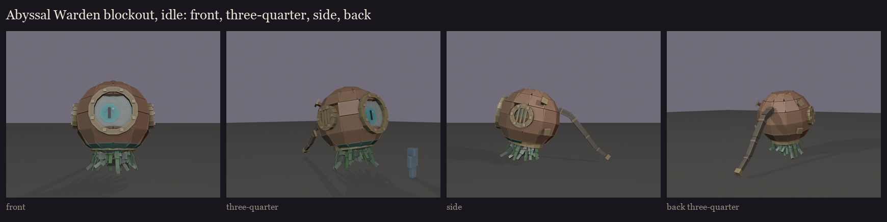
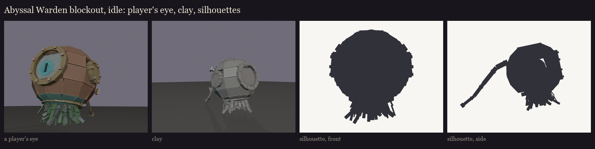
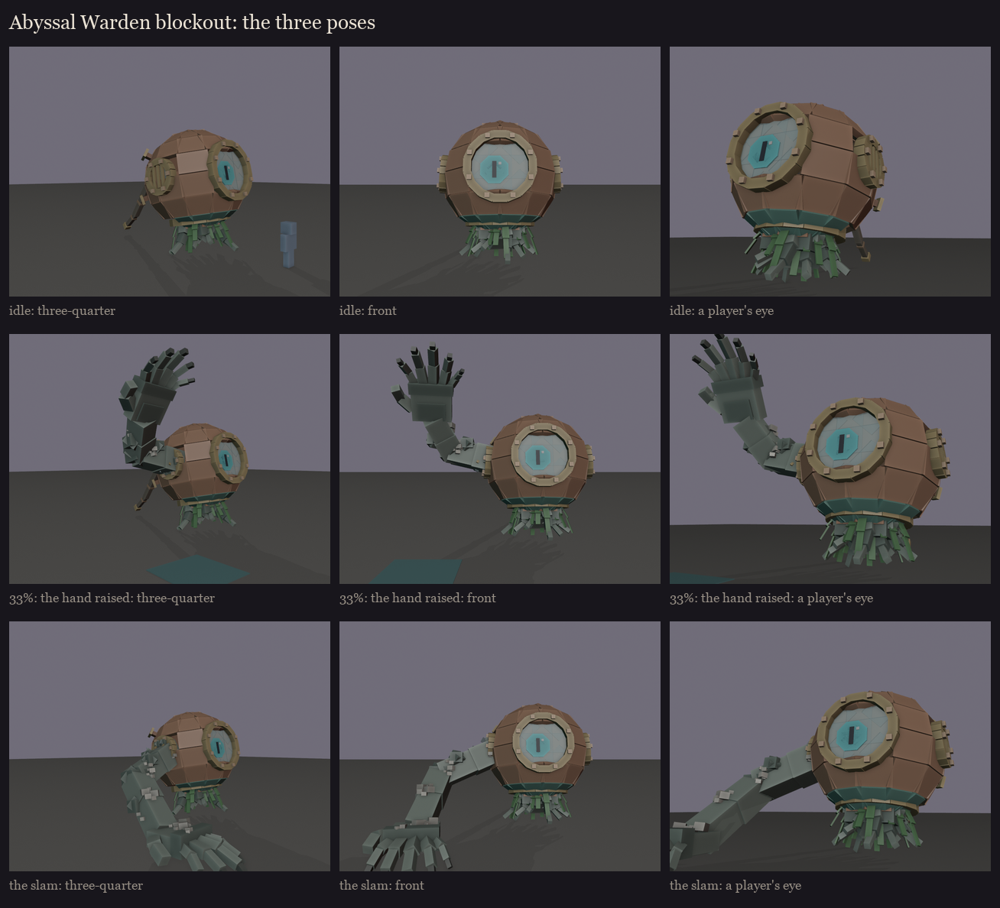
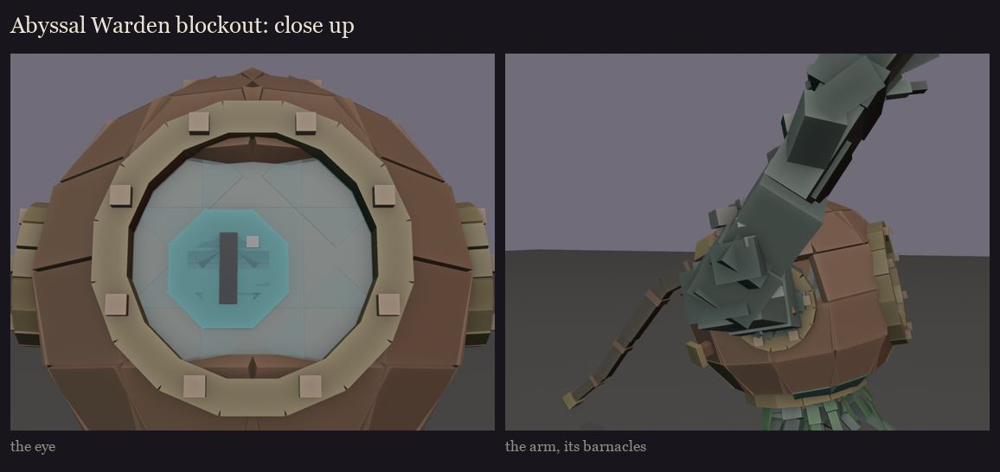
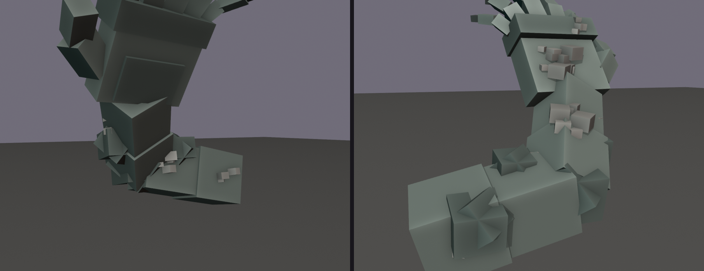

# The Abyssal Warden, session 1 step 3: the full blockout

Everything picked in session 1, in one model. Made by `python tools/art/bosses/warden_s1.py` (on
`warden_take2.py` and `warden_window.py`); the editable model is `idle/occultech_abyssal_warden_blockout.bbmodel`.

**Size:** idle, 5.2 x 5.9 x 8.9 blocks (with the hose), 326 cubes. With the arm out, 423.

**The parts:**
- **The Lost Helmet** (take 2): the copper helmet sphere, 4.5 blocks across, bowed a little forward.
  - the grilled side windows;
  - four pressure valves where the guardian's spikes stand;
  - the air hose trailing like a tail. It now ends just off the floor: the bow had tipped its end into the ground.
- **The open neck:** the growth hangs from it: a fleshy mass with swellings, ten tendrils and 22 ragged kelp
  strands. They are shortened a little so the longest stop just off the floor.
- **W1's slit eye** crammed in the front window, with flesh bulging into the window's rim. **Its veins are texture
  now** (the user's change): the red vein cubes are gone, and session 5 paints them on the sclera.
- **W1's hand** at 33%:
  - it bursts out of his right side window: jagged glass in the frame, the bars bent, flesh squeezing out;
  - **raised:** over a player;
  - **the slam:** flat on the floor (lowered, since the bow had left it hovering).

**The barnacles, scattered like an infection** (the user's change):
- **Where:** uneven patches in random spots along the upper arm and the forearm, with lone ones between, a crust
  over the back of the hand and a few on the knuckles.
- **Each patch:** 3 to 8 barnacles, or a lone one or two, of five sizes, some old and pale, crowded together and
  never in a row.
- **Placement:** they sit on the arm's faces. The first try put some inside the beam's corners, where they didn't
  show.

Colours are blockout zones. Next is session 2: the design lock (the rig, the hitbox, the key poses).
