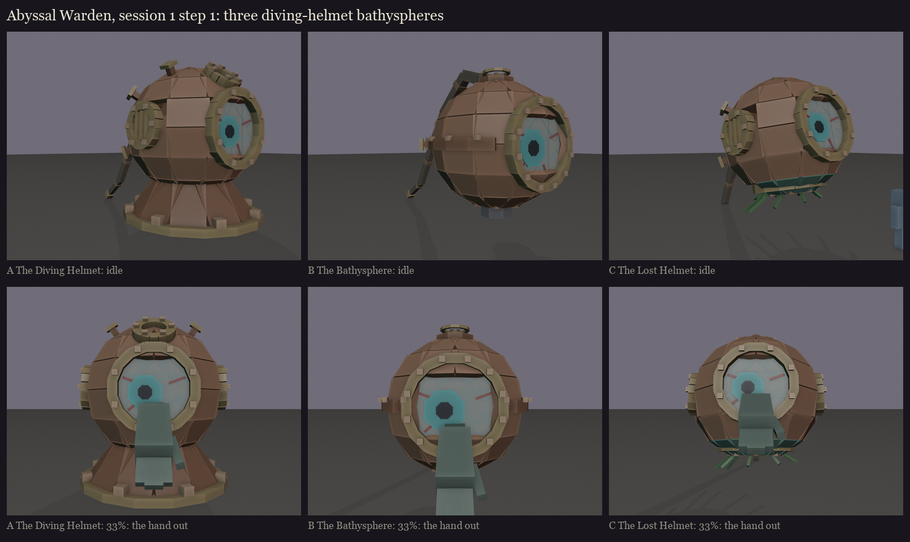

# The Abyssal Warden, session 1 step 1: three diving-helmet bathyspheres

The brief is in [../plan.md](../plan.md). Made by `python tools/art/bosses/warden_silhouettes.py`; one sheet per take
(`A_the_diving_helmet.png`, `B_the_bathysphere.png`, `C_the_lost_helmet.png`) shows each pose from the three-quarter,
the front, the side as a silhouette and a player's eye. The blue figure is a player.

**The same in all three:**
- **The sphere**, 4.5 blocks across, built the way cuboids can be round: latitude bands of tilted panels, 12 round,
  22.5 degrees apart, with flat caps. Its outline is round from every side.
- **The central window:** a thick bolted frame and sea glass, the crammed eye filling it. The iris is turned off
  centre to look, with a pupil and veins.
- **Pressure valves** standing out round the sphere where the guardian's spikes stand: stems with hand-wheels. These
  are what blow in jets of spray.
- **The air hose** trailing behind like the guardian's tail, banded, ending in a brass nozzle.
- **At 33%:** the forearm comes out of the lower part of the window and the hand reaches forward and down to slam.
  The pupil stays in view above it.

| | Take | What frames the sphere | Height |
|---|---|---|---|
| **A** | the Diving Helmet | The classic standard dress helmet: grilled side windows, the top window, and a flared breastplate under the neck ring with wing nuts. | 6.1 blocks |
| **B** | the Bathysphere | A pressure sphere: one bigger window (12 bolts), an equator flange stopping at the window's frame, a hatch on top with its wheel, a ballast weight under it, the hose from the hatch. | 6.4 blocks |
| **C** | the Lost Helmet | A helmet with no diver: no breastplate, the open neck underneath dark inside with kelp spilling out of it, bowed a little forward, grilled side windows. | 7.2 blocks |

**My pick: C's helmet, floating, without the bow.**
- **A** reads instantly as a diving helmet, but its breastplate stands on the ground like a pedestal: a statue more
  than a thing that glides.
- **B** is the cleanest sphere, but loses the helmet look (no side windows, no grilles).
- **C** keeps everything that says "diving helmet" (the grilled side windows, the gooseneck, the bolted front window)
  and floats free. The dark open neck with kelp is a creepy hint at what's crammed inside.

**Notes from the self-review:**
- **The first round plates** (the glass, the iris, the pupil) were a square and the same square turned 45 degrees,
  which makes an eight-pointed star. They are now true octagons: a cross of two bars and four corner plates on the
  diagonal faces.
- **B's equator flange** first ran straight across the window. It now stops at the frame.
- **C's kelp** first hung in long straight strands, which read as legs. It is now short, thin and curling outward.
- **The hand** is a rough block here. Its fingers, the cracked glass and the eye are designed in step 2 (the window
  study).

Colours are blockout zones, not the palette.
