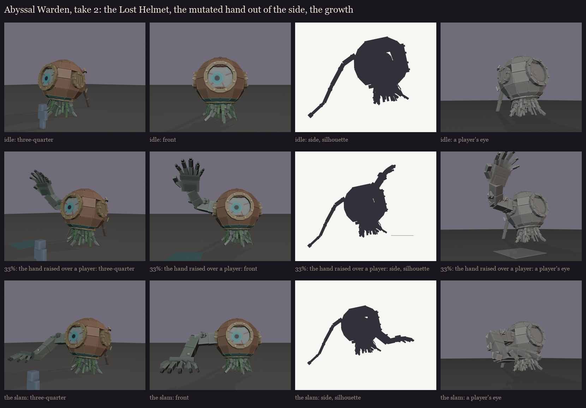

# The Abyssal Warden, session 1 step 1, take 2: the Lost Helmet with the hand out of the side

The user picked **C, the Lost Helmet** (2026-10-29), with changes. Made by `python tools/art/bosses/warden_take2.py`
(on `warden_silhouettes.py`).

- **The hand comes out of a side window** where an ear would be (his right), not the eye's window. The front window
  stays whole, so the crammed eye keeps looking and firing. At 33% the side window bursts: its glass shatters
  outwards and its grille is gone, the frame and bolts still on.
- **The hand is much larger, buff and mutated:**
  - **The arm:** a swollen upper arm and forearm, nearly two blocks thick, with lumps bulging out of it and barnacles
    crusted on. The elbow is a knotted lump.
  - **The palm:** broad and flat, with a heavy knuckle ridge.
  - **The fingers:** five, one more than it should have, of uneven length and thickness, spread wide and clawed,
    with a thick thumb.
- **The poses:**
  - **Raised:** the smash's wind-up. The arm rears up out of the side, the palm turned down at a player, the ring
    marked on the floor below.
  - **The slam:** the arm flung out along the floor, the hand flat on it.
- **The growth:** the tendrils and kelp hanging from the open neck are a growth now. A fleshy mass bulges out of the
  neck with swellings on it, ten thick tendrils taper and curl out of it, and 22 flat kelp strands hang ragged and
  uneven, so it never reads as legs.
- **The rest** is C: the helmet bowed a little forward, the bolted window with the eye, the grilled left side window,
  the valves and the hose.

**Size:** idle 5.2 x 7.2 x 9 blocks (with the hose); with the arm raised it reaches 9.3 blocks up and 8.7 across.

**Notes from the self-review:**
- **The first palm** was a square-sectioned beam, so it read as a cube with a clump of cubes for fingers. It is now
  a flat palm (built as one turned box), with a knuckle ridge and fingers fanned from it.
- **The raised arm** first went out of frame (11 blocks up). It is lower now.
- **The three-quarter view** is taken from his right, so the arm comes towards you.

Colours are blockout zones. Next is step 2, the window study: the eye, the glass, the bursting side window and the
hand's shape, close up.
