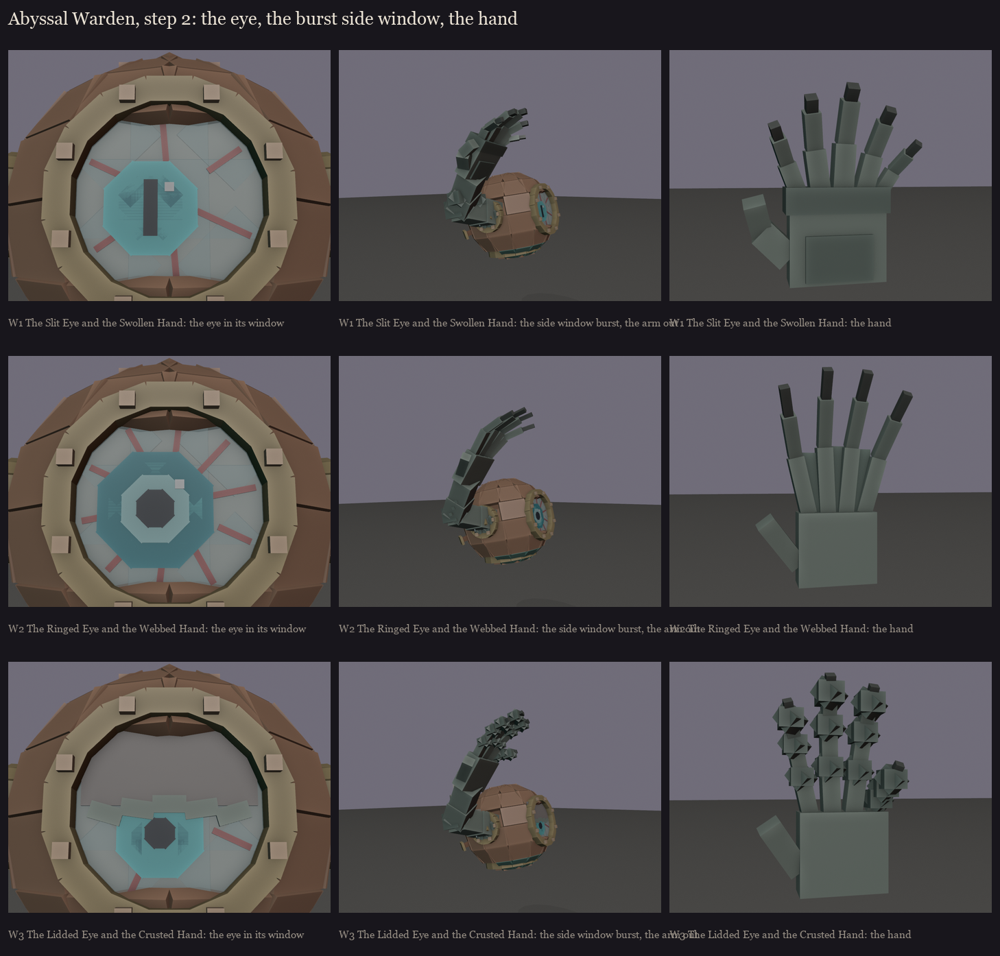

# The Abyssal Warden, session 1 step 2: the window study

Take 2 ([../s1_take2](../s1_take2/README.md)) close up: the crammed eye in the front window, the side window burst
with the arm out of it, and the hand on its own. Made by `python tools/art/bosses/warden_window.py` (on
`warden_take2.py`). Each take pairs an eye with a hand; parts can be mixed.

| | Eye | Hand |
|---|---|---|
| **W1** | **The Slit Eye:** the eyeball pressed flat against the glass, a cyan iris with a dark inner ring, a vertical slit pupil (a guardian's stare), a glint, veins | **The Swollen Hand** (take 2's): a broad, flat palm with a heavy knuckle ridge, six uneven clawed fingers spread wide, a thick thumb |
| **W2** | **The Ringed Eye:** a bigger iris in three rings round a round pupil that can tighten for the beam's tell, ten veins | **The Webbed Hand:** four long fingers webbed together near the palm, long hooked claws, a fin of spines down the forearm |
| **W3** | **The Lidded Eye:** a heavy fold of flesh sagging over the top of the eye, a lumpy lid edge, the iris looking up from under it | **The Crusted Hand:** long knobbly fingers of three joints (one stunted), barnacles crusted over the back of the hand and up the arm |

**The same in all three:**
- **Crammed flesh** bulges into the window's rim round the eye.
- **The side window has burst:** jagged glass left pointing in from its frame, two grille bars bent outwards, the
  arm's flesh squeezing out round it.

**My pick: W1's slit eye with W3's lid, and W1's hand.**
- **The slit pupil** stares like the guardian it stands in for, and narrowing or widening it is a clear tell.
- **A lid over the top** makes it look crammed and alive, and it can droop during the rest.
- **The swollen hand** reads best as "much larger, buff and mutated". W3's barnacles could go on its arm.

**Notes from the self-review:**
- **The hand's fingers were fanned the wrong way** (in take 2 too): they met in a point. They now spread from the
  middle, and take 2 is regenerated.
- **The hand close-up** shows the hand alone, palm on, fingers up. The arm is in the side view.
- **The first close-up cameras** were too close or on the wrong side.

Colours are blockout zones. Next is step 3, the full blockout with the chosen eye and hand.
