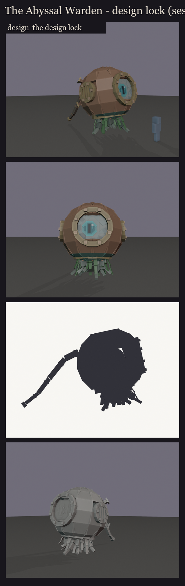
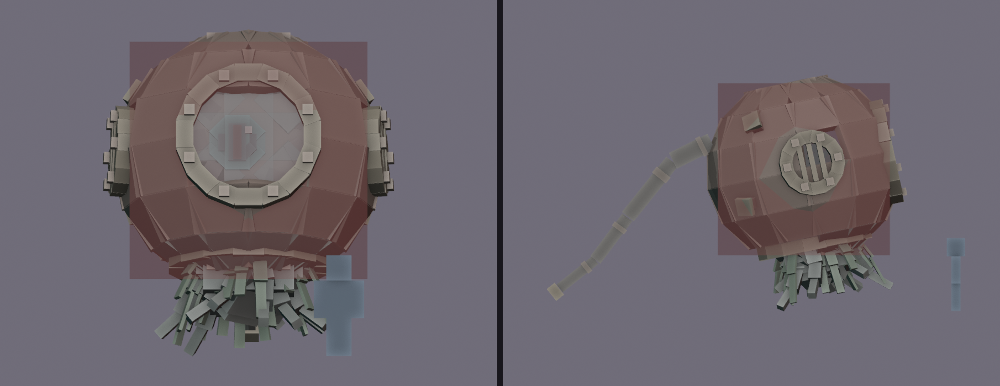
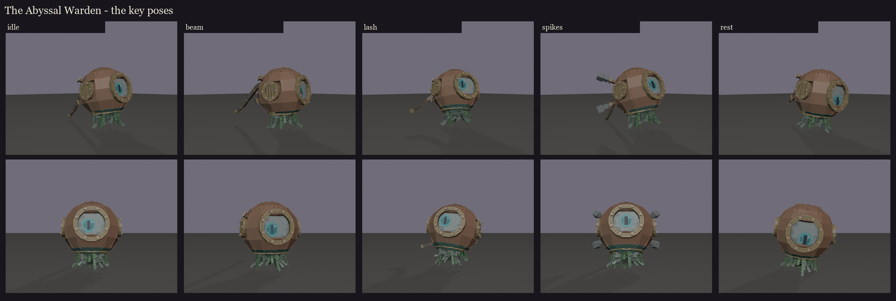
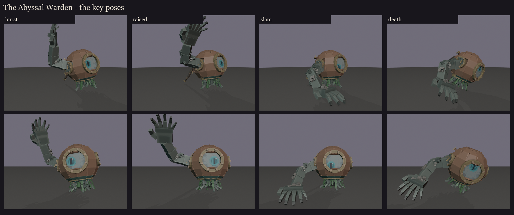

# The Abyssal Warden, session 2: design lock

The approved blockout ([../s1_blockout](../s1_blockout/README.md)) is rebuilt as a rig at its final size, and every
cube is snapped to whole texels. Made by `python tools/art/bosses/warden_s2.py` (on the session 1 scripts).

## One model

**`occultech_abyssal_warden`:** 429 cubes on 21 bones with geometry. At spawn it shows 326 of them, about 4.5 x 5.9 x
8.9 blocks with the hose.

**The 33% hand is part of the same model.** It is hidden until his side window bursts, and the fight then shows it
(part visibility, as the Archevoker's hands use). So it needs no second carrier, and it moves with the helmet.

Full list: [parts.md](parts.md).

## Bones (BetterModel names)

- `base`: everything. Its pivot is on the ground, so it carries the float, the rest's sink and the death.
- `body`: the bowed helmet. Its pivot is the sphere's centre, so it can turn and nod without moving.
  - Holds the hull, the window frames and bolts, the left window, the neck ring, the sclera and the flesh in the
    window's rim.
  - The windows' own groups are baked into it, because a bone per window would cost displays for nothing.
  - `glow_iris`: the iris and its glint. It slides round the window to look about.
    - `pupil`: the slit. It is scaled thinner for the beam's tell and wider for the spikes and the rest.
  - `valve0` to `valve3`: they jump out at the spike burst.
  - `spray` (hidden): the jets out of the four valves.
  - `window_r_glass`: his right side window's glass and grille, until 33%.
  - `window_r_burst` (hidden): that window's jagged glass, bent bars and squeezed-out flesh, from 33%.
  - `hose1` to `hose4`: a chain, for the lash's whip.
  - `growth`: the fleshy mass under the open neck.
    - `tendrils_even`, `tendrils_odd`: every other tendril, so the two halves sway against each other.
    - `kelp`: all the kelp, swaying on its own.
  - `arm`, then `forearm`, then `hand` (all hidden): straight out of the window in the bind pose. Each pose aims the
    arm and the forearm, and turns the hand until the palm and fingers face the right way.

## The hitbox

**One `ob_hitbox`, 4.25 blocks on each side**, inside the helmet's sphere. The hose, the growth and the hand stay
outside it, so they are never targets. When the hand is down after a slam, the opening is the helmet.

## Key poses

The fight's moments, posed from the rig as renders for the design; not animation.

| Pose | Moment | What he does |
|---|---|---|
| idle | the glide | the eye looking ahead, the hose trailing |
| beam | the beam's tell | he turns onto his target, the iris locked on it, the pupil narrowed to a thread |
| lash | the tail lash | the hose whipped round at anyone close, the growth swinging the other way |
| spikes | the spike burst | the valves jump out with jets of spray, the pupil flared |
| rest | the 2 s rest | he sinks and nods forward, the eye drooping, the hose slack |
| burst | 33% | the side window bursts and the hand claws its way up out of it |
| raised | the smash's wind-up | the hand over a player, while the eye watches another |
| slam | the slam | the hand flat on the floor, left down for a second as the opening |
| death | the implosion | he tips over and sinks, the eye rolled up, the arm limp on the floor |

## Checks

- **No flicker:** no two faces share a plane, 0 pairs. The nudges are found once in the bind pose and kept for every
  pose.
- **The floor:** the hand lands a texel or two above the floor in the slam (lowest point 1.8). In the rest and the
  death the kelp tips rest a few texels into the floor, which reads as lying on it.

## For session 3: the drawing cost is high

**About 245 displays** by my count. The Archevoker had 95. BetterModel needs a display for each different cube turn it
can't keep in a bone's item model.

- **`body`, about 101:** the hull's 72 panels are each tilted and turned round the sphere, so nearly every one is its
  own turn.
- **`kelp`, about 45**, and **the tendrils, about 32:** each strand hangs at its own angle.
- **The fixes, for session 3** (the look stays the same):
  - put the hull's panels at turns of 22.5 degrees (16 round, not 12), so each band shares a few turns;
  - give the kelp only a few hang angles;
  - fold quarter turns, as on the Archevoker.

Colours are blockout zones.
