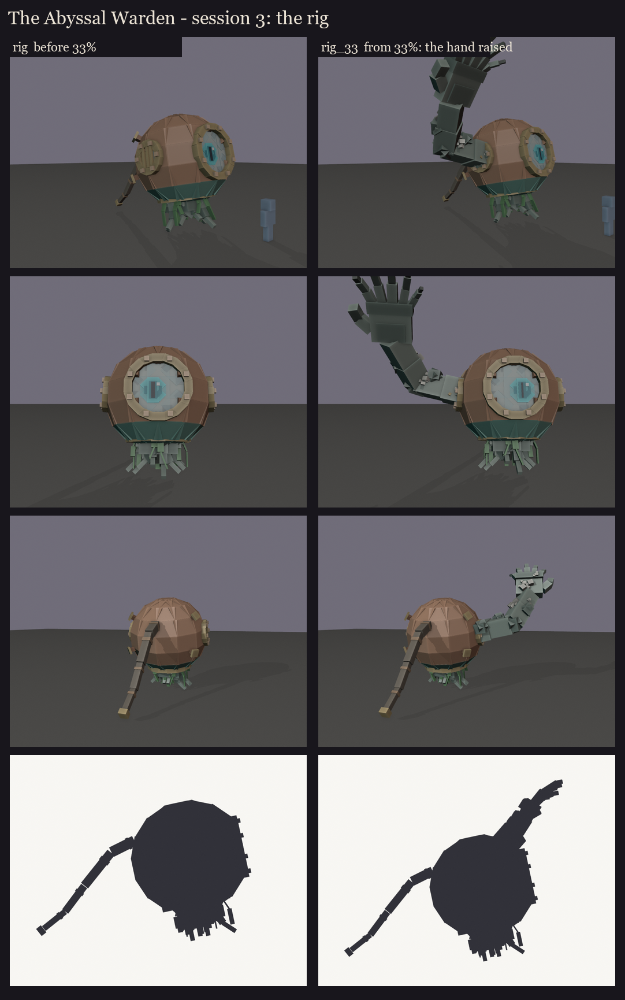
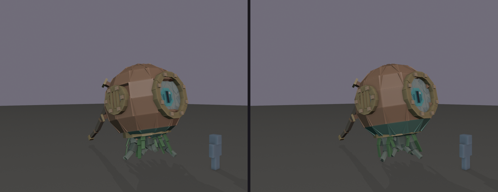

# The Abyssal Warden, session 3: rig and pose test

The approved design lock ([../s2_design](../s2_design/README.md)) made ready to move and to see in game. Made by
`python tools/art/bosses/warden_s3.py` (on top of `warden_s2.py`).



## Drawing cost ([rig_report.json](rig_report.json))

BetterModel draws each bone as one display entity. A bone needs one more for every different cube turn it can't keep
inside its item model (anything but a single 0, 22.5 or 45-degree turn).

**From about 245 displays to 73. 31 of them show at spawn**: the hand, its arm, the burst window and the spray only
appear when the fight shows them.

**How, with the same look:**



- **The hull:** each of its 12 columns of panels is now its own bone, turned to its place round the sphere. A bone's
  own turn is free.
  - Inside a column the panels only tilt. The latitude bands are re-cut so every tilt is a multiple of 22.5 degrees,
    which the item model keeps.
  - The band edges moved a few degrees, so the sphere has one more band and a smaller cap. It reads as rounder.
  - Cost: from about 101 displays to 12.
  - **Fix (after the first in-game look):** the re-cut bands had opened slots round the side windows, the front
    window and the neck, and slits under the top cap.
    - A window used to drop every whole panel whose middle was near it, and its frame didn't cover all of a panel.
      Those panels are now cut into 3 x 3 tiles, and only the tiles over the opening go. The tiles keep the panel's
      tilt, so they cost no displays.
    - Each panel is now as wide as its band's wider edge, so no gaps open between the panels.
- **The side windows** keep their own groups as bones. Session 2 had baked them into the body, which gave every frame
  slab its own turn.
- **The kelp and the tendrils** lean out in the four square directions only, by 22.5 or 45 degrees. The strands still
  vary in length, root and sway, but each bone costs one display (it was about 77).
- **The flesh round the eye** is 8 lumps 45 degrees apart; it was 9, 40 apart.
- **Quarter turns** are folded, as on the Archevoker.

**Where the rest go:**

| Bone | Displays | Why |
|---|---|---|
| `hand` | 19 | six fingers fanned out, the thumb and the claws (only from 33%) |
| `window_r_burst` | 13 | the shards and bent bars, each at its own angle (only from 33%) |
| `spray` | 4 | a jet per valve (only during the spike burst) |
| `arm`, `forearm` | 3 each | the limb's two halves and the bulges |
| every other bone | 1 or 2 | |

## Rig checks

- **No flicker:** no two faces share a plane, 0 pairs.
- **BetterModel tags:** only `glow_iris` and `ob_hitbox` carry one.
  - **Renamed:** session 2's `tendrils_b` would have been read as BetterModel's `b` tag, so the two halves are now
    `tendrils_even` and `tendrils_odd`.
- **Pivots** ([pivots.md](pivots.md), [pivots.png](pivots.png)): every limb joint turns where it should. The hose turns
  at each link, the arm at the shoulder inside the window, the forearm at the elbow, the hand at the wrist, and each
  valve at its foot. Some pivots are flagged by the check, but they are where they should be:
  - **`body` and the hull's columns:** they pivot at the sphere's centre, which is empty space inside the hull.
  - **`glow_iris`:** also at the centre; it only slides.
  - **`window_r`, its burst, `spray`:** they never turn on their own.
  - **The tendrils and the kelp:** they swing from the neck, where the mass is.
- **Load test:** on the second test server, BetterModel loaded all three review models ("17 of models are loaded
  successfully"). They were then taken off that server again. Its `build.zip` still holds them until BetterModel
  rebuilds it at its next start.

## In game

**Three review models:** each is the same rig with different parts shown.
- **What they look like:** flat material colours, no texture yet. The iris is full-bright.
- **Where they are:** in `run/plugins/BetterModel/models` (your server, on port 25565). They aren't shipped.
- **The poses:** every key pose is an animation in each of them.

| Model | Shows |
|---|---|
| `occultech_abyssal_warden_rig` | before 33%: the side window whole, the hand and the spray hidden |
| `occultech_abyssal_warden_rig_spikes` | the same with the spray jets (for the spike burst) |
| `occultech_abyssal_warden_rig_33` | from 33%: the side window burst, the hand out |

```
/bm reload
/bm test occultech_abyssal_warden_rig idle
/bm test occultech_abyssal_warden_rig beam
/bm test occultech_abyssal_warden_rig lash
/bm test occultech_abyssal_warden_rig_spikes spikes
/bm test occultech_abyssal_warden_rig rest
/bm test occultech_abyssal_warden_rig_33 burst
/bm test occultech_abyssal_warden_rig_33 raised
/bm test occultech_abyssal_warden_rig_33 slam
/bm test occultech_abyssal_warden_rig_33 death
```

**What moves besides turns:**
- the iris slides round the window (position keys);
- the pupil narrows for the beam and widens for the spikes and the rest (scale);
- the valves jump out at the spikes;
- the whole model sinks in the rest and the death.

**The pack:** your client needs BetterModel's pack (`run/plugins/BetterModel/build.zip`) next to the Occultech pack
to see them.
