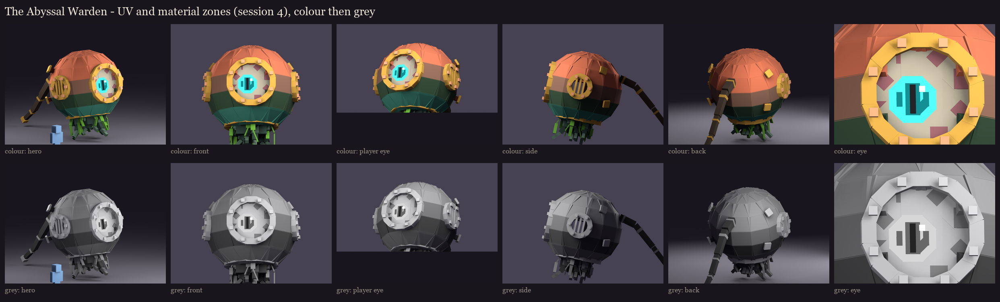
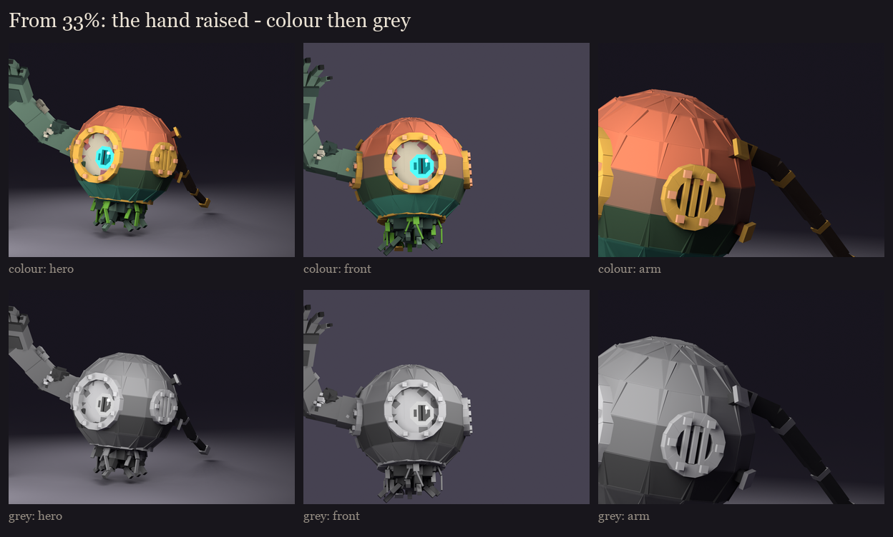

# The Abyssal Warden, session 4: UV and material blocking

Every visible face of the session 3 rig is mapped at one texel per model unit (16 per block, the vanilla density),
each face a flat colour of its material zone. Made by `python tools/art/bosses/warden_s4.py` (after `warden_s3.py`).




## The atlas ([uv_report.json](uv_report.json))

- **One atlas, 512 x 512**, for the whole model, the hand included. It is 2,585 islands and 2,793 faces drawn, filling
  415 rows at 60%. Each island has a 1-pixel border against seams.
- **Shared space:**
  - the left side window uses the right one's islands, and each valve on his left uses its right twin's;
  - **the hull's panels each keep their own**, so the weathering, the seams and the streaks can be painted without
    any panel repeating.
- **Buried faces:** 27 faces lie inside another cube of the same bone. They are left out, so they are never drawn.
- **Fixed on the way:** the eye's sclera lost its front faces at first, because they sit inside the window's glass and
  counted as buried. See-through cubes (the glass, the shards, the spray) no longer bury anything.

## Material zones

| Zone | Colour | Where |
|---|---|---|
| copper | 205, 115, 83 | the hull's crown, bright as new copper |
| copper_exposed | 135, 101, 83 | the band below: copper going dull |
| copper_weathered | 57, 82, 59 | the band below that, dark and wet |
| verdigris | 68, 136, 116 | the oxidised bottom bands round the open neck, as if the sea crept up him |
| copper_dark, rivet | 112, 58, 38 / 232, 162, 120 | the valve stems; the rivets |
| brass | 210, 164, 72 | the window frames, the grille bars, the valve wheels, the neck ring, the nozzle, the hose's bands |
| glass | 156, 222, 232, 38% opaque | the windows: thick sea glass the eye shows through |
| sclera, flesh_wet | 179, 171, 150 / 150, 100, 104 | the crammed eye's yellowed white; the wet flesh bulging round it |
| iris, iris_dark, pupil, glint | 80, 232, 214 / 24, 128, 132 / 12, 16, 22 / white | the sea-glow iris (full-bright), its dark ring, the slit, the glint |
| flesh, flesh_dark | 104, 130, 112 / 58, 78, 70 | the creature: the growth, the tendrils, the arm and hand |
| barnacle, barnacle_old, nail | 204, 198, 178 / 148, 144, 128 / 34, 38, 36 | the infected patches; the claws |
| kelp | 112, 176, 63 | the kelp in the growth |
| hose | 70, 56, 44 | the air hose's rubber |
| shard, spray | see-through | the burst window's glass; the valves' jets |

**The value check:** every pair of neighbouring zones is at least 12 apart in lightness, so he reads in grey too. The
first pass found eight pairs too close, all fixed:
- **The copper ramp** (copper, exposed, weathered, verdigris) was nearly one value; it now steps down to the wet,
  weathered band and back up to the pale oxidised crust.
- **The brass** is brighter than all four coppers and stays 12 apart from the glass.
- **The sclera** is a sickly yellow, a step below the glowing iris.
- **The kelp** is a lighter green than the flesh it grows from.

## Left for painting (session 5)

- **The hull:**
  - the bands are hard stripes for now. They become ragged weathering: verdigris creeping up in drips and blooms from
    the neck, streaks down from the rivets;
  - riveted seams between the panels, dents, and the shine on the crown.
- **The glass:** scratches, a crack line and the sea glow on it.
- **The eye:** the veins on the sclera (the user's call: painted, not cubes), the iris's rings and its glow as a
  gradient, never flat (STYLE.md).
- **The flesh:** wet sheen, mottling, the barnacles' plates and openings, the arm's swollen veins.
- **The kelp and the hose:** blades with a midrib and ragged ends; the hose's canvas weave.

## In game

The three review models (flat zones, the nine poses) replace session 3's in `run/plugins/BetterModel/models`:
`occultech_abyssal_warden_rig`, `_rig_spikes`, `_rig_33`. This is the first look at the pixel size in game.

```
/bm reload
/bm test occultech_abyssal_warden_rig idle
/bm test occultech_abyssal_warden_rig_33 raised
```

**Worth a look:** whether the window's glass draws see-through in game. The eye must show clearly behind it. If it
doesn't, the glass goes almost clear (or becomes just its frame's scratches) in session 5.
