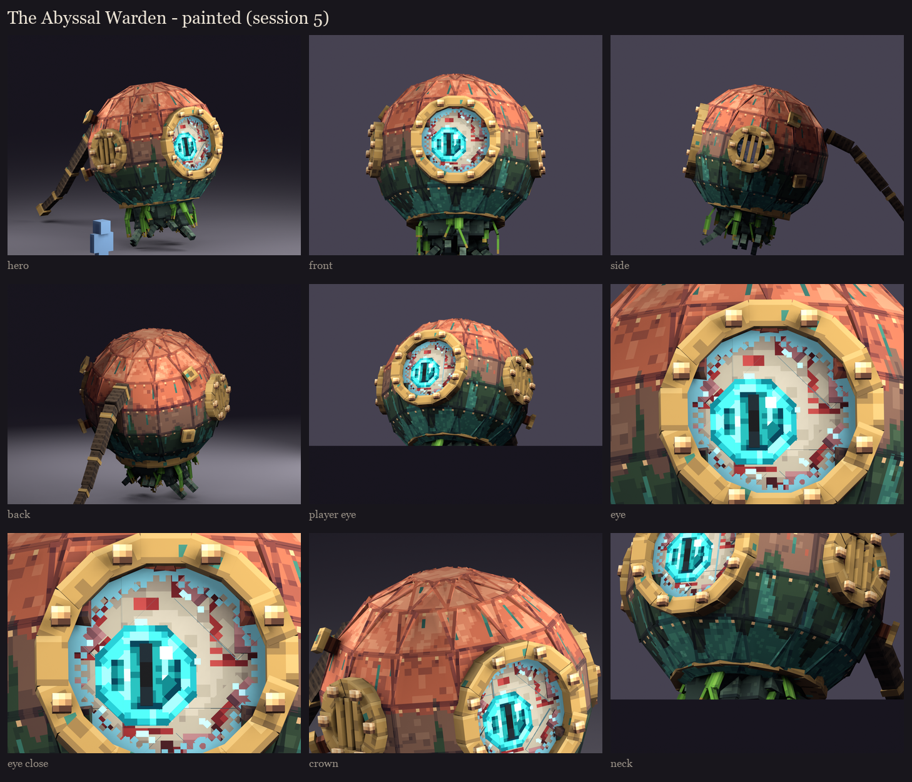
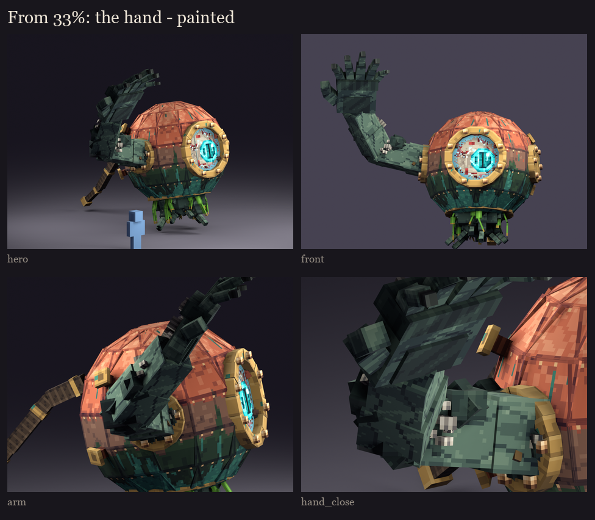

# The Abyssal Warden, session 5: texture painting

Session 4's layout painted, with the same islands in one 512 x 512 atlas. Made by
`python tools/art/bosses/warden_s5.py` (after `warden_s4.py`).

- **The ramps:** each runs from a cool dark through the zone's colour to a warm light.
- **No painted light direction:** the painting carries form only. Crease shading (ambient occlusion) is baked from the
  real geometry.




## The hull

The hull is painted from where each texel sits on the sphere, not panel by panel, so the weathering runs on across the
panels and the seams.
- **The four stages of copper,** from the crown down:
  - bright copper, with a soft shine on the crown;
  - exposed, dulling;
  - a dark, wet band of weathered copper;
  - the pale verdigris crust round the open neck, with lighter grains in it.
- **The edges between the stages are ragged.** Each stage darkens a step just before it turns.
- **Tongues of verdigris climb** up from the neck in sixteen places, as if the sea crept up him.
- **Every panel** has a dark seam round it and a row of rivets along its top, and some rivets weep a verdigris streak
  down the panel. The tiles by the windows only draw seams on their real panel edges, so no grid shows.

## The fittings

- **The brass:** old and polished, with a lit upper edge, a shaded lower one, tarnish in clusters and a rare spot of
  green. It is less saturated than session 4's, so it reads as brass, not gold.
- **The bolts:** lit along the top and left of each bolt, with a dark lower edge so the head sits proud.
- **The valves' stems:** threaded.
- **The hose:** ribbed rubber with a faint canvas weave, its brass bands ribbed too.

## The window and the eye

- **The glass:** clear sea glass. It has a thick, greener rim that thins into the clear glass in a dither, a few
  broken scratches and a broken glint. The eye shows through it.
  - **Every texel is fully clear or fully opaque** (fixed 2026-10-31). The first glass was half-clear everywhere. In
    game a half-clear texel hides whatever is drawn behind it after it, so the eye vanished in the frames where the
    glass happened to be drawn first. Animation changes that order, so the eye flickered.
  - The spray and the burst shards had the same problem. They are now dithered: a 4 x 4 pattern of clear and opaque
    texels that matches their old see-through amount.
- **The sclera:** yellowed, a step darker towards the rim, with a few blotches and wet glints.
  - **The veins are painted**, as you asked: eight vessels winding in from the edge.
  - Each keeps turning a little one way, then the other, forks once or twice, and thins and pales from dark red to
    pink towards its tip.
- **The wet flesh** round the eye: mottled, with a glint or two.
- **The iris:** a glowing gradient, brightest in a ring round the slit, with fibres running out from it and darker at
  its rim. Its inner ring is a deeper teal. Thin glows keep their colour instead of burning white.

## The creature

- **The skin:** sea-green and mottled in soft blotches, painted from where each texel sits, so the blotches run on
  across the cubes. It has pale flecks.
- **The arm:** swollen veins wavering along it.
- **The tendrils:** ringed, with pale suckers down their inner side.
- **The hand:** knuckle creases on the fingers, two creases across the palm, and a lit ridge over the knuckles.
- **The barnacles:** plates up their sides, and the top a ring of plates round a dark opening. The old ones are chalkier.
- **The claws:** glossy, lighter towards their tips.
- **The kelp:** blades with a lit midrib and darker edges. The lower ends go yellow-brown and ragged, with cut-out
  texels. The bulbs are round.

## Self-review fixes along the way

- **Too much verdigris:** the first pass turned half the sphere green and hid the dark weathered band. The stages
  now sit lower, and the tongues are shorter.
- **The rivets:** two dotted rows on every panel looked like noise. Now there is one row along the top, a rivet every
  five texels, and fewer weep a streak.
- **The veins:** the first ones read as red crosses, the second as straight red lines. They now wind and fork.
- **The brass** read as gold, and its tarnish as noise. It is calmer and less saturated now.
- **The glass's rim** was a heavy blue ring. It is now thinner and lighter.
- **The hand's close-ups** were aimed at his left side. They now look at his right, where the hand comes out.

## In game

The painted review models replace session 4's in `run/plugins/BetterModel/models`, with the nine poses:
`occultech_abyssal_warden_rig`, `_rig_spikes`, `_rig_33`.

```
/bm reload
/bm test occultech_abyssal_warden_rig idle
/bm test occultech_abyssal_warden_rig_33 raised
```

**Things to check at 10 blocks:**
- the eye behind the glass;
- the weathering's read on the round hull;
- the rivet row: whether it is busy or calm;
- the hand's skin against the verdigris.
