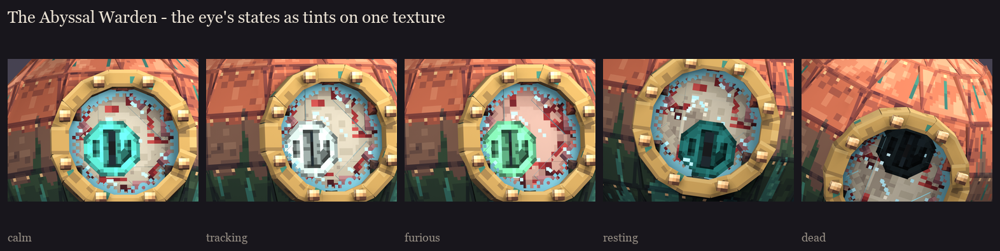
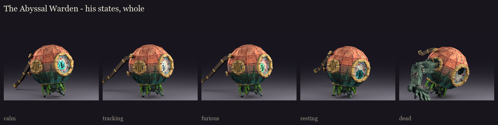
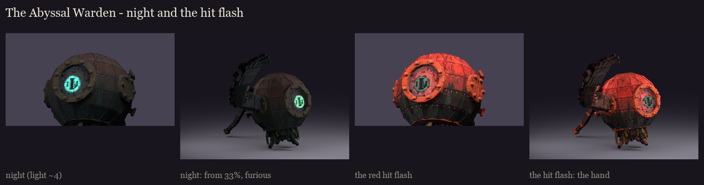

# The Abyssal Warden, session 6: variants and readability

His one living light is the eye, so his states are BetterModel tints on `glow_iris`: a colour multiplied into the
texture, with no texture swap. Made by `python tools/art/bosses/warden_s6.py` (after `warden_s5.py`).

- **The neutral iris:** the iris is now painted as a neutral grey gradient. These are session 5's ramps without their
  hue: each level is session 5's colour divided by the calm tint, so calm looks as it did.
- **One texture, every state:** the same texture takes each state's colour.
- **The same atlas:** it is still 512 x 512.




## The eye (`glow_iris`)

| State | Tint | When |
|---|---|---|
| calm | 110, 246, 226 | the sea glow: gliding, watching |
| tracking | 236, 255, 250 | the beam's last second: white, as the fight's warning already is |
| furious | 150, 255, 196 | below half: hotter and greener, with the bloodshot white |
| resting | 44, 120, 116 | the rest after the spikes, his opening: the eye dims while he vents |
| dead | 26, 34, 38 | out |

- **Resting is the dimmest living state** on purpose: a dim eye tells players "hit him now".
- **Tracking is the brightest**: a white eye means a beam is coming.

## One part swap: the bloodshot eye (below half)

The plan has the eye bloodshot below half. A tint can only darken the white or redden it, so the veins can't grow
that way. Instead the white is swapped:
- **Two bones:**
  - the sclera now has its own bone, `sclera`;
  - a copy of it, `sclera_blood`, starts hidden.
- **The copy's paint:** it is pinker and carries 13 vessels instead of 8. They are longer and thicker, fork more often
  and reach nearer the iris. A flushed rim runs round its edge.
- **The veins stay texture**, as you asked. The two copies never show together, so they can't flicker.
- **In the fight** (session 8): below half, hide `sclera` and show `sclera_blood`.

**Cost:** 75 displays, 32 at spawn. Each sclera bone draws one display, and the bloodshot one is hidden at spawn.

**The other phase parts** are session 3's and are not changed: the spray jets (the spikes), and from 33% the burst
side window and the hand.

## Readability



- **At night** (light level about 4: everything but the full-bright iris dimmed):
  - the eye is the one bright thing, and it shows clearly through the glass;
  - the hull's round shape and the brass rings still read against the sky.
- **From 33% at night:**
  - the hand and the arm go nearly black;
  - the floor ring warns of the smash, so that is fair. A glow on the hand (for instance in the barnacles' openings)
    would make it read at night, but it would be a second light, and the plan keeps the eye as his only one. I left
    it out.
- **Under the red hit flash:**
  - the copper, the brass and the eye keep their shapes;
  - the verdigris and the flesh stay darker, so he doesn't turn into one red mass.

## In game

**The review models:**
- The three models (`occultech_abyssal_warden_rig`, `_rig_spikes`, `_rig_33`), with the neutral iris and the
  bloodshot copy, replace session 5's in `run/plugins/BetterModel/models`.
- Untinted, the iris shows white. The fight tints it in session 8.

```
/bm reload
/bm test occultech_abyssal_warden_rig idle
/bm test occultech_abyssal_warden_rig_33 raised
```

**Still unchecked in game:**
- the glass's see-through look;
- the painted read at 10 blocks.
