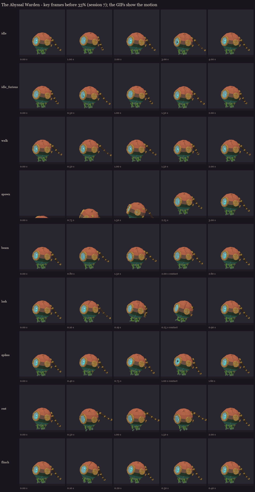
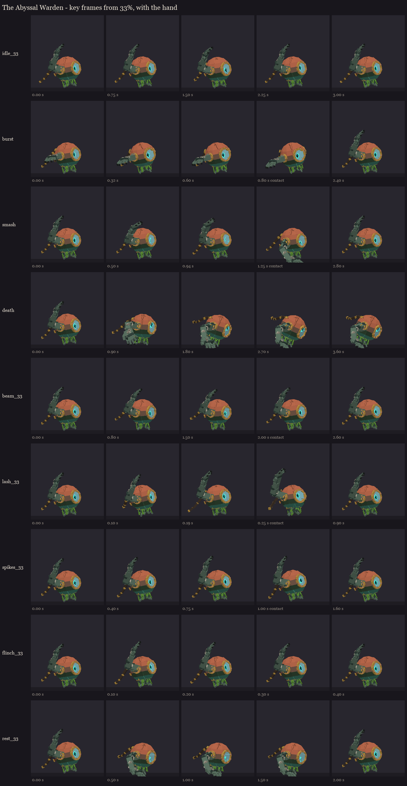

# The Abyssal Warden, session 7: animation

Made by `python tools/art/bosses/warden_s7.py` (after `warden_s6.py`).

**How the clips are built:** each clip is a few whole poses at key times, built with session 2's pose code. The
keyframes are:
- each bone's turn;
- the model sinking and rising (`base`);
- the eye looking round (`glow_iris`);
- the valves jumping out;
- the arm sliding out of the burst window;
- the pupil's width.

**What the clips leave to the server:**
- **Movement:** he glides with his carrier, so no clip travels.
- **Glow tints and part swaps** (session 6, wired up in session 8): the spray, the burst window, the hand and the
  bloodshot white.




The motion is in the GIFs in [gifs/](gifs/). The previews are flat zone colours.

## The clips (timed to AbyssalWarden.java)

| Clip | Length | Contact | What happens |
|---|---|---|---|
| `idle` | 4.0 s loop | | hanging in the air: a slow bob and sway, the hose and the growth swaying after him, the eye looking round |
| `idle_furious` | 2.0 s loop | | below half: tighter, the eye darting from spot to spot (a quick move, then a hold) |
| `idle_33` | 3.0 s loop | | from 33%: the hand hovering beside him, its fingers flexing, the eye still darting |
| `walk` | 2.0 s loop | | gliding after a player: leaning in, the hose trailing |
| `spawn` | 3.0 s | | rising out of the circle from 6 blocks down, turning to face the arena, a small overshoot |
| `beam` | 2.6 s | 2.0 s | the eye locks on and the pupil narrows to a thread for the beam's 40 ticks; a recoil and a flare as it fires |
| `lash` | 0.9 s | 0.25 s | the hose whips round. The server hits as the clip starts, so the whip comes fast |
| `spikes` | 1.6 s | 1.0 s | he swells and the valves strain for the 20-tick warning, sucks in, then the valves blow out |
| `rest` | 2.0 s | | the 40-tick rest: he sinks, heaves and vents with the eye drooping, and rises at the end |
| `burst` | 2.4 s | 0.8 s | 33%: shudders as something pushes from inside; at contact the window bursts, the arm slides out and rears, the hand claws open |
| `smash` | 2.8 s | 1.25 s | the hand rears over a player (the 1.25 s tell), slams, stays down for 1 s (the opening), then lifts |
| `flinch` | 0.4 s | | hit: a jolt |
| `death` | 3.6 s hold | | a groaning shudder, the hand drops, the hull tips over and sinks, the eye rolled up |

**The same attacks with the hand out:** `beam_33`, `lash_33`, `spikes_33`, `rest_33` and `flinch_33`.
- **Why:** once the hand shows, a clip that doesn't key the arm snaps it back to its bind pose, straight out sideways.
- **In the rest,** the hand props him up on the floor.

## Checks

- **Nothing sinks under the floor:** the lowest point of the hand in any key is 0.2 units above it
  ([clips.json](clips.json)). The first pass sank:
  - the rest's hanging hand (it now props him up);
  - the dying hand;
  - the smash's impact dip.
- **The burst:** the arm is hidden until the window breaks. It first slides straight out along the window's axis and
  only then rears up. Any other way, the rigid arm poked out through the top of the hull. (The previews show the
  hidden arm before 0.8 s too.)
- **Load test:** on test server b, BetterModel loaded the animated rig with every clip, "15 of models are loaded
  successfully", with no errors. It was taken off that server again.
- **Parts vanishing during clips** (found in game, fixed 2026-10-31): the eye, the spray and the shards were painted
  half-clear, so what lay behind them vanished in the frames where they were drawn first. The atlas now has no
  half-clear texels ([session 5](../s5_paint/README.md#the-window-and-the-eye)). The rebuilt rig loaded again on
  server b.

## Left for session 8 (the fight)

- **Which clip plays when:**
  - `beam` when a beam starts (two beams play it once);
  - `lash` on a lash hit;
  - `spikes` at the warning, then `rest`;
  - `burst` at 33%, then `idle_33`;
  - `smash` for the new hand smash;
  - the `_33` versions from 33% on.
- **The idle loops** switch below half (`idle_furious`) and at 33% (`idle_33`).
- **The smash's floor ring** should sit where the hand lands, about 3 blocks out to his right. He turns towards the
  target before the slam.
- **Part swaps at contact:**
  - the spray in `spikes`;
  - the window and the hand in `burst`;
  - the bloodshot white below half.

## In game

**The model:** `occultech_abyssal_warden_rig`, with every clip, replaces the three review models in
`run/plugins/BetterModel/models`.
- The `_spikes` and `_33` review rigs are removed. Hidden parts stay hidden, so the hand and the spray don't show in
  `/bm test`.
- Untinted, the iris shows white.

```
/bm reload
/bm test occultech_abyssal_warden_rig idle
/bm test occultech_abyssal_warden_rig beam
/bm test occultech_abyssal_warden_rig spikes
/bm test occultech_abyssal_warden_rig rest
```
