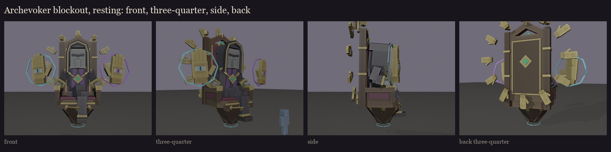
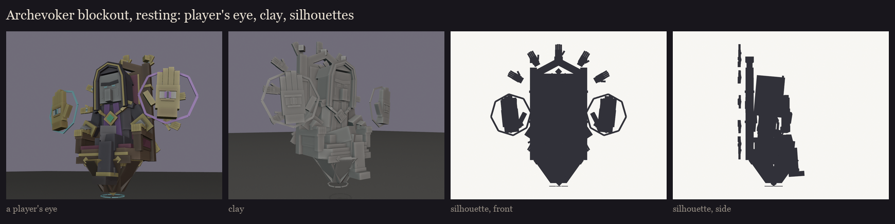
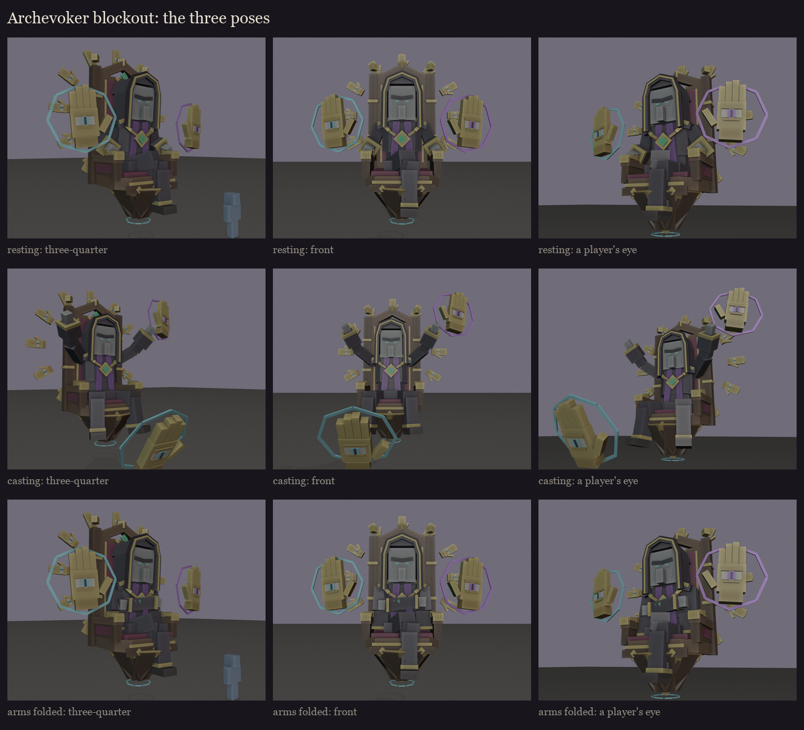

# The Archevoker, session 1 step 3: the full blockout

Everything locked in session 1, in one model. Made by `python tools/art/bosses/archevoker_s1.py` (it builds on
`archevoker_silhouettes.py` and `archevoker_face.py`); the editable model is
`rest/occultech_archevoker_blockout.bbmodel`.

**Size:** 341 cubes in 22 bones with geometry; 8.5 x 8.85 x 4.2 blocks with both casting hands at his sides and the
ring. The throne's point floats about half a block above the floor; the ring's top hand is at 8.85 blocks.

**The parts:**
- **The throne** (B take 2, decorated as a woodland-mansion piece): a carved dark-oak frame with a velvet seat and
  back, and gold edging.
  - **The crest:** a pointed crest with an emerald in gold leaf.
  - **The posts:** each with two gold capitals.
  - **Under the armrests:** carved side panels with velvet inlays.
  - **The apron:** a carved apron with three gold leaves.
  - **The armrests:** they end in gilded hands gripping them.
  - **The back:** a carved panel in a gold frame, with an emerald in a gold diamond.
  - **Floating:** below the seat it tapers to a gold point, and a small ring of spirit cyan runes hangs under it.
- **The ring:** twelve free gilded hands round the throne's back, each with a small eye in its palm (cyan iris,
  slit pupil). In game it is one bone that turns.
- **The priest:**
  - **The head:** vanilla's illager head at 2.5x with M2's face (the light scowl, sunken sockets, glowing cyan slit
    eyes), in the mitred hood: the gold edge, the dark lining, the drapes over the shoulders, and the point down the
    back.
  - **Under the hood:** the standing collar, the sloped shoulders, the chain of office with its emerald medallion,
    and the purple stole down the cassock.
  - **The arms:** wide sleeves with gold cuffs.
- **The casting hands:** smooth gold, palm out like a stop sign, an open eye in each palm with a spell circle behind.
  The cyan one is a right hand on his right, the purple one a left hand on his left.

**The poses:**
- **Resting:** his forearms along the armrests, legs crossed at the knee, the casting hands hovering at his sides.
- **Casting:** arms raised forward, palms out, legs spread. The cyan hand swoops about 5 blocks ahead to draw on the
  floor, and the purple hand rises high on his left.
- **Arms folded:** across his belly, legs crossed.

**Notes for session 2:**
- **The hitbox** should be the priest and the throne's seat and back, about 3.3 blocks wide by 6 tall. The ring is
  decorative and outside it. The casting hands are their own models with their own hitboxes and health (his totems).
- **The rune ring** under the point is cyan like the cyan hand's floor warnings, but small and attached to the
  throne. Check in game that it is never mistaken for a warning; if it is, it becomes a different shape or colour.
- **From the side** the ring is a thin line by design: it is meant to be seen from the front, behind him.
- **His own hands** are blockout blocks. Fingers come with the rig, where the casting pose needs an open palm.
