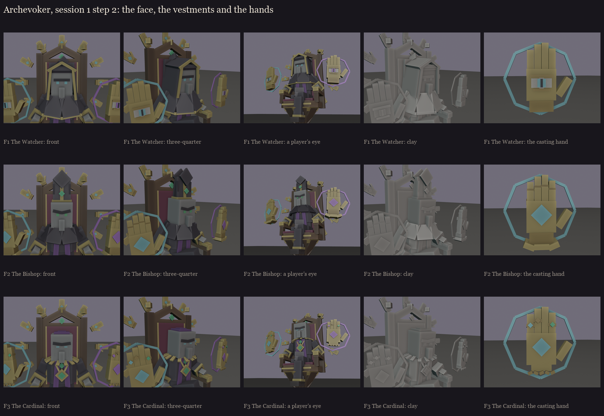

# The Archevoker, session 1 step 2: the face, the vestments and the hands

B take 2 was approved (2026-10-15, [../s1_take2](../s1_take2/README.md)). Three ways to dress the dark priest, each
with its own casting hands, built on the same seated body, throne and ring, so each is judged in its real frame.
Made by `python tools/art/bosses/archevoker_face.py` (body and throne from `archevoker_silhouettes.py`).

The head is vanilla's illager head at 2.5x in all three: the long face, the hanging nose and the unibrow. What
changes is what frames it, the eyes and the brow.

| | Vestments | Face | Casting hands |
|---|---|---|---|
| **F1** the Watcher | a deep hood, its opening a pointed arch edged in gold, its point folded back; a shoulder cape with an emerald clasp | vanilla's straight unibrow; the eyes **glow spirit cyan** in the hood's shadow | smooth gold with an **open eye in the palm**, its iris in the hand's glow (cyan or purple) and a slit pupil |
| **F2** the Bishop | a two-peaked **mitre** with a gold band, an orphrey and an emerald, lappets hanging behind; a short buttoned cape | the unibrow broken into a **scowl** (inner ends low); vanilla's **green eyes** | **plate gauntlets**: jointed fingers, a knuckle plate, a flared cuff; a sigil on the palm |
| **F3** the Cardinal | a purple **skullcap**; a heavy gold **chain of office** lying on the shoulders, an emerald medallion on the chest | a lighter scowl, sunken sockets, hollow cheeks, **narrow glowing slit eyes** | **jewelled**: rings with gems, dark nails, a chain bracelet; a sigil on the palm |

The ring's small hands would follow whichever casting-hand style is picked. Parts can be mixed (for example F1's
eye palms with F2's mitre).

**My pick: F1's hands with F2's head.**
- **The eye in the palm** is the strongest idea here. It is the "being looked at is the warning" rule from the boss
  overhaul: when a hand turns its palm to you, it is watching you, and its iris shows whose spells it casts.
- **The mitre and the scowl** read as a priest from the furthest away. The hood hides the illager's long head, and the
  skullcap barely shows above the throne's back.
- **The Cardinal's chain** risks echoing the Masquerade's ruff.

**Notes from the self-review:**
- The first hood was a straight-sided box and read as a doorway round his face. It now rises to a pointed arch and
  flares to the shoulders.
- The Cardinal's first thick brow over dark sockets read as sunglasses. The sockets are now darker skin, not black.
- His own hands on the armrests stay grey illager hands; rings or nails could echo the chosen casting hands.

Colours are blockout zones. Wrinkles, embroidery and the eye's shading are painted in session 5.
