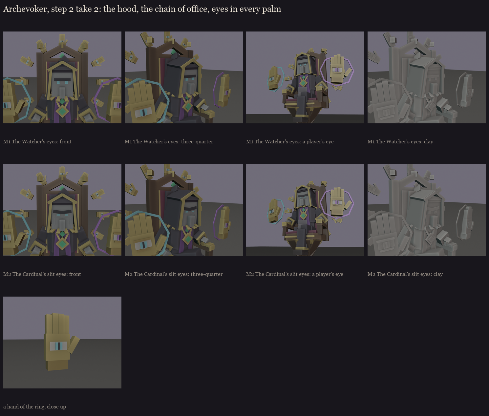

# The Archevoker, session 1 step 2, take 2: the user's mix

The user's mix (2026-10-15, after [../s1_face](../s1_face/README.md)):
- **F1's hood** (it reads as a dark priest), **without its shoulder cape**: the user didn't like that collar area.
- **F3's neck and gold chain of office**: the chain lying on the shoulders, the emerald medallion on the chest.
- **The eye in the palm** on the casting hands. The ring's small hands now carry it too: a small eye with a cyan iris
  and a slit pupil on each palm.

Made by `python tools/art/bosses/archevoker_face.py mix`. Two faces sit in the hood:

| | Face |
|---|---|
| **M1** the Watcher's eyes | vanilla's straight unibrow and square eyes, glowing spirit cyan |
| **M2** the Cardinal's slit eyes | a lighter scowl, sunken sockets, hollow cheeks, narrow glowing slits |

**My pick: M2.** In the hood's shadow the slits read as a stare, while M1's square eyes are closer to vanilla but
calmer. Either way the eyes are the face's one light, as the boss overhaul asks.

Next is step 3: the full blockout with the chosen face, from cuboids, in the three poses (resting, casting, arms
folded) and from every side.
