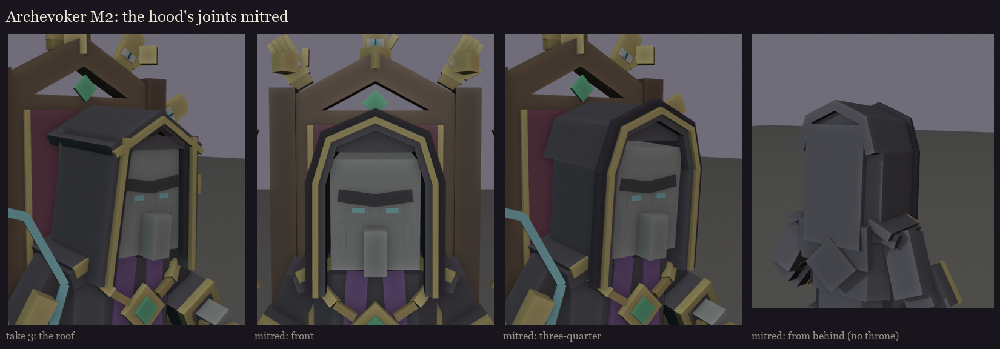

# The Archevoker, session 1 step 2, take 3: the hood redone, the neck and shoulders

The user (2026-10-15): make the hood look a little better and the connection with the neck and shoulders clearer
before the blockout; the face is **M2** (the light scowl, sunken sockets, glowing slit eyes). Made by
`python tools/art/bosses/archevoker_face.py hood`; `faces.png` has both faces from five sides.

**The hood:**
- **The opening:** its gold edge is half as thick, and a dark lining now shows between the edge and the face, so the
  opening has depth instead of reading as a frame.
- **The sides** drop past the jaw and turn out over each shoulder as a drape with a gold edge, so the hood visibly
  sits on the shoulders.
- **The back:** its corners are chamfered at 45 degrees, so it rounds off instead of ending in a box. The cloth falls
  on down the back and ends in a point between the shoulder blades. The upright tail flap of take 2 is gone.

**The neck and shoulders:**
- **The collar:** a standing cassock collar that the head sits in.
- **The shoulders:** they slope down from the collar to the arms, instead of the chest block's flat top.
- **The chain of office** lies over those slopes and hangs in a U down the chest to the medallion. It is one line
  of alternating gold links now, not plates standing round the neck.
- The small pendant from the first body is removed, so the medallion is the only emerald on his chest.

**Still open:**
- From the side the hood is a broad flat panel. Its folds go in the texture (session 5); rounding it further in
  geometry would cost a lot of cubes for little.

## The hood's joints fixed (2026-10-15)

The user: the hood looked like the roof of a house. A curved, many-segment take was tried and rejected (too many cubes;
take 3's shape was better), so take 3 is back with only its joints fixed:
- **What made the roof:** the two crown slabs crossed into a ridge at the top and overhung the side walls like eaves.
  The gold edge pieces crossed the same way.
- **The fix:** the opening is now one line: the wall past the jaw, a short chamfer round the head's corner, and the
  crown up to a soft peak (`HOOD_LINE`). Each slab is lengthened at a joint by exactly enough that the two outer faces
  meet in a clean mitre, with no gap and no overhang. The gold edge and the dark lining follow the same line.
- **Cost:** 307 cubes against take 3's 300. The chamfer is one slab more per side.
