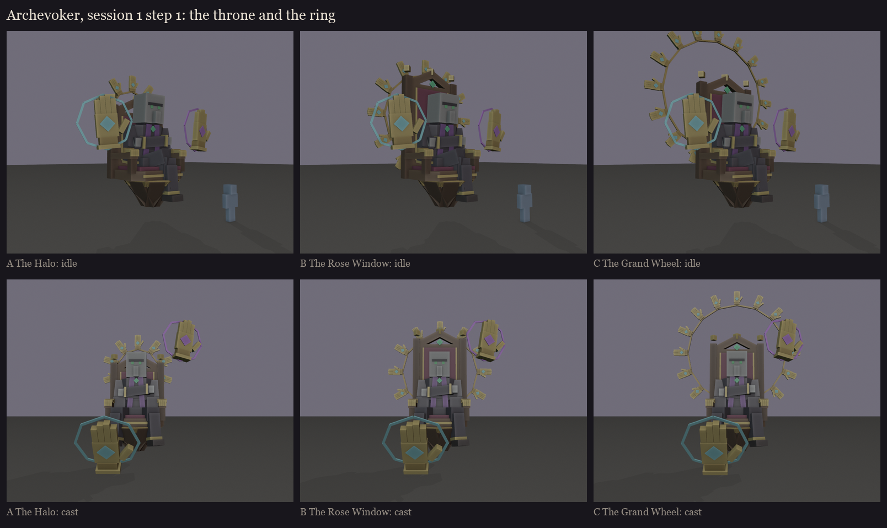

# The Archevoker, session 1 step 1: the throne and the ring against the priest

The direction is in [../plan.md](../plan.md). Made by `python tools/art/bosses/archevoker_silhouettes.py`; one sheet
per take (`A_the_halo.png`, `B_the_rose_window.png`, `C_the_grand_wheel.png`) shows each pose from the three-quarter,
the front, the side as a silhouette and a player's eye. The blue figure is a player.

**The same in all three:**
- **The priest:** vanilla's illager head at 2.5x, the black cassock with the gold trim, a purple stole down the front,
  an emerald pendant. His arms are folded across his belly in wide sleeves with gold cuffs.
- **The pose:** idle, his right knee is crossed over his left; casting, his legs are spread and he leans in.
- **The throne:** a carved dark-oak frame, a velvet seat and back, gold edging, finials and an emerald in the crest.
  It has no legs; below the seat it tapers to a point a block above the floor. The armrests end in small gilded hands
  gripping their ends.
- **The casting hands:** two large gilded hands held up palm out, fingers together and the thumb out (a stop sign),
  each with a sigil on the palm and a spell circle behind it, one cyan and one purple. Idle, they hover at his sides.
  Casting, the cyan hand swoops down in front to draw on the floor while the purple one rises.
- **The ring:** small gilded hands pointing outward from its centre, palms forward, joined at the wrists by a thin
  band. In game it is one bone that turns.

| | Back of the throne | Ring | Height (idle) | Reads as |
|---|---|---|---|---|
| **A** the Halo | at his head | 10 hands round his head | 7.6 blocks | a crown of hands; compact |
| **B** the Rose Window | tall and pointed | 12 hands round the whole back | 8.6 blocks | the throne framed like a stained-glass window |
| **C** the Grand Wheel | tall | 16 hands rising far above | 10.9 blocks | a great wheel behind him; the tallest and grandest |

**My pick: B.**
- **A** crowds his head: the ring's hands and the big casting hands sit at the same height and blur together.
- **C** is the most dramatic, but at almost 11 blocks the ring dwarfs him, and its small hands get lost at
  distance.
- **B** frames the whole throne, keeps the ring's hands clear of the casting hands, and lets the priest stay the
  centre.

**Notes from the self-review:**
- The arms were vanilla's folded block at first. At this size they read as two huge pauldrons and hid his chest, so
  they are now a seated pose in priest's sleeves.
- The glow round the casting hands was first a see-through plate, which read as a pane of glass. It is now a spell
  circle behind each hand.
- The casting hand draws well forward of him (about 5 blocks), so it never hides his body.
- From the side the ring is a thin line. It is meant to be seen from the front, behind him.

Colours here are blockout zones, not the palette. The face, the vestments' detail and the hands are designed in
step 2.
