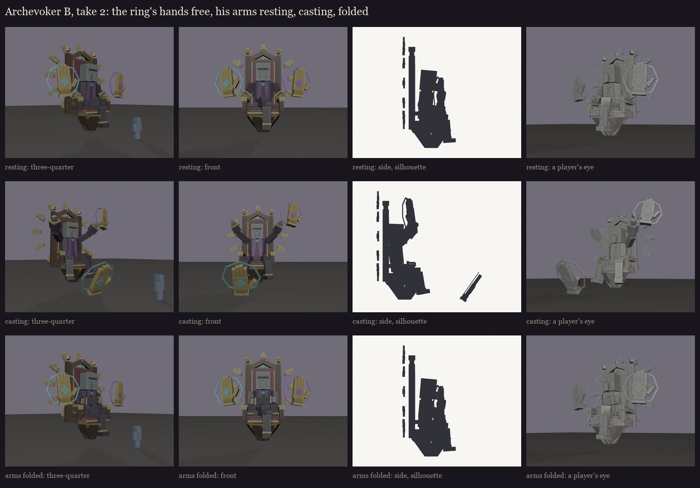

# The Archevoker, session 1 step 1, take 2: B with free hands and his own arms

The user picked **B, the Rose Window** (2026-10-15), liked the throne, and found the seated postures good. Made by
`python tools/art/bosses/archevoker_silhouettes.py take2`.

The user's changes:
- **The ring's hands float free:** the band joining their wrists is gone. They still turn together as one ring (one
  bone in game).
- **His arms move:**
  - **Resting** (idle): his forearms lie along the armrests, his hands just behind the armrests' gilded hands.
  - **Casting:** both arms raised forward, palms out, echoing the stop-sign hands.
  - **Arms folded:** sometimes, across his belly in the wide sleeves.
- **The legs:** crossed at the knee when resting or folded, spread when casting (unchanged).

Each arm is a wide priest's sleeve: the bell round the forearm, a gold cuff, the grey hand past it. The hands and the
face are still blockout blocks; they are designed in step 2 (the face, the vestments and the hands).
