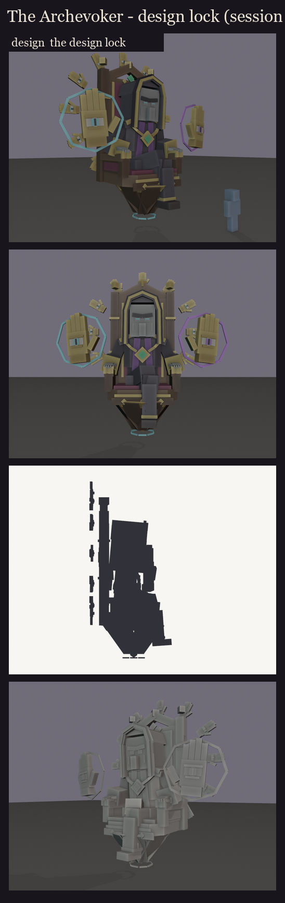
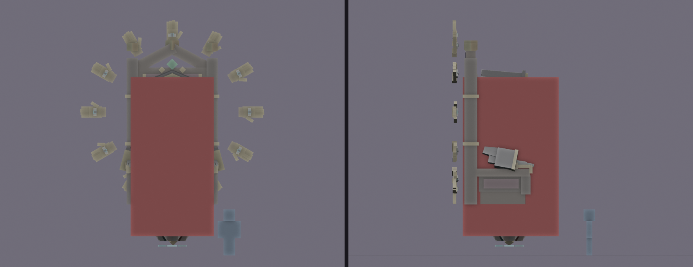
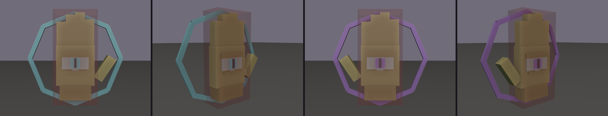
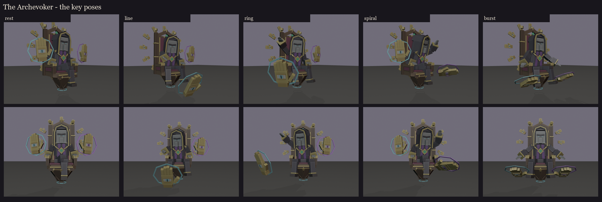
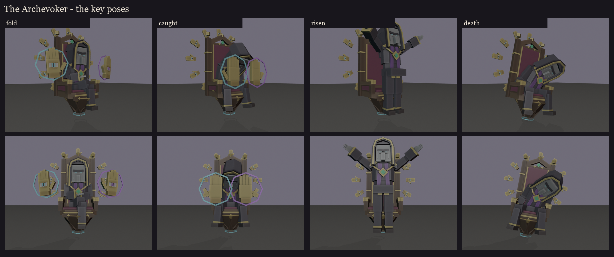

# The Archevoker, session 2: design lock

The approved blockout ([../s1_blockout](../s1_blockout/README.md)) is rebuilt as a rig at its final size, and every
cube is snapped to whole texels. Made by `python tools/art/bosses/archevoker_s2.py` (after the session 1 scripts).

## Two models

- **`occultech_archevoker`:** the priest on his throne, with the ring. 309 cubes on 18 bones with geometry, so about
  18 displays. It is 7.2 x 8.9 x 4.2 blocks, the ring's top hand being the highest point.
- **`occultech_archevoker_hand_cyan`** and **`_purple`:** the casting hands, his totems. In the fight each is its own
  carrier with its own hitbox and health. They are 21 cubes on 3 bones each. The cyan is a right hand and the purple a
  left, so each thumb points towards him.

Full lists: [parts.md](parts.md).

## Bones (BetterModel names)

**The priest's model:**
- `base`: everything. Its pivot is on the ground under the throne, so it carries the float, the list and the sinking
  at death.
- `throne`: the seat, back, armrests (with their gilded hands), the decoration and the tapering base.
  - `ring`: the twelve small hands, one bone, so it turns as one and costs one display.
    - `glow_ring`: their irises.
  - `glow_runes`: the rune ring under the point.
- `body`: the hips and the lap.
  - `thigh_*`, then `shin_*`: these cross at the knee, spread, or straighten to stand.
  - `torso`: the chest, stole, collar, shoulders, the chain of office and the hood's fall down the back.
    - `hi_head`: the head in its hood. It follows the carrier's look.
      - `glow_eyes`: the slit eyes.
    - `arm_*`, then `forearm_*`, then `hand_*`: his own grey hands. The arms hang straight in the bind pose; each pose
      aims the arm, aims the forearm, and rolls the hand until its palm faces the right way.

**Each casting hand:**
- `hand`: the gold, the eye's white and the lids.
- `glow_eye`: the iris.
- `glow_circle`: the spell circle.

## Hitboxes

- **The priest:** one `ob_hitbox`, 3.25 x 6.25 x 3.75 blocks. It covers the priest and the throne's seat and back,
  from just above the floating point to the top of his hood. The ring, the runes and the crest's finials stay outside
  it, so nothing decorative is a target.
- **Each casting hand:** 1.1 x 2.4 x 0.6 blocks, round the palm and fingers. The spell circle is outside it.

## Key poses

The fight's moments, posed from the rig, as silhouettes for the design; not animation. In game, each casting hand is
placed by its own carrier.

| Pose | Moment | What he does |
|---|---|---|
| rest | idle | forearms on the armrests, legs crossed, the hands hovering at his sides |
| line | the line pattern | his right arm thrust out; the cyan hand presses the line into the floor ahead |
| ring | the ring pattern | his right arm sweeps overhead; the cyan hand circles out at the target |
| spiral | the spiral pattern | his left wrist twirls; the purple hand turns out from beside him |
| burst | the fang burst | arms flung down; both hands slam palm-down on the floor beside him |
| fold | waiting | arms folded, legs crossed |
| caught | cheating death | slumped forward; the two hands hold him up, palms against his chest |
| risen | both hands dead | he rises off the throne and stands in the air before it, arms spread: from now on he casts himself |
| death | death | he slumps sideways; the throne lists and sinks |

**Notes:**
- **The hood's slabs** round up when snapped, so their mitred joints overlap a hair instead of opening.
- **No two faces share a plane:** the flicker resolver nudges the smaller part of each clash a fraction of a texel.
  The nudges are found once in the rest pose and kept for every pose.
- **His fingers** are blockout fingers. The palms read the right way (down on the armrests, out when casting), and
  the hands get their shape in the UV and paint sessions.

**Fix (2026-10-15, after the session 6 review):** in the rig, a positive pitch on the torso or the head leans him
*back* and tilts his face *up*. The poses meant to lean forward (line, caught, death) had it the wrong way round, and
in "caught" his head went through the throne's back. Every pose's pitch now follows the rule written in `POSES`
(negative = forward and down). The casting poses lean a little further forward, so the hood's back stays off the
throne in every pose; the deepest it reaches is the rest pose's. Sessions 2 to 6 were regenerated.
