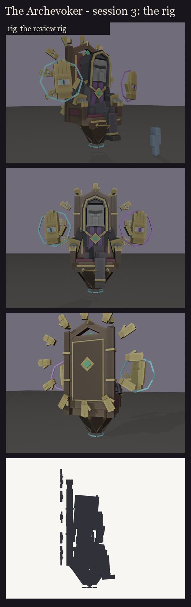

# The Archevoker, session 3: rig and pose test

The approved design lock ([../s2_design](../s2_design/README.md)) made ready to move and to see in game. Made by
`python tools/art/bosses/archevoker_s3.py` (on top of `archevoker_s2.py`). The look is session 2's, unchanged.



## Drawing cost ([rig_report.json](rig_report.json))

BetterModel draws each bone as one display entity. A bone needs one more for every different cube turn it can't keep
inside its item model (anything but a single 0, 22.5 or 45-degree turn).

- **The priest:** 307 cubes on 18 bones, **95 displays**. Two free savings brought that down from 111:
  - **Quarter turns:** a cube turned by any multiple of 22.5 degrees is now stored as a 0, 22.5 or 45-degree turn with
    its sides swapped. It is the same box.
  - **The rune ring and the irises:** the rune ring has eight bars (45 degrees apart) instead of ten, so it is one
    display. The small hands' square irises lost their turn, which they never needed, so all twelve are one display.
- **Where the rest go:**

  | Bone | Displays | Why |
  |---|---|---|
  | `ring` | 21 | twelve hands 30 degrees apart, so most of their cubes are turned |
  | `hi_head` | 21 | the hood's mitred slabs |
  | `throne` | 20 | the tapering base's tilted panels |
  | `torso` | 17 | the chain's links, the shoulders, the drapes |
  | every other bone | 1 or 2 | |

- **For the M6 performance pass** (all bosses together, once every boss is designed): a ring of **16** hands (22.5
  degrees apart) or **8** (45 apart) would make the ring a single display, instead of 21.
- **Each casting hand:** 21 cubes on 3 bones, 4 displays.

## Rig checks

- **No flicker:** no two faces share a plane on either model, 0 pairs. The casting hand had 4; the resolver now runs
  on it too.
- **Pivots** ([pivots.md](pivots.md)):
  - every moving bone turns in its joint: the throne, the body and the torso at the hips, the head at the neck, each
    thigh at the hip, shin at the knee, upper arm at the shoulder, forearm at the elbow and hand at the wrist.
  - Four are flagged on purpose: `ring` and `glow_ring` turn about the ring's centre, which is empty space behind the
    throne. `glow_runes` and `glow_eyes` never turn on their own; they ride on their parents.
- **BetterModel tags:** only the intended bones carry one: `hi_head`; the `glow_` bones (eyes, ring, runes, and the
  hand's eye and circle); and `ob_hitbox`.
- **Load test:** on the second test server, BetterModel built every bone of all three review models: 18 for the
  priest, 3 for each hand. The review models were then taken off that server again.
  - **The stop:** the console didn't take the `stop` command, so the idle server (no players, nothing changed) was
    ended from outside.
  - **Before its next pack build**, the second server's `build.zip` still holds the review models until BetterModel
    rebuilds it at the next start.

## In game

The review models have flat material colours and no texture yet. The eyes, the runes, the irises and the spell
circles are full-bright. They are in `run/plugins/BetterModel/models` (your server on port 25565), aren't shipped,
and hold each key pose as an animation:

```
/bm reload
/bm test occultech_archevoker_rig rest
/bm test occultech_archevoker_rig line
/bm test occultech_archevoker_rig ring
/bm test occultech_archevoker_rig spiral
/bm test occultech_archevoker_rig burst
/bm test occultech_archevoker_rig fold
/bm test occultech_archevoker_rig caught
/bm test occultech_archevoker_rig risen
/bm test occultech_archevoker_rig death
/bm spawn occultech_archevoker_hand_cyan_rig
```

- **Position keys:** in `risen` the whole priest lifts off the seat and steps forward, and in `death` the whole
  model sinks as it lists.
- **The casting hands** aren't in the priest's poses, because in the fight each hand is its own model on its own
  carrier. Spawn the hand models next to him to judge them together.
- **The pack:** your client needs BetterModel's pack (`run/plugins/BetterModel/build.zip`) next to the Occultech pack
  to see them.
