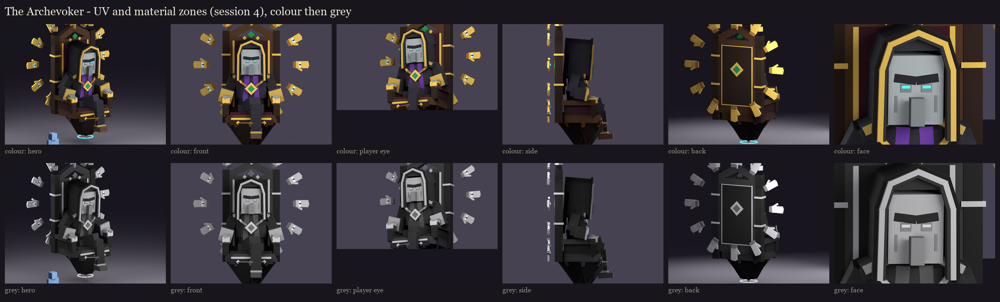
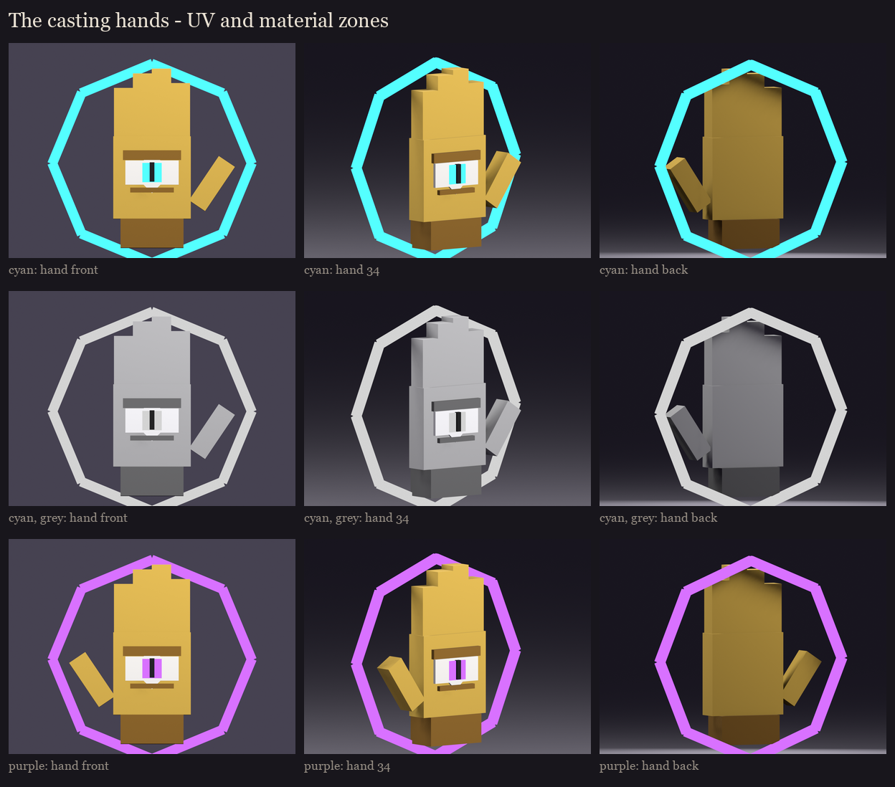

# The Archevoker, session 4: UV and material blocking

Every visible face of the session 3 rig (session 2's geometry) is mapped at one texel per model unit (16 per block,
the vanilla density), each face a flat colour of its material zone. Made by `python tools/art/bosses/archevoker_s4.py`
(after `archevoker_s3.py`).



## Atlases ([uv_report.json](uv_report.json))

- **The priest: 512 x 256.** 960 islands, 1,787 faces drawn, 67% filled, each island with a 1-pixel border against
  seams. He is about 7 blocks across at the vanilla density, so a 256-wide atlas wouldn't hold him.
- **Each casting hand: 64 x 128.** 119 islands. It is its own model, so it has its own atlas.
- **Shared space:**
  - A left part uses its right twin's islands: the arms, the legs, the throne's sides, posts, capitals and leaves, and
    the armrests' gilded hands.
  - The ring's twelve small hands share one hand's islands, since they are alike.
  - Everything else (the face, the hood, the chain, the throne's back) has its own.
- **Buried faces:** 55 faces on the priest and 7 on each hand lie inside another cube of the same bone. They are
  left out, so they are never drawn.

## Material zones

| Zone | Colour | Where |
|---|---|---|
| robe, robe_dark | 46, 44, 52 / 20, 18, 24 | the evoker's black robe, the hood, the sleeves; the collar |
| hood_in | 12, 10, 16 | the hood's dark lining |
| trim | 192, 160, 74 | the gold trim: the hood's edge, the cuffs, the hem, the stole's tips |
| stole | 104, 58, 150 | the violet stole (tier 1) |
| skin, nose, brow | 150, 156, 156 / 116, 122, 122 / 32, 32, 38 | vanilla's evoker grey, the nose a step darker, the black brow and sockets |
| shoe | 96, 76, 60 | his shoes |
| gold, gold_dark | 220, 184, 86 / 150, 112, 46 | the gilded hands, the chain, the finials, the capitals, the leaves; the cuffs and the frame's shade |
| emerald | 28, 150, 84 | the crest, the back, the medallion |
| oak, oak_dark | 82, 56, 34 / 46, 31, 21 | the woodland mansion's dark oak |
| velvet | 58, 18, 34 | the seat, the back's panel, the side inlays |
| white | 248, 246, 240 | the eye in each palm |
| cyan, purple | 80, 220, 250 / 186, 104, 255 | the magic (full-bright): his slit eyes, the runes, the irises, the spell circles |

**The value check:** every pair of neighbouring zones is at least 12 apart in lightness, so he reads in grey too. The
first pass found seven pairs too close, all fixed:

| Pair | Fix |
|---|---|
| robe / robe_dark | the collar went darker and the robe a little lighter |
| robe / shoe | the shoes became brown leather |
| skin / nose | the nose a step darker |
| gold / emerald | a deeper emerald |
| white / cyan (the eye) | a slightly deeper spirit cyan |
| oak / oak_dark | a darker shade |
| oak / velvet | a darker wine |



## Left for painting (session 5)

- **The casting hands' fingers:** at whole texels the four fingers touch. Their gaps and knuckles are painted, as are
  the eye's lids and lashes.
- **The robe:** folds, the hood's folds down its long flat sides, and the gold embroidery along the trim, the stole
  and the cuffs.
- **The face:** the illager's skin, the brow, the sockets and the hollow cheeks.
- **The throne:** carving and grain on the dark oak, tufting on the velvet, and the gold leaf's shine.
- **The magic:** the glows as gradients, never flat (STYLE.md): the runes, the irises and the spell circles' sigils.

## In game

The review models (flat zones, the nine poses) replace session 3's in `run/plugins/BetterModel/models`:
`occultech_archevoker_rig`, `occultech_archevoker_hand_cyan_rig`, `occultech_archevoker_hand_purple_rig`. This is the
first look at the pixel size in game:

```
/bm reload
/bm test occultech_archevoker_rig rest
/bm spawn occultech_archevoker_hand_cyan_rig
```
