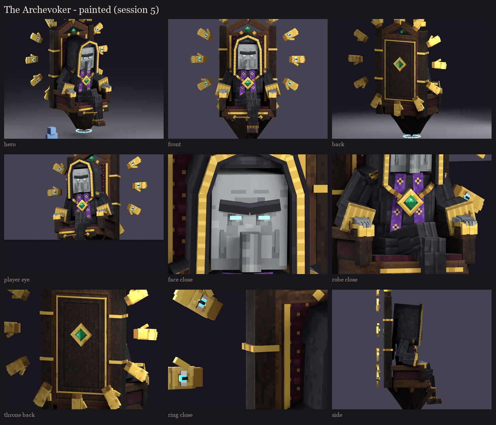
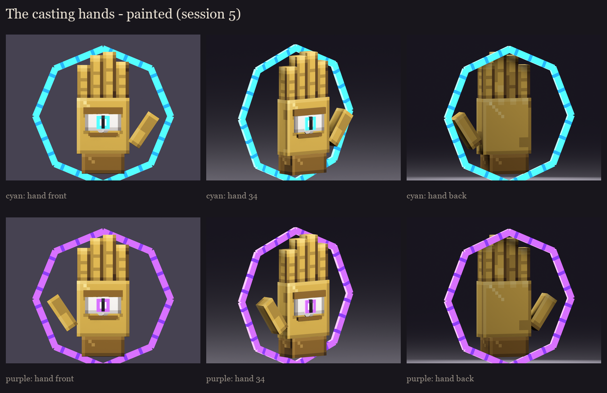

# The Archevoker, session 5: texture painting

Session 4's layouts painted, with the same islands: the priest's 512 x 256 atlas and each casting hand's 64 x 128.
Made by `python tools/art/bosses/archevoker_s5.py` (after `archevoker_s4.py`). Every ramp runs from a cool dark
through the zone's colour to a warm light. The painting carries form only, with no painted light direction: crease
shading (ambient occlusion) is baked from the real geometry.



**The priest:**
- **The robe:** the evoker's black wool. Folds run down each panel's length, a dark crease with a lit ridge beside
  it, unevenly spaced. Upper edges catch light and lower ones fall in shade. The hood's long sides fold the same way.
- **The gold trim:** an embroidered braid, with a dark border at each edge and a bright stitch every third texel.
- **The stole:** violet velvet with lighter edges and a small gold sigil (a diamond with a dot) every seven texels
  down its length.
- **The face:** vanilla's even evoker grey with a few soft flecks.
  - two creases across the forehead and a shadow under the scowl;
  - the sunken sockets, with tired shadow under them;
  - the cheeks hollowing as they go down, and the chin a step darker.
  - **The nose:** a lit ridge and its tip, with dark nostrils underneath.
- **The slit eyes:** spirit cyan. Thin glows keep their colour instead of burning white.

**The throne:**
- **The dark oak:** grain along each board's length. The big faces (the back, the seat, the panels) carry a carved
  panel sunk inside a lit bevel.
- **The velvet:** tufted. Gold buttons on a diamond grid, creases pulled between them and puffed cushion in between.
- **The gold:** polished, a lit border round each plate and a smooth field inside it. The chain's links alternate
  bright and dark.
- **The emeralds:** cut, with a lit half and a dark half across the diagonal and a glint.
- **The runes:** brightest in the middle, with glyph marks along each bar.



**The hands (the casting hands, the ring's and the armrests'):**
- **The fingers** are parted by dark gaps, so the four fingers no longer read as a mitten. Each has two knuckle
  creases and a lighter tip.
- **The palm** has two creases. **The back** has a row of knuckles.
- **The eye:** a white with shaded corners, under gold lids, with the glowing iris and its slit pupil.
- **The spell circle** carries glyph marks along its bars.

**Self-review fixes along the way:**
- **Too noisy:** the first pass speckled every surface, and gold looked like sponge from a distance (STYLE.md:
  "clusters, not noise"). The skin, gold, velvet and robe are now far calmer.
- **The braid** first read as a checkerboard; it is now a quieter repeat.
- **The face:** the skin's blotches became soft flecks, so it reads like vanilla's evoker.
- **The slit eyes** first burned white. Thin glows now keep their cyan.

## In game

The painted review models replace session 4's in `run/plugins/BetterModel/models`, with the nine poses:

```
/bm reload
/bm test occultech_archevoker_rig rest
/bm spawn occultech_archevoker_hand_cyan_rig
/bm spawn occultech_archevoker_hand_purple_rig
```

To check at 10 blocks: the hands' gold against the black robe, the hood's edge, the eyes in the hood's shadow, and the
ring's small eyes.
