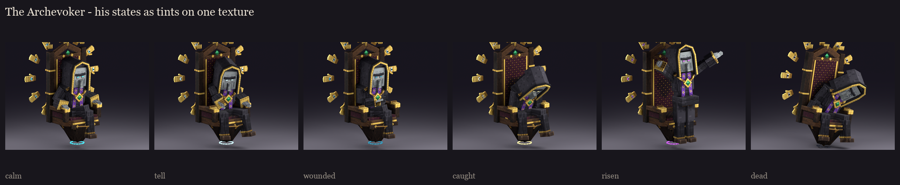
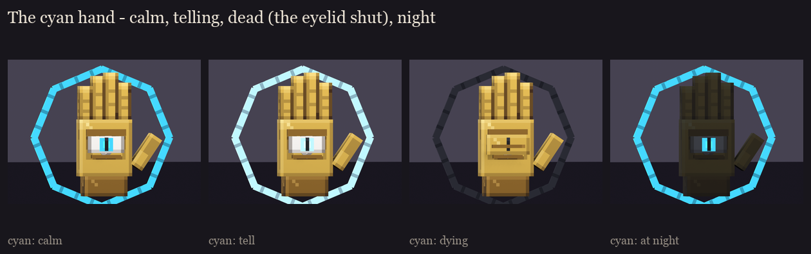
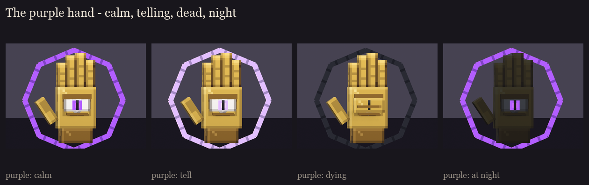
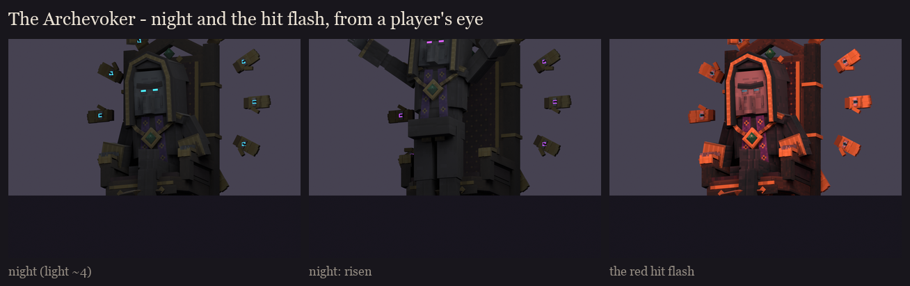

# The Archevoker, session 6: variants and readability

His states are BetterModel per-bone tints: a colour multiplied into the texture, with no texture swap. The glows (his
eyes, the ring's irises, the runes, each hand's eye and spell circle) are now painted as a neutral white gradient,
session 5's ramps without their hue, so one texture takes every state's colour. Made by
`python tools/art/bosses/archevoker_s6.py` (after `archevoker_s5.py`).

## The priest (`glow_eyes`, `glow_ring`, `glow_runes`)

| State | Tint | When |
|---|---|---|
| calm | 80, 220, 250 | spirit cyan: both hands alive |
| tell | 200, 250, 255 | flaring, the moment a pattern or the burst is cast |
| wounded | 54, 150, 176 | one hand dead: the ring, the runes and his eyes dim together |
| caught | 255, 232, 160 | cheating death: a gold-white flash while the hands hold him up |
| risen | 206, 96, 255 | both hands dead: he burns violet, casting for himself |
| dead | 46, 48, 56 | out |

The ring shows how many hands live: it is bright cyan with both, dims with one, and turns violet when he has risen.
Players read his state from his body, as the boss overhaul asks.

## The casting hands (`glow_eye`, `glow_circle`)

| State | Cyan hand | Purple hand | When |
|---|---|---|---|
| calm | 80, 220, 250 | 186, 104, 255 | alive, hovering |
| tell | 200, 250, 255 | 232, 196, 255 | drawing its pattern on the floor (its vulnerable window) |
| dying | 52, 52, 60 | 52, 52, 60 | killed: the light goes out |

**One part swap:** each hand has an `eyelid` bone, hidden until the hand dies. It then shuts over the eye: a gold lid
with a crease across it, under the dead circle.

## Readability

- **At night** (light level about 4, everything but the full-bright parts dimmed): his slit eyes, the ring's eyes and
  the runes still mark him out, and the hood's gold edge stays readable as a shape. Risen, the violet eyes read just
  as well.
- **Under the red hit flash:** the gold, the face and the robe keep their shapes and the eyes stay visible. Nothing
  turns into one red mass.

## In game

The review models with the neutral glows are in `run/plugins/BetterModel/models`, replacing session 5's. Untinted,
the glows show white; the fight tints them in session 8. The hand's `eyelid` starts hidden.

**Fix after review (2026-10-15):** "caught" had his head clipping through the throne's back (a pitch sign error in the
rig's poses, also in line and death). He now slumps forward into the two hands holding him; see
[../s2_design](../s2_design/README.md). Sessions 2 to 6 and the review models on your server were regenerated.
