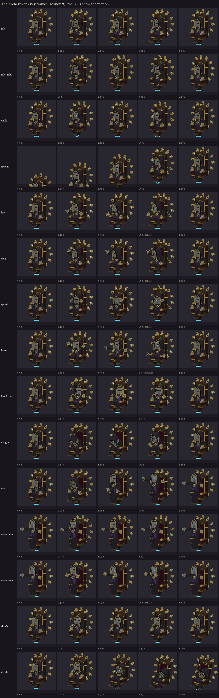
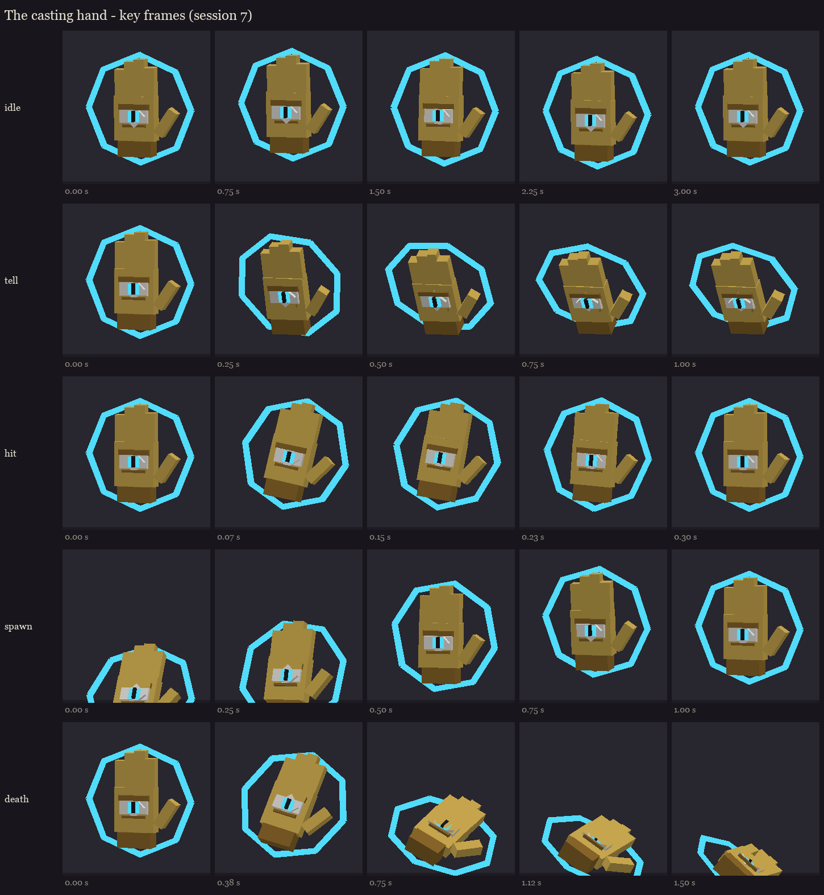

# The Archevoker, session 7: animation

Fifteen clips on the priest and five on each casting hand, on the session 6 rigs (the painted atlases with the
neutral glows that the state tints colour). Made by `python tools/art/bosses/archevoker_s7.py` (after
`archevoker_s6.py`).

**How the clips are built:**
- **Whole poses:** each clip is a few whole poses at key times, built with session 2's pose code. The keyframes are
  each bone's turn away from rest, plus three position keys: the priest rising off the seat, the whole model sinking,
  and the throne's bob.
- **The ring** turns as one bone: a full circle every 8 s at rest, faster while he casts, spinning up as he arrives.
- **No travel:** the throne glides with the carrier, so no clip moves him over the ground and nothing doubles up.



## The priest

| Clip | Length | Plays | What it does | Timed to |
|---|---|---|---|---|
| `idle` | 8.0 s | loop | Breathing, a slow look round. At 3.5 s he uncrosses his legs, at 7 s he crosses them again. | - |
| `idle_fold` | 4.0 s | once | Now and then while he waits: he folds his arms, holds, and unfolds them (a gesture, so it ends by itself). | - |
| `walk` | 2.0 s | loop | Gliding: the throne bobs and dips forward. | his movement |
| `spawn` | 2.6 s | once | He rises out of the circle, the ring spinning up. | the summon |
| `line` | 1.6 s | once | His right arm lifts and thrusts. **Contact at 1.0 s.** | the pattern's 20-tick warning |
| `ring` | 1.6 s | once | An overhead sweep. **Contact at 1.0 s.** | the same |
| `spiral` | 1.6 s | once | His left wrist twirls. **Contact at 1.0 s.** | the same |
| `burst` | 1.2 s | once | Both arms rise, then fling down. **Contact at 0.75 s.** | the burst's warning (15 ticks in session 8) |
| `hand_lost` | 1.0 s | once | He recoils and turns towards the hand that died. | a casting hand's death |
| `caught` | 2.6 s | once | He slumps forward into the hands (by 0.5 s), hangs, and pushes himself back up. | cheating death |
| `rise` | 2.0 s | hold | He pushes up off the throne and stands in the air before it, arms spreading. | both hands dead |
| `risen_idle` | 3.0 s | loop | Standing, breathing, arms half spread. It replaces `idle` once he has risen. | - |
| `risen_cast` | 1.6 s | once | Both arms gather, then thrust out. **Contact at 1.0 s.** | his patterns once risen |
| `flinch` | 0.4 s | once | A jolt of the head. | a hit |
| `death` | 3.0 s | hold | A gasp, then he slumps sideways as the throne lists and sinks. | death |

**Overrides:** `idle_fold`, `line`, `ring`, `spiral`, `burst`, `hand_lost`, `caught`, `rise`, `risen_cast` and `flinch` override
the loops while they play.

## The casting hands



| Clip | Length | Plays | What it does |
|---|---|---|---|
| `idle` | 3.0 s | loop | Bobbing, the spell circle turning (it now turns about its own middle). |
| `tell` | 1.0 s | hold | It presses forward and the circle spins fast: drawing its pattern, its vulnerable window. |
| `hit` | 0.3 s | once | A jolt. |
| `spawn` | 1.0 s | once | It rises into place. |
| `death` | 1.5 s | hold | It sags and drops. Session 8 shows the `eyelid` as it starts and tints it out. |

The preview GIFs are in `gifs/` (`hand_*` for the hands).

## What session 8 adds (the code and Mythic)

- **The hands mechanic:**
  - the two hands as their own killable carriers, hard to kill and evasive;
  - they swoop low and play `tell` while drawing;
  - revival while one lives (`caught`), and `rise` once both are dead;
  - no vexes.
- **The tints** from session 6, on every state change.
- **The fight fixes** from the plan: cast priority, the 15-tick burst, the revival saved apart from health.

## In game

The animated review models are in `run/plugins/BetterModel/models` on your server:

```
/bm reload
/bm test occultech_archevoker_rig idle
/bm test occultech_archevoker_hand_cyan_rig tell
```

- **His other clips:** `idle_fold`, `walk`, `spawn`, `line`, `ring`, `spiral`, `burst`, `hand_lost`, `caught`, `rise`,
  `risen_idle`, `risen_cast`, `flinch`, `death`.
- **The hand's:** `idle`, `tell`, `hit`, `spawn`, `death`.
- **The glows** show white until session 8 tints them in a fight.
- **Not load-tested on the second server** this time: the clip format is the one the earlier bosses shipped with.
