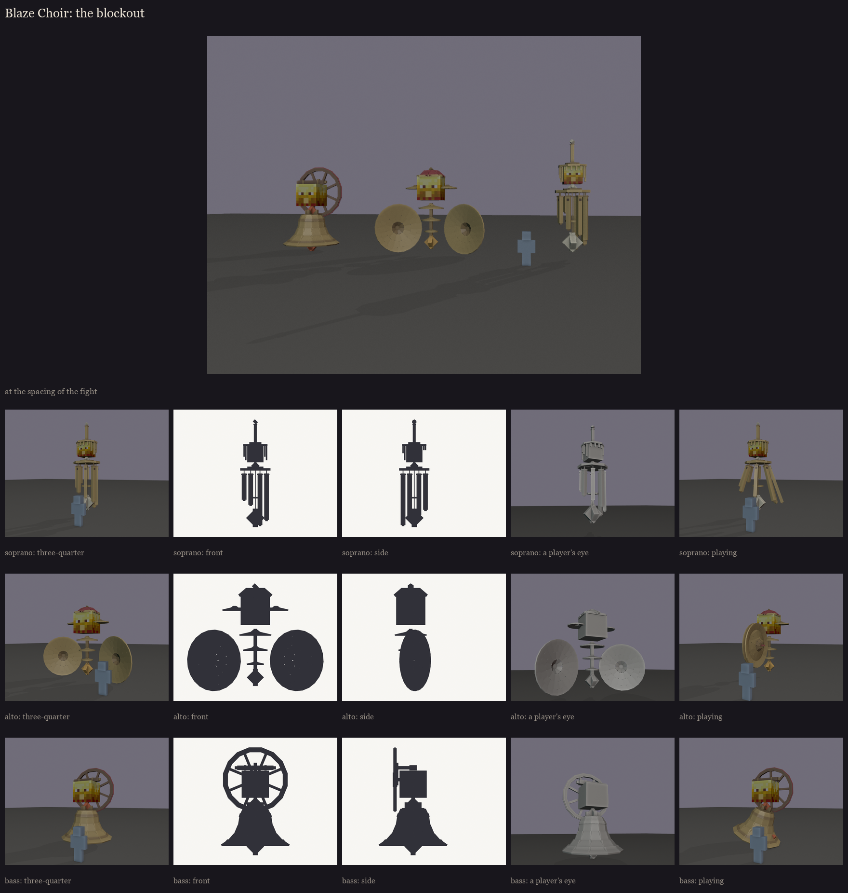

# The Blaze Choir, session 1 step 3: the full blockout

Made by `python tools/art/bosses/choir_blockout.py <folder holding assets/ from the 26.2 client>`.

Each singer has vanilla's blaze head with the singing mouth. Colours are blockout zones, not the palette.

| Singer | Body | Head | Playing | Size (blocks: wide, tall) |
|---|---|---|---|---|
| Soprano | a wind chime of eight hanging organ pipes, a striker, a white-fire sail | Chime Fringe with a spire | the pipes swing out | 1.9, 6.7 |
| Alto | two great cymbals round a tower of small ones | a cantor's cap and Finger Cymbals | the cymbals clash in front | 7.0, 5.6 |
| Bass | the Great Bell, the fire its clapper | the Bell Wheel and yoke, the bell rope in its rim | the bell swings, the wheel rocks | 3.8, 6.0 |
