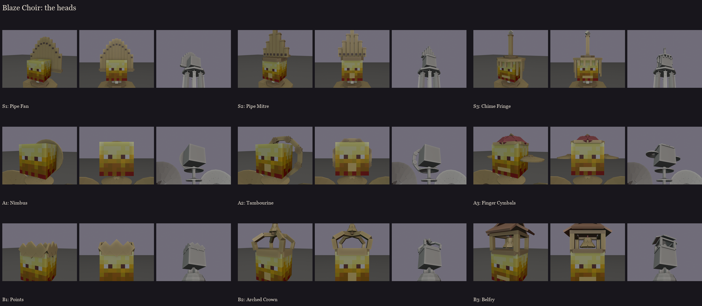

# The Blaze Choir, session 1 step 2: the heads

Made by `python tools/art/bosses/choir_heads.py <folder holding assets/ from the 26.2 client>`. The Great Bell was picked
as the Bass in step 1.

Each head is vanilla's blaze head with its real pixels. Each option shows three-quarter, front, and a player's view from
the floor. Headpieces and mouths can be mixed.

| Singer | 1 (vanilla face) | 2 (a singing mouth) | 3 (a humming slit) |
|---|---|---|---|
| Soprano | S1 Pipe Fan | S2 Pipe Mitre | S3 Chime Fringe |
| Alto | A1 Nimbus | A2 Tambourine | A3 Finger Cymbals |
| Bass | B1 Points | B2 Arched Crown | B3 Belfry |
