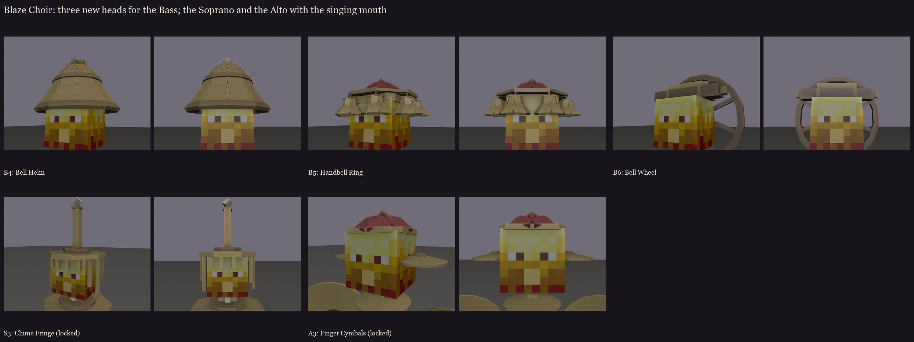

# The Blaze Choir, session 1 step 2, round 2: the Bass's head

Made by `python tools/art/bosses/choir_heads2.py <folder holding assets/ from the 26.2 client>`.

Picked from [round 1](../s1_heads/README.md): S3 Chime Fringe, A3 Finger Cymbals and the singing mouth on all three.
None of the Bass's first three was picked, so these are three more: B4 Bell Helm, B5 Handbell Ring, B6 Bell Wheel.
