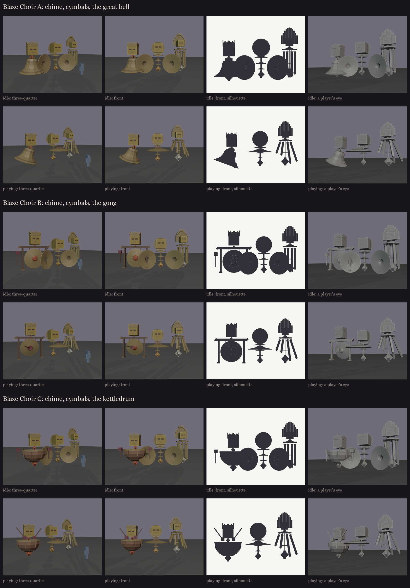

# The Blaze Choir, session 1 step 1: three takes on the trio

Made by `python tools/art/bosses/choir_silhouettes.py [A B C]`. The brief is in [the plan](../plan.md).

The Soprano (a wind chime of organ pipes) and the Alto (cymbals) are the same in all three. The takes differ in the Bass:

- **A, the Great Bell:** a church bell, the fire its clapper.
- **B, the Gong:** a great gong hung in a frame, with a padded mallet.
- **C, the Kettledrum:** a wide copper bowl and two mallets.

The singers stand close together here to fit the picture. In the fight they are about 8.6 blocks apart.
Colours are blockout zones, not the palette.
