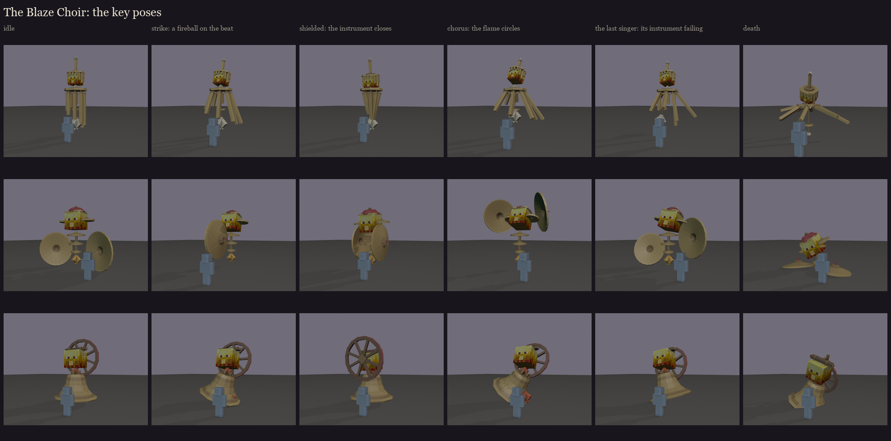

# The Blaze Choir, session 2: design lock

Made by `python tools/art/bosses/choir_s2.py <folder holding assets/ from the 26.2 client>`.

## Three models

| Model | Cubes | Hitbox (blocks) |
|---|---|---|
| `occultech_blaze_choir_soprano` | 88 | 1.5 x 5 x 1.5, the head and pipes, not the spire |
| `occultech_blaze_choir_alto` | 465 | 7.25 x 4.9 x 1.5, the head, tower and the resting cymbals |
| `occultech_blaze_choir_bass` | 150 | 3.25 x 4.4 x 3.25, the head and bell, not the wheel |

Bone by bone: [parts.md](parts.md). Sizes: [stats.json](stats.json). Blockout rigs: `design/`.

## Key poses

| Pose | Soprano | Alto | Bass |
|---|---|---|---|
| strike | the pipes swing out | the great cymbals clash in front | the bell swings, the wheel rocks |
| shielded | the pipes draw in to a cage | the cymbals close round the tower | the wheel comes over the face like a grille |
| chorus | the pipes flare, the sail rises | the cymbals are thrown high | the bell's full swing |
| last | the pipes flail unevenly | one cymbal hangs, broken loose | the bell lurches, the wheel slips |
| death | the pipes splay and it sinks | the cymbals fall flat, the tower sinks | the bell drops, the wheel falls behind |

## Decisions

- **Whole texels** on every cube. The head's texel tiles are preview only: the model has one painted cube and a separate
  `glow_mouth`.
- **The Alto's temple cymbals stay flat,** as picked.
- **The fight's hover height drops** from 2.5 blocks to about 1, in session 8, so the singers stay within reach. Idle and
  the attacks sit near the model's floor line, so at that height they clear the ground.
- **The Alto's great cymbals are its cube cost** (465), left for the performance pass after every boss is designed.

## Checked

Measured against the model's floor line (the carrier's feet): the Bass's swinging lip dips 3.6 units below it in the chorus, which the 1-block hover clears. Only the deaths go lower (to about 15 below), on purpose.
