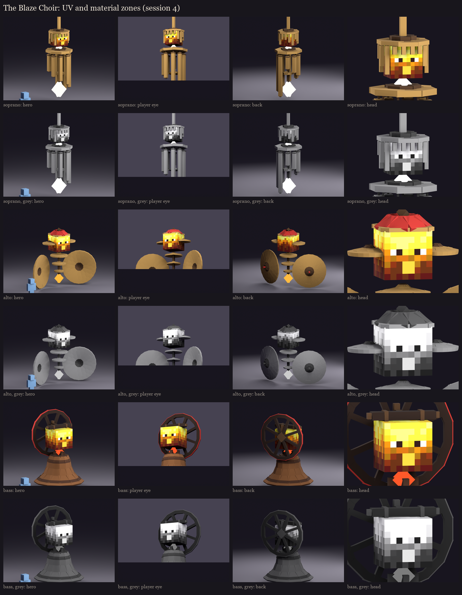

# The Blaze Choir, session 4: UV and material zones

Made by `python tools/art/bosses/choir_s4.py <folder holding assets/ from the 26.2 client>`.

| Model | Atlas | Islands | Faces drawn |
|---|---|---|---|
| `occultech_blaze_choir_soprano_rig` | 512 x 128 | 521 | 521 |
| `occultech_blaze_choir_alto_rig` | 512 x 128 | 2020 | 2786 |
| `occultech_blaze_choir_bass_rig` | 512 x 256 | 905 | 917 |

All three review models, with the session 3 poses, are in `run/plugins/BetterModel/models`.

## Zones

- **The Soprano and the Alto:** dull, heat-stained brass, with dark brass for bands, caps and the cymbal domes.
- **The Bass's bell:** darker bell bronze, so the heaviest singer reads apart from the two brass ones. Its wheel is
  near-black oak, and the yoke straps are dark brass.
- **The accent:** one red, for the bell rope, the Alto's cap and its tassels.
- **Glow:** white fire for the Soprano, orange for the Alto, deep red for the Bass, and the warm singing mouths.
- **The heads** carry vanilla's blaze skin already, each skin texel a whole block of pixels (2 for the Soprano, 3 for the
  others), so one pixel per unit holds.

Value check: every pair of neighbouring zones is at least 12 L* apart. The first pass failed it: the wood, the dark brass
and the red were within 2 to 10 of each other, so the brass and the wood were spread apart and the red made brighter.

## For session 5

Heat staining and tarnish on the brass, the hammered dimples and tone rings of the cymbals, the bell's raised bands and
lip, oak grain and iron straps on the wheel, the twist of the rope, and the inside of every pipe mouth.
