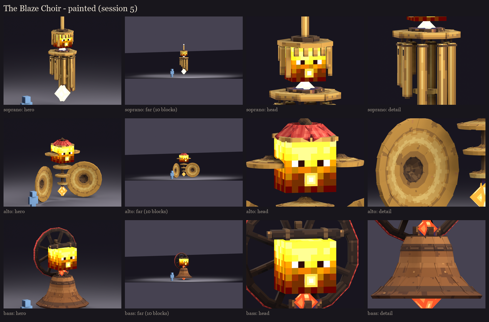

# The Blaze Choir, session 5: painted

Made by `python tools/art/bosses/choir_s5.py <folder holding assets/ from the 26.2 client>`.

The review models with this paint and the session 3 poses are in `run/plugins/BetterModel/models`.

- **Brass** (the Soprano, the Alto): drawn tubes with a lit column and a dark column and a few tarnish runs, dark sounding
  mouths on the outer pipes; cymbals smooth with fine tone grooves, one bright band two thirds out, darker by the dome;
  lathe rings and rivets on the plate.
- **Heat tint:** the metal nearest each singer's fire takes the temper colours of heated brass (straw, bronze, purple,
  blue), so the instruments look like they burn from inside.
- **Bell bronze:** one smooth casting shaded by height (shading each panel striped it like a barrel), a lit waist band,
  patina in soft patches, a raised inscription band, the lip struck bright.
- **The wheel:** dark oak with grain, the bell rope's twist.
- **The cord:** soft pleats on the Alto's cap, strands on the tassels.
- **The fire and the mouths:** hot cores fading out.
- **The heads:** vanilla's blaze skin, untouched.

The first pass was rejected in self-review: the cymbals read as woven straw, the pipes as bamboo and the bell as cork,
from too much small noise on the metal. Metal now follows vanilla's gold and copper blocks: smooth faces, one highlight.

Every texel is fully opaque.
