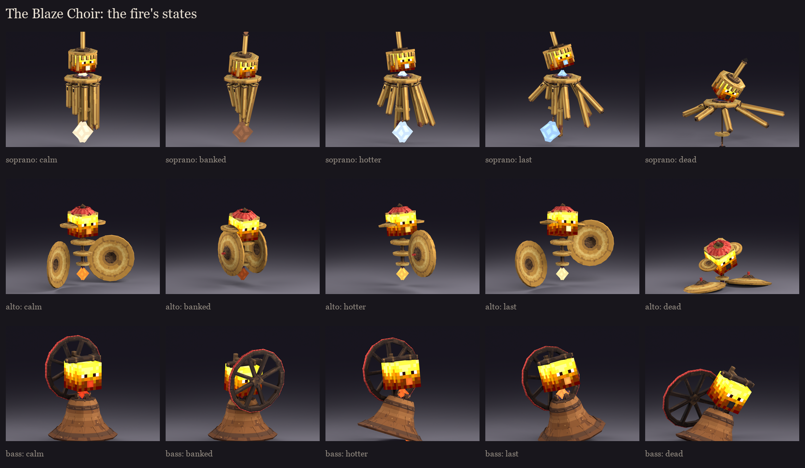
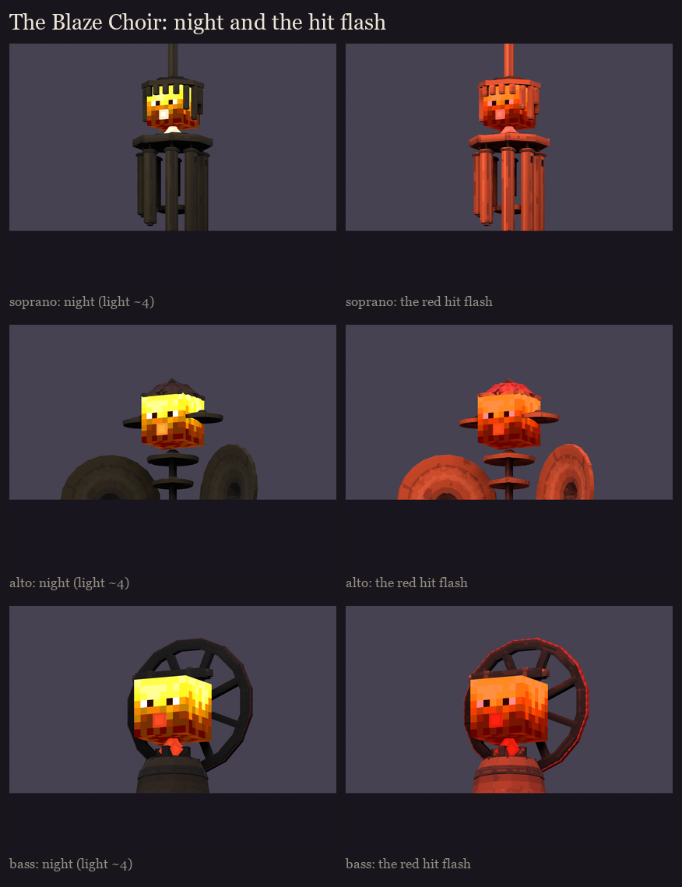

# The Blaze Choir, session 6: variants and readability

Made by `python tools/art/bosses/choir_s6.py <folder holding assets/ from the 26.2 client>` (after `choir_s5.py`).

Each singer's fire and singing mouth (`glow_wisp`, `glow_sail`, `glow_ember`, `glow_clapper`, `glow_mouth`) are painted
neutral and tinted per state with BetterModel's per-bone tint:

| State | When | Soprano | Alto | Bass |
|---|---|---|---|---|
| calm | the singer's own fire | 255 238 200 | 255 158 60 | 236 76 40 |
| banked | shielded: the fire drawn down while the instrument closes | 150 104 76 | 150 74 34 | 120 34 22 |
| hotter | a voice has fallen | 214 234 255 | 255 204 96 | 255 118 50 |
| last | the last singer | 176 214 255 | 255 238 170 | 255 166 84 |
| dead | out | 44 40 40 | 44 40 40 | 44 40 40 |

The shielded singer banks its fire while the two you should hit blaze; the fight also outlines it with the vanilla glow.
No parts swap: the instruments' moments are poses and clips.

## Readability

- **The heads are full-bright,** as vanilla draws a blaze. At night (light ~4) the first pass let them go dark and
  muddy green; now they stay lit like a real blaze, and they take no state tint.
- **The red hit flash** reads on all three: the brass and bronze turn red, the heads and fires stay visible.
