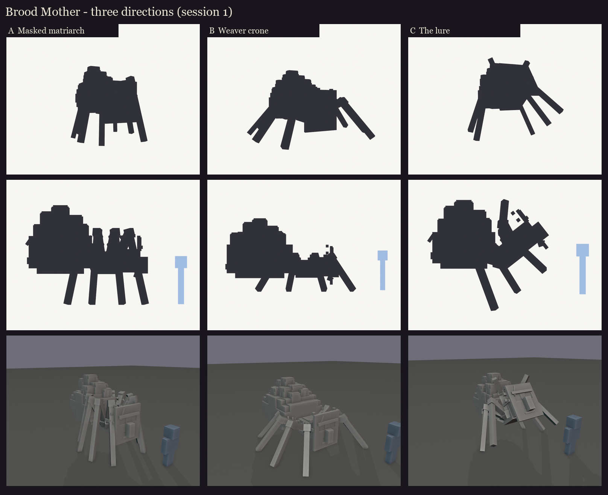
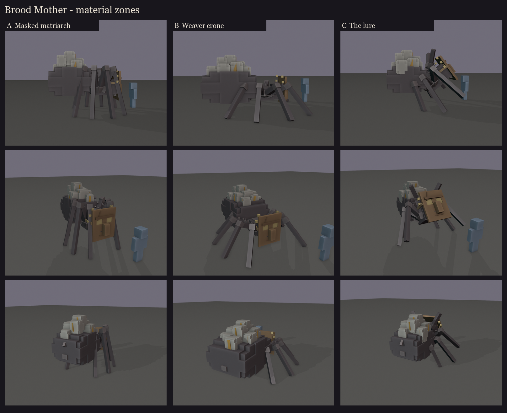

# Brood Mother redesign, session 1: three directions

The brief (2026-10-10):
- a scary, mutated Minecraft spider that looks enchanted and cursed;
- a wooden mask carved like a villager's face, worn as a lure, with two large glowing eyes showing through its eye
  holes;
- on her back, piles of breathing, glowing egg cocoons.

These are blockouts for picking a direction, in flat colours. Texture, the breathing and the glow animation come in
later sessions.

| | Direction | Posture | Size (w x h x d) | Cocoons |
|---|---|---|---|---|
| A | **Masked matriarch** | high-arched legs, the knees above the body: the classic looming spider | 3.5 x 3.7 x 4.6 blocks | a heap on the abdomen |
| B | **Weaver crone** | low and wide, the swollen abdomen near the ground, splayed legs | 5.7 x 3.3 x 5.9 | a whole hill of cocoons |
| C | **The lure** | the front body reared up so the mask sits at a villager's head height, the front legs raised | 4.3 x 4.0 x 4.4 | a heap on the abdomen |

Sheets per direction: [A](A/sheet.png), [B](B/sheet.png), [C](C/sheet.png). Regenerate:
`python tools/art/bosses/brood_s1.py`.

## What all three share

- **The mask:** a carved wooden board with the villager's brow ridge, his long nose and a mouth line. A crack runs
  through it and twine straps tie it on. The eye holes are real openings, filled by two large glowing eyes.
- **The spider behind it:** six small spider eyes peek out round the mask's edges. The mask is a disguise over
  something with too many eyes.
- **The brood:** egg cocoons heaped on the abdomen, two layers deep in the middle, bound with silk strands. The ember
  light of the eggs shows through a split in each cocoon. The fight's egg sacs can be laid from this pile, and the
  "breathing" is the cocoons swelling in turn (animation session).
- **A mutated body:** thick jointed legs with bristles and knuckles, a ridge of spines down the abdomen, fangs under
  the mask.
- **Colours:** tier 0: dark chitin, pale silk, old wood, twine. The accent is ember, in her eyes and inside the eggs.
  "Enchanted and cursed" would come through in the texture: carved runes on the mask, an ember glow, and a faint
  enchantment shimmer on the cocoons. To lean harder into "cursed", the eggs could glow sickly green instead, as
  a second accent.

## Fit with the fight

- **Egg sacs:** laid from the pile on her back, so it shrinks and refills.
- **Web zone:** the spinnerets at the back of the abdomen.
- **Pounce:** B's crouch and C's rear-up both make strong 1-second warnings before the leap.
- **A new tell:** C could hold the lure pose and turn the mask towards a player before she pounces.
