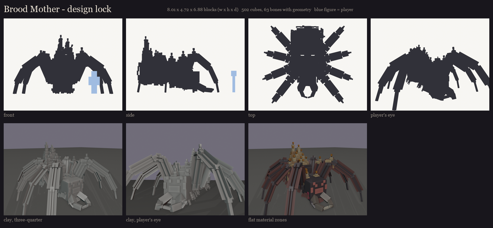
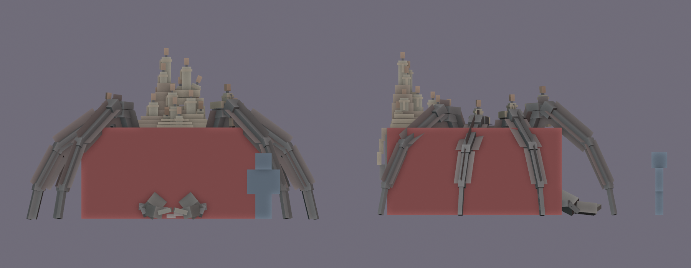
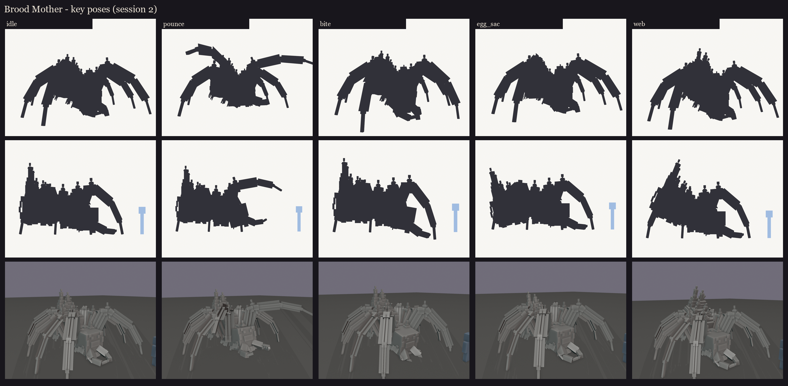

# Brood Mother redesign, session 2: design lock

Chosen in the session 1 review (2026-10-11): **C's legs on B's body**. That means the brute's heavy head, thorax and
abdomen and her big wax load, on the stalker's long legs with the knees far above her back. Leg thickness is set
between the two (1.05x), so the long legs still carry the heavy body. Added in the review:

- **Tarantula fur as 2D hair:** flat hair cards (zero-thickness cubes), each carrying an alpha hair texture from session 5.
  - **Legs:** on every femur, patella, tibia and metatarsus, two cards the length of the segment cross along its axis
    (a + in section, one upright and one flat). Each leg gets a fuzzy outline from every angle; the coxa and the
    foot stay bare. Session 5 changed this from an X: crossed at 45 degrees, the hair barely cleared the leg's corners.
  - **Body:** fringes down the flanks of the thorax and abdomen, round the back above the spinnerets, down the
    cheeks, and a beard under the jaws. Each fringe card hangs just off the surface and flares out at the bottom.
- **Melted candles on the rest of her:**
  - three on the carapace;
  - two on the back corners of the head, with wax run down its sides (clear of the eyes);
  - one on three of the knees, with wax round the joint and a drip down the leg;
  - two stuck sideways into her left flank, melting.

**Changed in session 5:** the head's face is 24 x 24 (it was 23 x 20), so the vanilla spider face maps at exactly 3x.
The eyes are now vanilla's own eye layout as glowing cubes, the extra mutant eyes moved to her right cheek, and the
brow ridge went (vanilla's head is a plain cube).

In the material view, the brown fins along the legs and flanks are the hair cards. Until they're textured they show
as solid planes.

## Size and hitbox

- **Model:** 8.0 x 4.7 x 6.9 blocks (w x h x d), including the leg reach and the candle flames. The body itself is
  about 2.6 blocks tall to the top of the abdomen, and the wax and candles add the rest. Tier 0 arenas have about an
  18-block radius, so she fits.
- **Hitbox:** one invisible `ob_hitbox` bone, 5 x 2.5 x 5 blocks, from the floor to the top of the abdomen, from her
  face to her spinnerets. The mandible tips, the outer legs, and the wax and candles are outside it.
  - It's one box rather than one per body part, so a sweep can never hit her twice.

## Key poses

These are the fight's moments, posed from the same rig. They are silhouettes for the design, not animation.

- **Idle:** crouched inside the cage of her legs.
- **Pounce warning (the 1-second tell):** the head lifts, the front legs rise high and forward, and the jaws open
  wide.
- **Bite:** the head dips and the front legs stab down in front of her as the jaws snap shut.
- **Egg sac:** the abdomen pumps down to lay at her feet.
- **Web:** the abdomen tips up and the spinnerets aim back.

The leap itself, walking, the candles guttering and her death are left for the animation session.

## Bones

- **Per area, not per candle:** each area's candles share a bone, and their flames share one `glow_` bone. Take 3 had
  a bone per candle.
- **Glow bones:** `glow_pile_flames`, `glow_thorax_flames`, `glow_head_flames`, `glow_flank_flames`, and one per
  candle-bearing knee (`glow_leg_r1_knee`, `glow_leg_l0_knee`, `glow_leg_l2_knee`), so the knee flames move with
  the knee.
- **Count:** 63 bones with geometry and 502 cubes, 131 of them hair cards.
- **The legs are most of the bones:** 8 legs × 6 segments. Session 3 checks the display cost in game and may merge
  each coxa into its hip.

## Parts

[parts.md](parts.md) lists every bone with its parent, cube count and materials. Bones the rig and the Mythic skills
will use:

- `h_head`: follows the target.
- `mandible_l` and `mandible_r`: open and shut for the bite and the pounce tell.
- `leg_r0_*` and `leg_l0_*`: the front legs, raised for the pounce.
- `abdomen`: tilts for the egg sac and the web.
- `wax_pile`: the mountain.
- The `glow_*` bones: the flames.
- `ob_hitbox`: the hitbox.

Editable blockout: [occultech_brood_mother_blockout.bbmodel](occultech_brood_mother_blockout.bbmodel). Regenerate with
`python tools/art/bosses/brood_s2.py`.

## Notes for later sessions

- **Hair cards are double-sided planes:** the UV session gives each one a hair strip in the atlas, with alpha.
- **The flicker check needs updating:** `bosskit/checks.flicker_pairs` doesn't handle zero-thickness cards yet, and
  is too slow for 500 cubes. Both must be fixed before the model ships.

Next, session 3: the rig and pose test. Pivots go inside the joints, the BetterModel names are checked, and six test
poses are set, with the blockout loaded on the test server so it can be seen in game.
