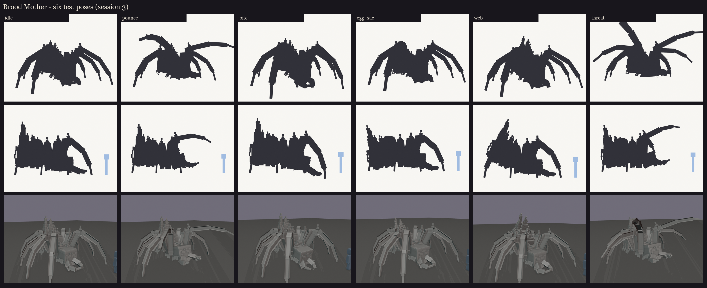
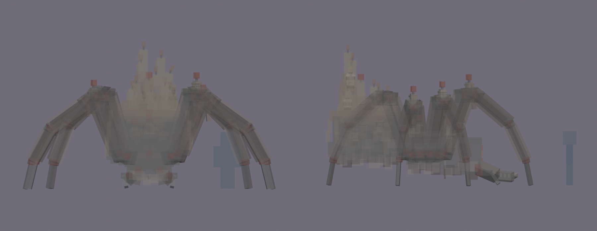

# Brood Mother redesign, session 3: rig and pose test

This makes the session 2 blockout ready to move and to see in game:
- the joints are checked;
- the bone names are checked against BetterModel's tags;
- the drawing cost is counted;
- six test poses are set;
- each material gets a flat colour, so BetterModel can show her before texturing.



| Pose | What it tests |
|---|---|
| idle | crouched in the cage of her legs |
| pounce | the 1-second tell: head up, front legs raised high and forward, jaws wide |
| bite | the lunge: head down, front legs stabbing in front of her, jaws shut |
| egg_sac | the abdomen pumped down to lay at her feet |
| web | the abdomen tipped up, spinnerets aimed back |
| threat | new: the tarantula's threat display. Reared up, the two front pairs of legs lifted, fangs bared. For her arrival and big moments |

## Rig checks ([rig_report.json](rig_report.json))

- **Pivots:** all 63 bones with cubes pivot inside their joint. [pivots.md](pivots.md) gives each one's distance to
  its own cubes.
  - Each leg segment turns at its knuckle.
  - The mandibles hinge where they meet the face.
  - The abdomen turns at the waist.
  - Each flame bone was moved onto one of its flames, so a flicker can scale it in place.

  
- **BetterModel tags:** only the intended bones carry one:
  - `h_head` follows the look;
  - the seven `glow_*` flame bones are drawn full-bright: the pile, the thorax, the head, the flank, and the three
    candle knees;
  - `ob_hitbox` is the invisible hitbox.
- **Drawing cost:** 63 bones and 504 cubes (131 of them hair cards), drawn as **71 display entities**.
  - All hair cards, leaning candles and wax fit inside their bones' item models: they are single 22.5 or 45 degree
    turns.
  - The only extras are the mandibles (4 displays each) and the pedipalps (2 each). Their beams are turned on two axes.
    Session 4 can cut 8 displays by rebuilding them from single-axis steps if the count matters.
  - For comparison, Volley draws 56. The legs alone are 48 bones (8 legs × 6 segments).
- **Zero-thickness cards:** BetterModel 3.5.0 loads the model with no warnings. A test server reload reported
  "3 of models are loaded successfully".

## In game

The review model is `occultech_brood_mother_rig`, with flat material colours and no texture yet. The hair cards show
as solid brown planes until session 5 gives them an alpha hair texture. It's already in `run/plugins/BetterModel/models`
(your server on port 25565). It isn't shipped, and the six poses are saved as held animations.

```
/bm reload
/bm test occultech_brood_mother_rig idle
/bm test occultech_brood_mother_rig pounce
/bm test occultech_brood_mother_rig bite
/bm test occultech_brood_mother_rig egg_sac
/bm test occultech_brood_mother_rig web
/bm test occultech_brood_mother_rig threat
/bm spawn occultech_brood_mother_rig
```

Things to check in game:
- **The poses:** each one looks like the render above. If a leg bends the wrong way, the animation sign convention
  needs flipping for leg bones.
- **Size:** her size against you. The body is about 2.6 blocks to the top of the abdomen and 4.7 with the candles;
  the legs span 8 blocks.
- **The vanilla face:** it reads at combat distance.
- **The hair cards:** they stand out from the legs evenly, and nothing flickers where they cross.
- **Turning:** the head (`h_head`) leads when she turns.

Regenerate with `python tools/art/bosses/brood_s3.py`. It also copies the review model to the test server.

Next, session 4: UVs at one texel per unit, a packed atlas with a hair strip for the cards, and a flat colour per
material zone, then a grey-value check.
