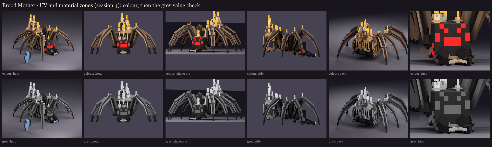

# Brood Mother redesign, session 4: UV and material blocking

The session 3 rig is now UV-mapped and filled with one flat colour per material zone. Session 5 paints over this
atlas.



## UVs ([uv_report.json](uv_report.json))

- **One texel per model unit** (16 per block, the vanilla density) on every face. Every cube size is whole, so no
  face is stretched; the script refuses to run if one isn't.
- **Atlas: 256 x 512**, the size you approved for Volley ([occultech_brood_mother.png](occultech_brood_mother.png),
  [enlarged](atlas_preview.png)). 477 of the 512 rows are used (after session 6). She's twice Volley's size, so three things were
  needed to fit:
  - **Buried faces left out:** 1,157 faces lie wholly inside another cube of the same bone (inside the stepped wax
    lumps and the bevelled boxes). They can never be seen, so they get no texture and aren't drawn.
  - **Sharing only where parts are truly identical:**
    - each left leg segment uses its right twin's texture space (the legs are built the same way and only turned
      apart);
    - hair cards of one size share one hair strip, used by both sides of each card;
    - candles, wick and flame cards, and wax drips of one size share theirs.
  - **A tighter packer:** islands go where they end lowest (skyline packing).
- **1,233 islands for 3,065 drawn faces,** each island with a 1-pixel border that repeats its edge, so filtering never
  pulls in a neighbour's colour.
- **Little room left:** 35 rows are free. Any phase or damage variants (session 6) will be part swaps or tints,
  or need a second small texture.

## Zones and values

| Zone | RGB | Value (L*) | Saturation |
|---|---|---|---|
| chitin | 52, 44, 42 | 19 | 0.19 |
| chitin_lit (knuckles, humps, swelling) | 83, 71, 68 | 31 | 0.18 |
| plate | 117, 103, 96 | 45 | 0.18 |
| hair | 163, 132, 106 | 57 | 0.35 |
| mandible | 26, 12, 16 | 5 | 0.54 |
| fang | 214, 198, 166 | 80 | 0.22 |
| eye (glow) | 232, 44, 44 | 51 | 0.81 |
| eye_small (glow) | 190, 30, 40 | 41 | 0.84 |
| wax | 212, 167, 115 | 72 | 0.46 |
| wax_old | 118, 81, 54 | 38 | 0.54 |
| candle | 236, 222, 190 | 89 | 0.19 |
| wick | 30, 24, 28 | 9 | 0.20 |
| flame (glow) | 255, 168, 58 | 76 | 0.77 |

- **Value check:** every pair of zones that touch on the model differs by at least 12 L*. To get there:
  - the chitin steps up in three shades (body, knuckles, plates);
  - the hair sits between the plates and the wax;
  - the old wax at the foot of the pile is darker than the fresh wax above it.
- **Colour:** only the lights are strongly coloured, the red eyes and the orange flames. The wax is honey but muted.
- **Jaws:** glossy near-black, darker than the body, like a tarantula's chelicerae, under bone fangs.
- **Glowing eyes (new):** the red eyes moved into their own `glow_eyes` bone. Vanilla spiders' eyes glow in the dark,
  and hers now do too.
- **Hair cards:** they show as solid brown planes in this flat pass, which makes the legs look striped. Session 5
  paints them as hair strips with alpha (dark roots, gold tips, gaps between hairs), so they become a fringe.

## In game

The review model `occultech_brood_mother_rig` now carries this atlas. It's copied into `run/plugins/BetterModel/models`
(your server on port 25565), and the test server reloads it without warnings. Use the same commands as session 3:

```
/bm reload
/bm spawn occultech_brood_mother_rig
/bm test occultech_brood_mother_rig threat
```

Check that:
- the texels match vanilla mobs' density;
- the red eyes glow at night;
- the vanilla face reads from 10 blocks.

Regenerate with `python tools/art/bosses/brood_s4.py`.

Next, session 5: the full paint. Chitin with form shading and fine bristle texture, hair strips with alpha, wax with
drips and sheen, candles, and the glow.
