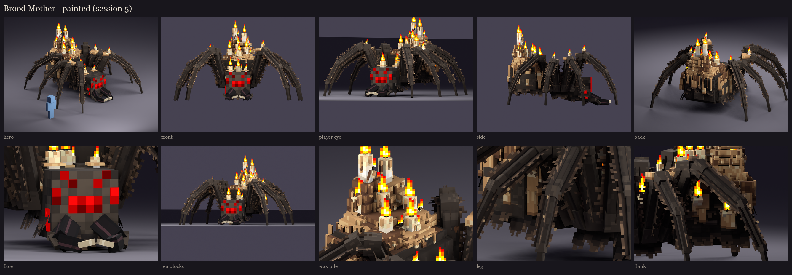

# Brood Mother redesign, session 5: texture painting

The session 4 atlas, fully painted: the same layout rules on the same 256 x 512 atlas. These are offline renders; the
in-game look is the real review.



## The vanilla spider, grown huge

- **Head:** vanilla's own spider head texture on every side of the head, read from the 26.2 client jar. On the face,
  each vanilla pixel is exactly 3 x 3 texels. To make that possible, the head's face became 24 x 24 (it was 23 x 20).
  Vanilla's two pale fang pixels sit above her real mandibles.
- **Eyes:** rebuilt to vanilla's exact layout (spider_eyes.png), as cubes one texel proud of the face. Each is in
  vanilla's three reds, and they glow (the `glow_eyes` bone), as a vanilla spider's eyes do in the dark. The
  mutation is three more eyes on her right cheek.
- **Chitin:** vanilla's own spider browns, plus one violet-leaning shadow below and one warm light above, so the body
  and the vanilla head are one material.

## Paint by material

- **Chitin:**
  - fine bristle strokes along each part's long axis, light and dark, in clusters;
  - legs: joint ends darken into the knuckles, and the femur and tibia have a lighter tarantula band near each knee;
  - plates: lit top edges with a dark lower lip;
  - a pale chevron runs down the rear of her abdomen, and dust settles low on the big faces.
- **Hair cards:** hair strips with alpha, painted as clumps rather than strands (reworked after session 6; see
  [the before and after](../s6_variants/fur_before_after.png)).
  - Leg cards:
    - a band of dark fuzz hugs the chitin, so the hair grows out of the leg;
    - over it, short dark under-fuzz and tapering tufts (two or three texels at the root, one at the tip) at irregular
      spacing and length;
    - every tuft leans towards the foot, so each side of a card has its own strip with the lean the right way;
    - a few longer guard hairs with pale tips.
  - Body fringes: a dark root band along the top, then tufts hanging from it with a slight random lean, ragged at the
    bottom.
  - The hair is dark like the chitin at the root and only catches light at the tips. The first pass (one-texel
    strands with gold tips, evenly spaced) read as combs and stripes.
  - The leg cards were turned square to the leg (one upright, one flat) and their hair lengthened, because crossed at
    45 degrees the hair barely cleared the leg's corners and read as dashes.
- **Jaws:** glossy near-black with one highlight line along each mandible; bone fangs that darken towards the tip.
- **Wax:** fresh runs stream down from the top of each face, ending in a darker lip. The fresh wax has sheen spots
  and the old wax has soot.
- **Candles (since session 6):** vanilla's lit white candle, warmed to ivory: its two columns of shading, the warm
  band under the wick and the shaded foot. The wick is vanilla's colour; the flame is vanilla's flame particle
  with its alpha, glowing (full-bright in game).
- **Drips (since session 6):** fresh wax with a glossy tip; beads catch the light.
- **No painted light direction:** Minecraft shades faces itself. Ambient occlusion is baked from the real geometry: a
  texel darkens where another part is close in front of it (under the legs, between the wax lumps, where the jaws
  meet the face).

## At 10 blocks

About the size she is on a 1080p screen at that distance, the vanilla face with its red eyes, the hairy legs and the
glowing candle pile all read; the bristle detail drops out, as it should.

## Open for session 6

- **The wax lumps still show their stepped slabs as terraces.** Paint helps, but they could be reshaped (fewer,
  rounder lumps) or painted with longer runs crossing the steps.
- **Leg bands:** the tarantula bands near the knees are subtle; they could be stronger, or a warm orange-brown as on
  a real tarantula, if you like that.

## In game

The review model `occultech_brood_mother_rig` carries this atlas. It's copied into `run/plugins/BetterModel/models`
(your server on port 25565), and the test server loads it with no warnings, see-through hair strips included.

```
/bm reload
/bm spawn occultech_brood_mother_rig
/bm test occultech_brood_mother_rig threat
```

Check that:
- the hair strips show as see-through fringes, with no dark boxes around them;
- the eyes and flames glow at night;
- the fringes don't flicker where they cross the legs.

Regenerate with `python tools/art/bosses/brood_s5.py`. It reads the vanilla spider textures from the installed 26.2
client jar; the jar itself is never copied into the repository.

Next, session 6: fixes from this review, phase and damage variants (tints and part swaps; 11 atlas rows are free),
and readability at night and under the red damage tint.
