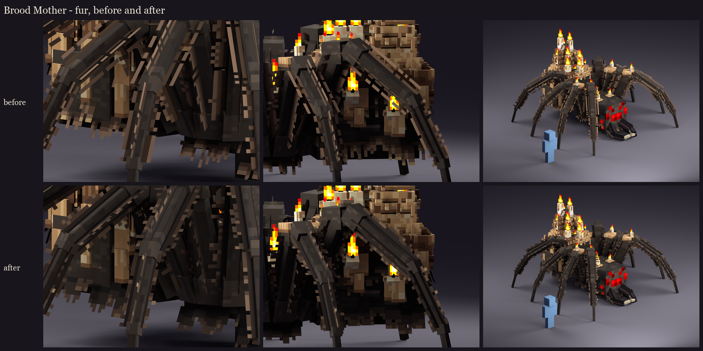
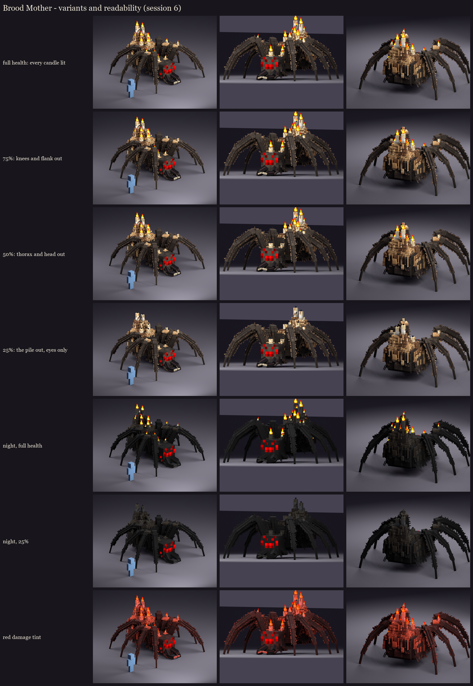

# Brood Mother redesign, session 6: polish and variants

## Review fixes

You asked for candles that look like vanilla's lit candles with a clear flame, and drippier wax. Both went in at
their source (the session 2 geometry and the session 5 paint), and sessions 2-5 were regenerated, so every stage
shows the same model.

- **Candles:** vanilla's lit candle at twice vanilla's size.
  - The body is 4 texels wide (2 for small ones), painted from vanilla's lit white candle: two columns of shading,
    the warm band under the wick and the shaded foot. The colours are warmed to ivory to sit with the honey wax.
  - The wick is two crossed planes, as in vanilla.
  - The flame is two crossed planes painted from vanilla's flame particle, with its alpha: a clear teardrop that
    glows. It always burns straight up, even over a leaning candle or the two stuck sideways into her flank.
  - One or two runs of wax go down each candle; melted candles stand in a puddle.
- **Drips:** 370 runs of fresh wax.
  - They hang over the edge of every step of every wax lump, so the steps read as dripping ledges rather than
    terraces.
  - More hang from the edge of the abdomen, down her flanks and back.
  - About a third end in a bead where the wax gathered, painted with a glossy tip.

All of this is free to draw: the flame and wick planes are single 45-degree turns, and the drips are unturned. She
is drawn as 72 display entities (71 before, plus the glowing eyes from session 4). Identical candles, cards and drips
share texture space, so the atlas is fuller of detail but still fits: 497 of 512 rows used after the fur rework.

## Fur

Reworked before animation, at your request.
- **Before:** the hair was one-texel strands at right angles to the leg, evenly spaced, with gold tips. On the dark
  chitin it read as combs and ladder rungs, and the shared strip made the hair lean back towards the body on one side
  of each card.
- **Now:** dark fuzz hugs the chitin, with tapering tufts at irregular spacing and length over it, all leaning towards
  the foot (each side of a card has its own strip). A few longer guard hairs have pale tips. The hair is dark at the
  root and only the tips catch light. The belly and flank fringes hang in clumps from a dark root band, ragged at the
  bottom.



The atlas still fits 256 x 512 (497 rows used).

## Variants: her candles go out as she weakens



Brood Mother has no phases, so her variant follows her health. The flames are already grouped by area, so Mythic
only hides bones (BetterModel part visibility, as Volley's cracked crystals), with no texture swap:

| Health | Candles that go out | Bones hidden |
|---|---|---|
| 75% | the knees and the flank | `glow_leg_r1_knee`, `glow_leg_l0_knee`, `glow_leg_l2_knee`, `glow_flank_flames` |
| 50% | the thorax and the head | `glow_thorax_flames`, `glow_head_flames` |
| 25% | the wax pile | `glow_pile_flames`: only her red eyes still glow |

The wicks stay, so the candles read as snuffed, not missing. Session 7 can add a puff of smoke as each group goes out,
and session 8 wires the thresholds into her Mythic skills.

## Readability

- **Night (light level about 4):** everything dims but the full-bright parts. At full health the candle flames
  outline her pile and her red eyes mark her face. At 25% only the eyes burn in the dark, which is the scariest
  state, and the right one for the end of the fight.
- **The red damage tint:** the eyes and flames stay readable; the body goes uniformly red with its shape intact.

## In game

The review model `occultech_brood_mother_rig` carries all of this. It's copied into `run/plugins/BetterModel/models`
(your server on port 25565), and the test server reloads it without warnings.

```
/bm reload
/bm spawn occultech_brood_mother_rig
```

Check that:
- the flames look like vanilla candle flames, see-through around the teardrop;
- the drips read at 10 blocks, not as noise.

Regenerate with `python tools/art/bosses/brood_s6.py` (after `brood_s2.py` to `brood_s5.py` if the geometry or paint
changed).

Next, session 7: animation. Idle, walk, the ritual arrival (spawn), the pounce (prepare, leap, land), the bite, the
egg sac, the web, her death, and a candle flicker.
