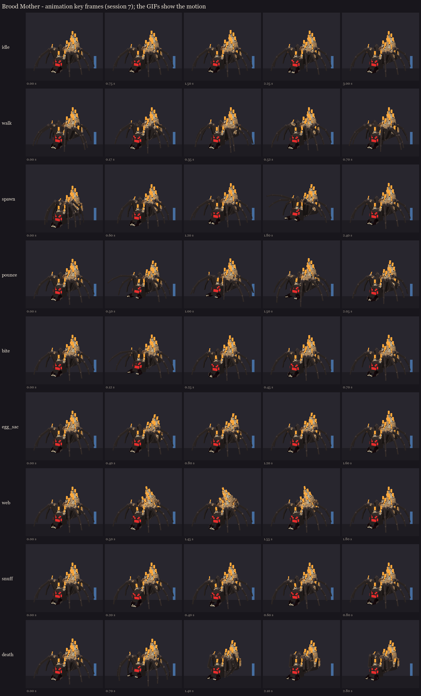

# Brood Mother redesign, session 7: animation

Nine clips, keyed on the session 6 painted rig. Animation is cosmetic: every hit, telegraph and timing still comes
from `BroodMother.java`, and each action clip starts on the server event that starts the attack.



GIF previews (a quick software render with the hair cards left out, for judging motion, not looks):
[idle](gifs/idle.gif), [walk](gifs/walk.gif), [spawn](gifs/spawn.gif), [pounce](gifs/pounce.gif),
[bite](gifs/bite.gif), [egg_sac](gifs/egg_sac.gif), [web](gifs/web.gif), [snuff](gifs/snuff.gif),
[death](gifs/death.gif).

| Clip | Length | Plays | Started by | What happens |
|---|---|---|---|---|
| idle | 3.0 s loop | BetterModel, automatically | - | the abdomen breathes, each front leg taps in turn, the jaws chew, the palps twitch, the small flames flicker |
| walk | 0.7 s loop | BetterModel, while moving | - | the spider gait: R0 L1 R2 L3 lift and swing while L0 R1 L2 R3 push, then the other way. Each leg rises on an eased arc (knee up, shin tucked) for 42% of the stride and pushes back along the ground for the rest; within a set the rear legs lead the front ones a little, so it ripples rather than marches. The body bobs twice a stride and sways, and the abdomen sways against it |
| spawn | 2.4 s | BetterModel, when the model appears | the ritual's summon | unfolds out of a crouch into the threat display (front legs up, fangs bared), then settles |
| pounce | 2.6 s | Mythic `state{s=pounce}` | the pounce telegraph | see the timing below |
| bite | 0.7 s | Mythic | her melee hit | a rear-back, then her whole front slides forward as the jaws snap; the front legs rise and strike down to the floor |
| egg_sac | 1.6 s | Mythic | the egg sacs appear | the abdomen pumps down twice |
| web | 1.8 s | Mythic | the web telegraph | the abdomen tips up and quivers through the warning, then jerks as the web lands |
| snuff | 0.8 s | Mythic | a group of candles goes out (75%, 50%, 25%) | a shudder through the thorax, the head dips |
| death | 2.8 s, holds | BetterModel, on death | - | the dead-spider curl: the legs fold in under her one after another, the jaws fall open, she settles |

**Timings against BroodMother.java:**

| Clip | Server | Animation |
|---|---|---|
| pounce | the telegraph, then `POUNCE_WARNING` (20 ticks): the server holds her still and turned to her mark, then throws her (about a second in the air), facing the way she flies | 0-0.35 s she sinks into a crouch for the tell: knees up, body low, front legs high, jaws wide. She holds it, the head trembling, until 0.9 s. 0.9-1.05 s launch: the rear legs kick straight. 1.05-1.95 s in the air: the front legs reach for the mark, the rest trail. 1.95-2.2 s landing: the legs fold to absorb it, the jaws snap shut. Back to her stance by 2.6 s |
| web | the telegraph, then `WEB_WARNING` (30 ticks) until the web zone lands | 0-0.35 s the abdomen tips up. She quivers until 1.45 s, then jerks at 1.5 s as the web lands, and recovers by 1.8 s |

**Revised after the first in-game review:** the walk was clunky, she glided during attacks, and she didn't face where
she pounced. The walk is the new gait above; during the pounce tell the server now holds her still and turns her to
her mark, and in the air she faces the way she flies. No clip pitches the thorax any more: every leg hangs off it, so
a pitch drove the feet through the floor. Every grounded frame of the walk, bite and pounce now keeps the body and
feet within two texels of the floor line, which is about where the feet already sit at rest.

**Override:** bite, egg_sac, web and snuff move only part of her. With BetterModel's override on, the bones they don't
key keep walking, so she can bite or web on the move without gliding (the lesson from Volley). Pounce, spawn and death
move the whole body.

**Candle flicker:** the small flame groups flicker in idle and walk: the knees, the head, the thorax and the flank.
The wax pile's flames share one bone spread across the whole pile, so scaling it would make the far flames drift; it
stays still. If you want the pile to flicker too, it can be split into three or four flame bones, at a few more display
entities.

**Floor:** at rest the mandible tips sit half a texel below the floor line. During the bite's snap and the pounce's
landing they graze 1.5 texels below for a moment. The spawn deliberately starts crouched into the floor, rising out of
the ritual circle, as Volley's does.

## In game

The review model `occultech_brood_mother_rig` carries the clips; the six held poses from session 3 are still there. It's
copied into `run/plugins/BetterModel/models` (your server on port 25565), and the test server loads it without warnings.

```
/bm reload
/bm spawn occultech_brood_mother_rig
/bm test occultech_brood_mother_rig pounce
/bm test occultech_brood_mother_rig web
/bm test occultech_brood_mother_rig death
```

The same goes for idle, walk, spawn, bite, egg_sac and snuff. Please check:
- **Bend directions:** every clip bends the right way. The legs use a new convention: a positive Z delta raises a
  segment, and the hip yaw swings a right leg forward and a left leg back. If a leg swings backwards, I flip it.
- **The walk:** it looks like a spider: the two alternating sets of four legs read.
- **The pounce tell:** it reads as "she's about to jump" during the 1-second warning.

Regenerate with `python tools/art/bosses/brood_s7.py`.

Next, session 8: the new model replaces the old Brood Mother, the Mythic skills play these clips and snuff the
candles at 75%, 50% and 25%, the pack is rebuilt and published (with your go-ahead), and the in-game review.
