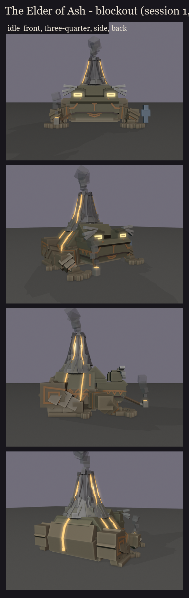
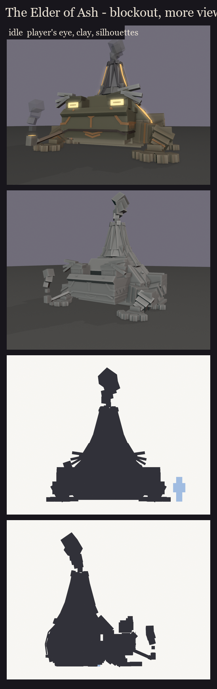

# The Elder of Ash, session 1 step 3: the full blockout

The whole toad from cuboids at B2's size, wearing the locked face (F3's eyes and angles, the ash-white brows sweeping
out past the eyes, the pipe). Made by `python tools/art/bosses/ash_s1.py` (it uses `ash_face.py` and
`ash_face2.py`). About 285 cubes in 12 bones with geometry; 9.4 x 10 x 8.2 blocks including the smoke placeholders.
Without them, the crater's rim is at 6.6 blocks.

**The parts:**
- **The body:** wide at the belly and sloping in to a broad back (a hexagon seen from the front). The back rises from
  behind the head to the hump without a step, and the rump slopes down behind.
- **The front legs:** propped under the head, with elbows out, beefy forearms and four big fingers.
- **The hind legs:** folded at his sides: a thick thigh muscle at the hip, the thigh down to the knee beside the
  belly, the shin back along the ground and the long foot forward with three big toes.
- **The volcano:** an ash crust with broken rocks where the warts harden, then a flared skirt of slabs. Above it, one
  ring of long basalt slabs leans in to a jagged rim round the glowing crater. The profile is concave, with no steps.
- **Lava:** four streams from the rim down the cone. Three run over the crust, down the sloped back and the flanks;
  one runs down the rump.
- **Tribal markings in ember:** long connected strokes.
  - **Face:** a line from under each eye down the cheek, round the face's corner and back along the side of the head,
    with sawtooth teeth hanging from it. An arrow runs down the brow to the nose, with two chevrons on the chin.
  - **Body:** the jaw line carries on along each flank, with sawtooth above and chevrons hanging below. Two strokes
    climb the slope towards the volcano. The flank line ends on the hip in an angular spiral.
  - **Arms:** three bands round each forearm, one round each upper arm and a stripe across each hand.
- **Smoke** from the crater and the pipe's bowl is shown as translucent cubes; in game it is particles.

## Take 2 (2026-10-14)

The user's changes:
- **Buffer, tapered limbs:** each limb segment is now overlapping beams that get longer and thinner.
  - **Upper arm:** thick at the shoulder.
  - **Forearm:** its muscle sits up by the elbow and narrows to a slim wrist.
  - **Thigh:** a round muscle at the hip (an octagon from the side), tapering to the knee.
- **Thinner fingers with a bump at the tip:** slim fingers and toes, each ending in a round pad (two boxes, one turned
  45 degrees).
- **A gradual, seamless body-to-volcano join:** the back now slopes in at 45 degrees and the mountain grows out of it
  in three rings, each steeper than the one below:
  - a foot ring lying on the back's slope, where skin turns to ash and hardened warts stud it;
  - an ash and basalt skirt;
  - the long basalt slabs up to the rim.

  The foot ring is squashed front and back, so it sits over the neck and the rump. The flat crust plate is gone.
- **Rounded:**
  - the belly now tucks under, and the flanks bulge;
  - the rump curves over and down in two planes;
  - the arm bands are down to one on each upper arm and one at each wrist, so the arms no longer look striped.
