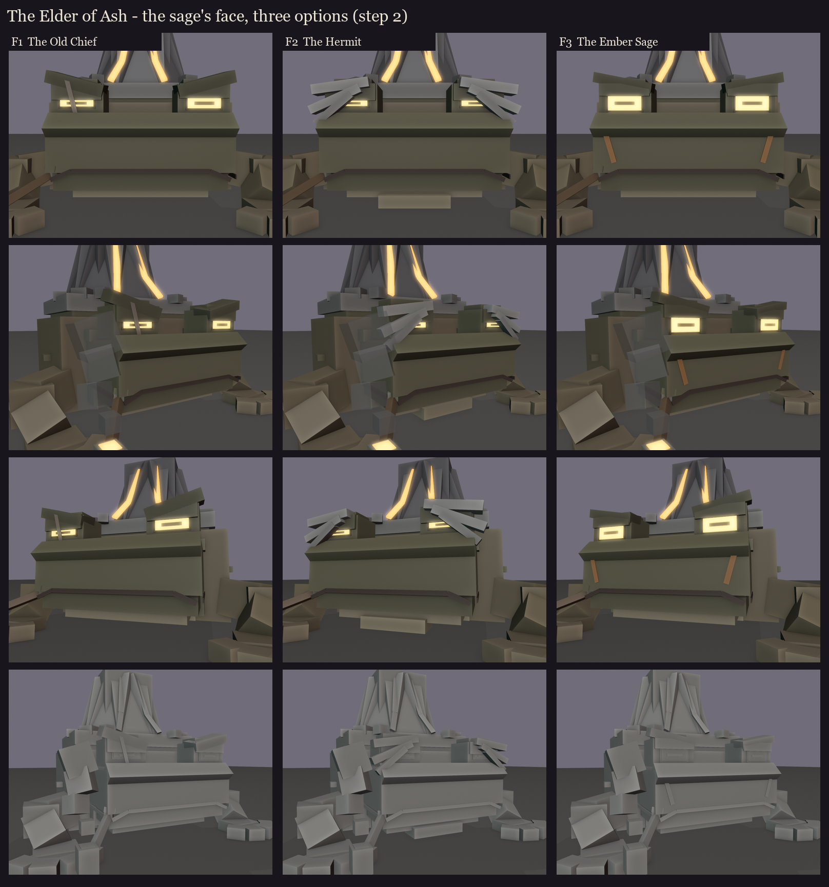

# The Elder of Ash, session 1 step 2: the sage's face

B2 was picked on 2026-10-14 ([../s1_take2](../s1_take2/README.md)). Three faces sit on the same front half of B2: the
body, the beefy front legs with four big fingers, and the foot of the volcano behind. That way each face is judged in
the frame it will live in. Made by `python tools/art/bosses/ash_face.py`.

All three share the frog's face, built vanilla's way:
- a big flat upper head over a thin jaw;
- the mouth as the seam between them, low on the face and right round the head, bending down at the corners;
- the eyes bulging up on the head's top corners, with a sloped snout and nostrils;
- the pale throat, and the glands behind the eyes;
- the pipe in his right mouth corner (the viewer's left), its bowl glowing, with smoke.

About 95 cubes for this whole front half. The colours are flat blockout colours; wrinkles, warts, the lips' shading and
the skin's mottling are painted in session 5.

| | Face | What it does |
|---|---|---|
| F1 | **The Old Chief** | Heavy brow shelves in a V scowl, an old scar through his right eye (narrowed more than the left), heavy jowls, the pipe clenched with the lip bunched up round it. A war-worn boss toad. |
| F2 | **The Hermit** | Long ash-white brows sweeping out and drooping past half-shut eyes, a hanging dewlap, the pipe resting. The oldest and calmest; the ash-white ties him to the volcano. |
| F3 | **The Ember Sage** | Wide-open glowing eyes under one heavy ridge, ember sage markings under and beside the eyes and down the cheeks. The most intense; the markings echo the lava. |

Parts can be mixed (for example F2's brows with F3's markings).
