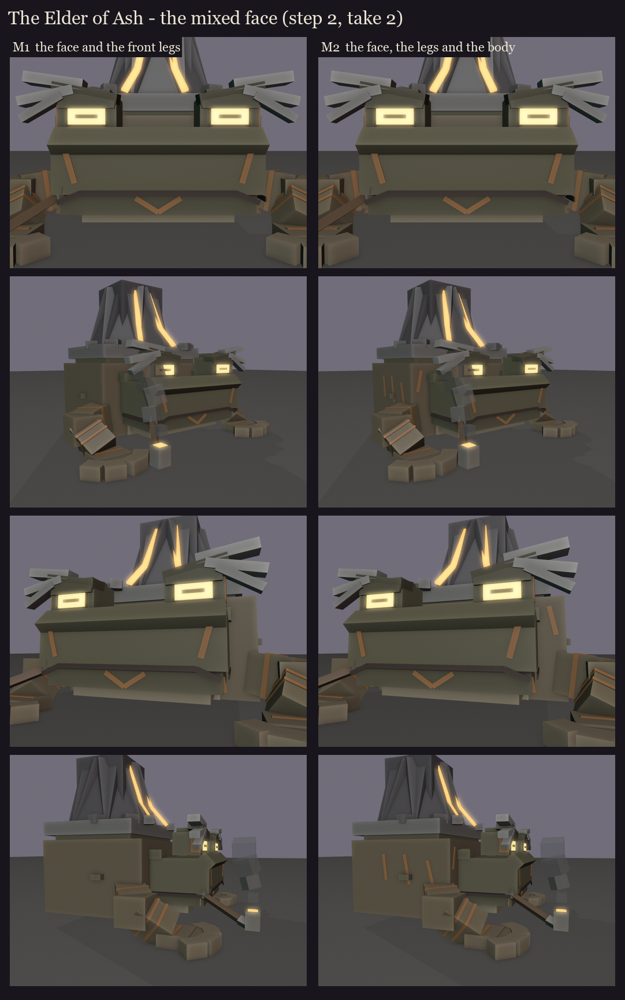

# The Elder of Ash, session 1 step 2, take 2: the mixed face

The user's mix (2026-10-14): F3's angles (wide glowing eyes under one heavy brow ridge, low over its inner end) and its
ember markings, with the Hermit's ash-white brows. The brows must not hide the eyes, and the markings should spread
to other areas. Made by `python tools/art/bosses/ash_face2.py` (frame and head from `ash_face.py`).

**The brows:** three ash-white tufts grow from the outer half of the brow ridge, sweep out past the eye's outer corner
and droop. They frame the eye from above and outside and never cross it.

**The markings** (ember paint, not glowing):

| | Where |
|---|---|
| **M1** the face and the front legs | Under and beside each eye, down the cheeks, a chevron on the chin, the mouth's corners, a small diamond between the eyes; two bands round each forearm, one round each upper arm, a stripe across each hand. |
| **M2** plus the body | M1, plus slanted stripes down the flanks, a stripe down each shoulder, along the glands, and up the back towards the volcano. |

Idea for later: the markings could warm up with the fight, dull at first, then glowing faintly once the volcano
erupts at 66%, and bright at 33%, so his skin shows the phase as well as the crater does.
