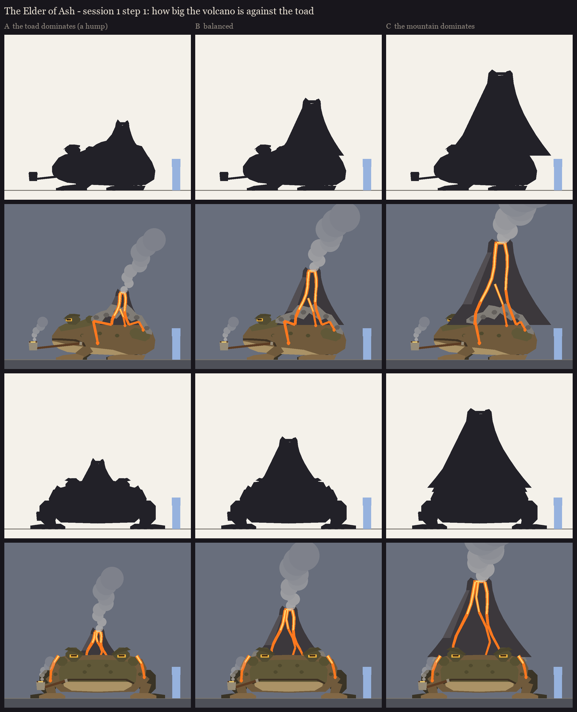

# The Elder of Ash, session 1 step 1: how big the volcano is against the toad

One crouched toad (about 6 blocks from snout to rump), three volcanoes. Made by
`python tools/art/bosses/ash_silhouettes.py`; the plan is in [../plan.md](../plan.md). The blue figure is a player.

| | Crater height | Cone base | Reads as |
|---|---|---|---|
| **A** the toad dominates | 3.9 blocks | 2.5 blocks | a giant toad with a smoking hump |
| **B** balanced | 5.1 blocks | 3.9 blocks | a toad carrying a volcano; both read at once |
| **C** the mountain dominates | 6.75 blocks | 6 blocks | a walking volcano, the toad underneath it |

The same in all three:
- **The crouch:** front legs propped under the head, a big folded thigh, wide webbed hands and feet.
- **The face:** the eyes stand up off the skull under a heavy brow, with half-shut lids and ember slit pupils. The
  mouth is as wide as the head is long, its corners turned down. The gland bulges behind each eye.
- **The volcano grows out of the back:** the warts harden into an ash-grey crust that climbs into the basalt cone.
- **The lava:** streams run from the crater down the cone, over the crust and down the flanks; the front view shows
  them coming round behind the head.
- **The pipe:** a long pipe from the right corner of the mouth, its metal bowl glowing, with smoke curling up.

The face and the lava paths are placeholders here; step 2 (the face study) designs the face and the pipe.
