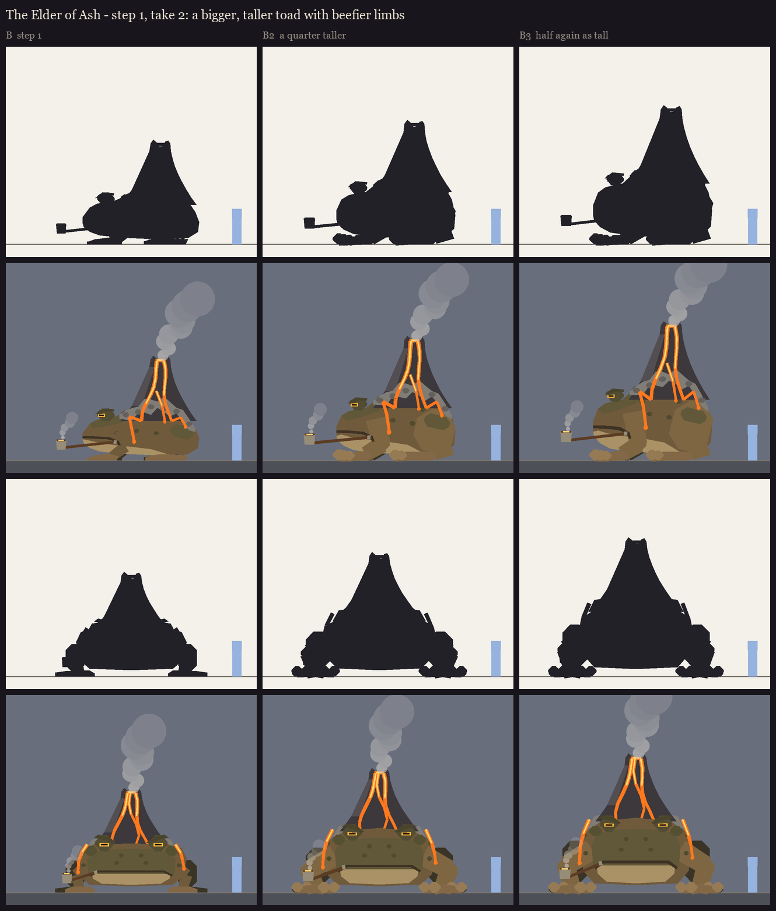

# The Elder of Ash, session 1 step 1, take 2: a bigger toad under B's volcano

The user picked B (balanced) and asked for a bigger, taller toad that isn't as flat, with beefier limbs and large
fingers. Made by `python tools/art/bosses/ash_s1_take2.py` (it reuses step 1's helpers in `ash_silhouettes.py`).

| | Back height | Crater | Changes |
|---|---|---|---|
| **B** (step 1) | 2.9 blocks | 5.1 blocks | as shown before |
| **B2** a quarter taller | 3.7 blocks | 6.1 blocks | a domed back and round rump, a deeper belly, thick arms with an elbow that stands clear of the body in front view, a huge thigh, four big padded fingers per hand and big toes |
| **B3** half again as tall | 4.3 blocks | 6.9 blocks | the same, taller still: a barrel of a toad |

In both, the volcano keeps B's share of the figure: it rises about as high again as the toad.

The limbs have their own warmer tone here so they read against the body; in the model this becomes a value step in
the texture.
