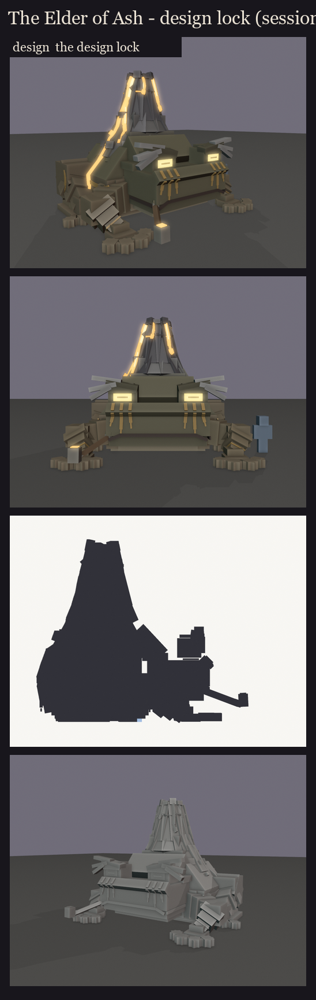
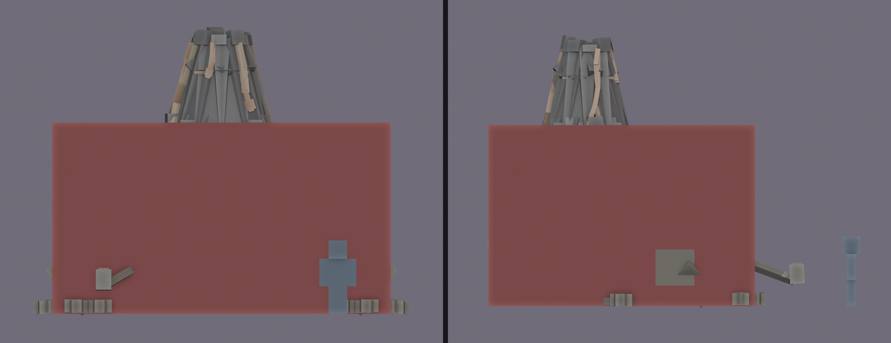
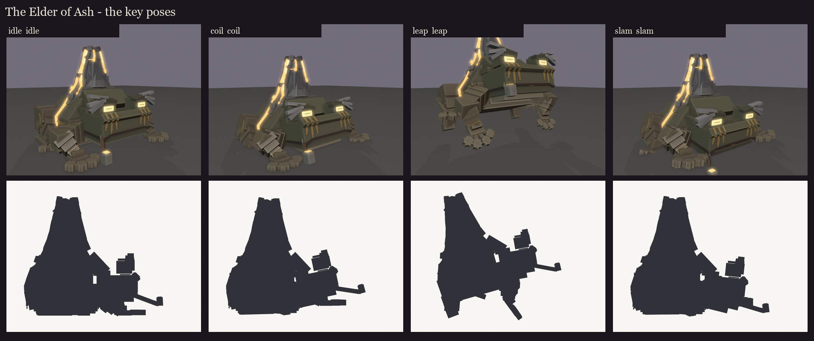
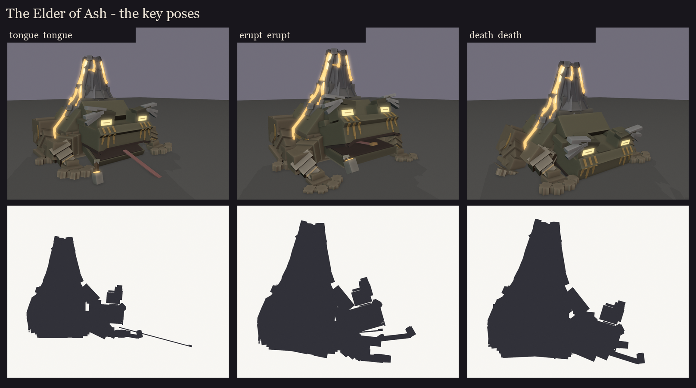
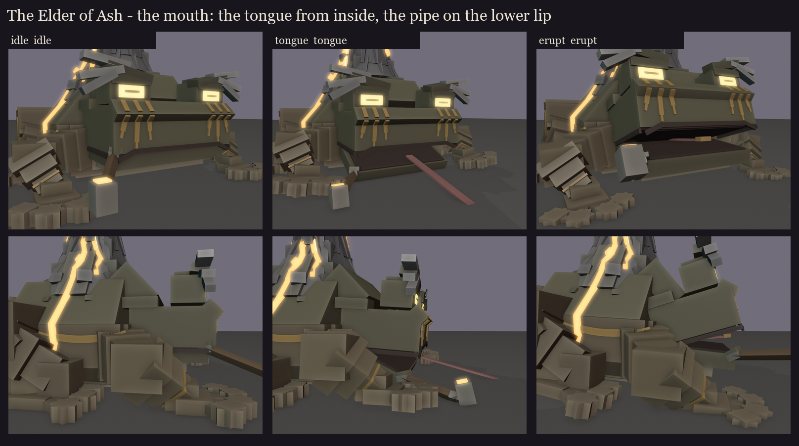

# The Elder of Ash, session 2: design lock

The approved blockout ([../s1_blockout](../s1_blockout/README.md), take 2) is rebuilt as a rig and locked:
- the face from step 2: F3's eyes and angled brow ridges, the ash-white brows, the pipe;
- the tall, rounded B2 body with buff, tapered limbs and slim fingers ending in bumps;
- the volcano growing out of the back in three steepening rings, with its lava streams.

He is built at his final size, and every cube is snapped to whole texels. Made by
`python tools/art/bosses/ash_s2.py` (after `ash_s1.py`).

## Size and hitbox

- **Model:** the crater's rim is 6.6 blocks up; he is 9.2 blocks wide, toes to toes, and 8.1 blocks from the pipe's
  bowl to the rump. The player is 1.8.
- **Hitbox:** one invisible `ob_hitbox` bone, 8.25 x 4.7 x 6.9 blocks.
  - It covers the body, the head, the haunches, the upper arms and the volcano's foot, up to the top of the skirt.
  - It leaves out the hands, the feet, the brows, the pipe and the upper cone, so nothing loose is a free target and
    no one swings at a finger.
  - It is one box, so a sweep can't hit him twice.

## Bones (BetterModel names)

**The bones:**
- `base`: the whole toad, its pivot on the ground under his middle. It lowers, lifts and tilts him for the coil, the
  leap and the slam.
- `body`: the trunk; `volcano` rides on it.
- `hi_head`: turns with the target. Its children:
  - `jaw`: hinged at the back of the mouth;
  - `tongue`: a thin flat strip like vanilla's frog, 4 texels wide and 5 blocks long, rooted at the back of the mouth on
    the head (not the jaw), with a hot tip.
    - Retracted, it lies in the closed mouth's seam and runs back down his throat into the body, hidden.
    - It lashes straight out of the middle of the open mouth: it tilts half as far as the jaw and slides along itself,
      about 5 blocks past his lips.
    - The fight's lane reaches 14 blocks, so in session 7 the clip will stretch the tongue bone along its length for
      the far lashes; a solid-colour strip stretches cleanly.
  - `brows`: they lift and lower for expression;
  - `pipe`: on the jaw, held in the lower lip, so it drops with the jaw (user's fix). It tips back up as the jaw
    opens, so its bowl never digs into the ground.
- **Front legs:** `arm_*`, then `forearm_*`, then `hand_*`.
- **Hind legs:** `thigh_*`, then `shin_*`, then `foot_*`.

**Glow bones** (drawn full-bright in game, tinted per state in session 6):
- `glow_eye`: both eyes, as flat planes;
- `glow_crater`: the crater's pool;
- `glow_lava`: the streams;
- `glow_pipe`: the bowl's ember.

**Counts:** 237 cubes on 23 bones with geometry, so about 23 displays. Full list: [parts.md](parts.md).

**Painted, not modelled:** the tribal markings, the mouth's line, the nostrils and the pupils are texture (session 5).
They are left out of the model and only drawn over these renders so the design reads.

**No flicker:** no two faces share a plane; the resolver nudged the smaller part of each clash a fraction of a texel.

## Key poses

The fight's moments, posed from the rig. Hands and feet are planted back on the ground. These are silhouettes for the
design, not animation.

- **Idle:** still and heavy, the pipe smoking.
- **The coil** (the leap's 1.5 s warning): sunk low, elbows up, glaring up at the target. In game this is when the
  smoke thickens and the crater pops.
- **The leap:** launched nose-up, arms reaching, hind legs thrown back.
- **The slam:** landed flat and splayed.
- **The tongue:** the jaw dropped, the flat tongue lashing out with its hot tip.
- **The eruption at 66%:** head thrown back, jaw open, as the volcano throws its lava bombs.
- **Death:** slumped flat, chin on the ground; the volcano goes cold (a tint, session 6).

**The mouth, close up** (after the user's review): the tongue comes from inside the mouth, and the pipe stays in the
lower lip. The inside of the mouth is paint on the jaw's top and the head's underside.

**The amber markings, take 2** (the user's change: there were too many, and they didn't look natural): no sawtooth,
chevrons, bars or angular spirals any more. Each mark is now one curved stroke that swells in the middle and tapers to a
point at both ends, a little uneven, like paint pulled by a finger, following the toad's forms. Four kinds in all:
- **The cheeks:** tribal face paint, three stripes running down from under each eye. They go over the snout's slope
  and down the cheek, the middle one longest, each tapering to a point, the outer ones leaning a little out. Two
  earlier tries were rejected: single strokes beside the mouth read as tusks, and a sweep across the cheek read as a
  moustache.
- **The flanks:** a long stripe down each, like a toad's lateral stripe. It runs from behind the head, dips along the
  body and rises to fade before the haunch.
- **The haunches:** a crescent on the outside of each, opening towards the tail.
- **The wrists:** one band round each.

The colour is a warmer amber (236, 150, 52).

Smoke, explosions and the lava bombs are particles and fight effects (session 8). The editable blockout with its hitbox
is in `design/`.
