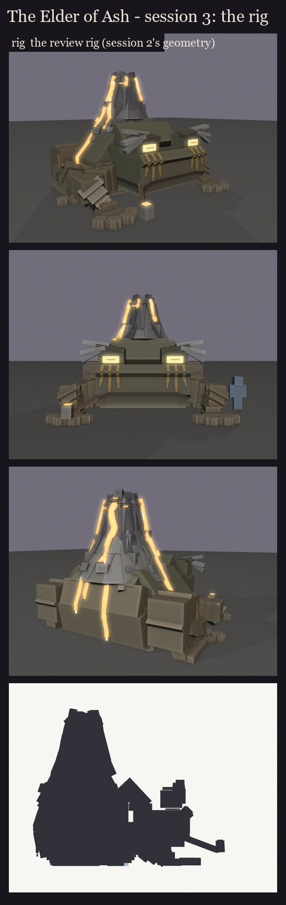
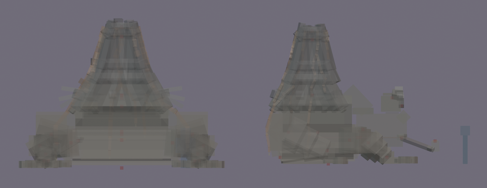

# The Elder of Ash, session 3: rig and pose test

This makes the approved design lock ([../s2_design](../s2_design/README.md)) ready to move and to see in game:
- the drawing cost is counted (cutting it waits for the M6 pass, below);
- the joints are checked;
- the bone names are checked against BetterModel's tags;
- the seven key poses are saved as animations;
- each material gets a flat colour, so BetterModel can show him before texturing. The eyes, the lava, the crater and
  the pipe's ember are drawn full-bright.

Made by `python tools/art/bosses/ash_s3.py` (on top of `ash_s2.py`).

## The look: session 2's geometry, kept

A first take rebuilt the volcano, the lava and the back on BetterModel's free angles, to draw as 32 display entities
instead of 173. **The user rejected it** (2026-10-14): it lost a lot of the important detail on the mountain and on
the frog's back. The drawing cost is for the performance pass (M6), done for every boss together once all of them are
designed (the user's call on 2026-10-12), so the rig keeps session 2's geometry exactly.



- **Now:** 300 cubes on 23 bones with cubes, **225 displays** (since session 4's lava rework; it was 237 cubes and
  173 displays):
  - the volcano: 68;
  - the lava: 31 (more since the rework: the flows fork and meander);
  - the body: 9;
  - each hand: 9;
  - the brows: 8;
  - each foot: 7;
  - the pipe: 5.
- **For M6:** the legal-angle builder is kept in `ash_s3.py` (`LEGAL = True`) as a starting point. The detail it lost
  would have to come back first: the many slabs per ring, the flared skirt, the rocks and warts on the back, and the
  wiggling streams.

## Rig checks ([rig_report.json](rig_report.json))

- **No flicker:** no two faces share a plane (0 pairs).
- **Pivots** ([pivots.md](pivots.md)), with the brows as one bone (`brows`) and the pipe square as in session 2:
  - every moving bone turns in its joint: the head at the neck, the jaw at the back of the mouth, the tongue at its
    root in the throat;
  - each arm at the shoulder, forearm at the elbow and hand at the wrist;
  - each thigh at the hip, shin at the knee and foot at the ankle (the foot's pivot sits at the end of the shin, 2
    texels behind the foot);
  - the pipe at the mouth corner.
  - `brows` only lifts (a position key), and the glow bones (`glow_eye`, `glow_lava`) never turn on their own. They
    just ride on their parents, so where their pivots sit doesn't matter.

  
- **BetterModel tags:** only the intended bones carry one:
  - `hi_head` turns with its children;
  - the `glow_` bones are drawn full-bright;
  - `ob_hitbox` is the invisible hitbox (8.25 x 4.7 x 6.9 blocks).
- **Load test:** on the second test server, BetterModel loaded the rig with the ten shipped models and no warnings
  ("11 of models are loaded successfully"). The rig was then taken off that server again, since its models folder must
  hold only shipped models for pack builds.

## In game

The review model has flat material colours and no texture yet. It is in `run/plugins/BetterModel/models` (your
server on port 25565), isn't shipped, and holds each pose as an animation:

```
/bm reload
/bm test occultech_elder_of_ash_rig idle
/bm test occultech_elder_of_ash_rig coil
/bm test occultech_elder_of_ash_rig leap
/bm test occultech_elder_of_ash_rig slam
/bm test occultech_elder_of_ash_rig tongue
/bm test occultech_elder_of_ash_rig erupt
/bm test occultech_elder_of_ash_rig death
```

The poses use position keys too:
- the whole toad sinks for the coil, the slam and death, and lifts for the leap;
- the tongue slides out along itself;
- the brows lift.

Your client needs BetterModel's pack (`run/plugins/BetterModel/build.zip`) next to the Occultech pack to see him.
