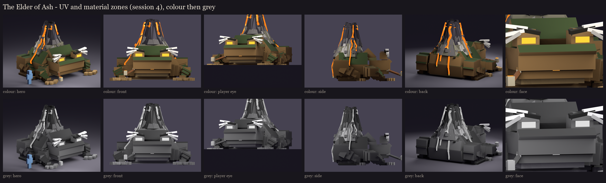

# The Elder of Ash, session 4: UV and material blocking

Every visible face of the session 3 rig (session 2's geometry) is mapped at one texel per model unit (16 per block,
the vanilla density) into one atlas. Made by `python tools/art/bosses/ash_s4.py` (after `ash_s3.py`).

- **Atlas: 512 x 512.** He is about 9 blocks across, so at the vanilla density his faces need more room than the
  other bosses' 256-pixel atlases. 923 islands use 504 rows, 72% filled. Each island has a 1-pixel border against
  seams.
  - The alternative would be half the density for the whole boss (8 texels a block, a 256 atlas): chunkier pixels than
    the player and the other bosses. Not taken, unless you want it.
- **Shared space:**
  - A left limb, hand, foot, eye or gland uses its right twin's islands (built mirrored, the same size).
  - Every finger, toe, tip bump, wart and lava piece of one size shares one island: they look alike, and the lava is one
    glowing flow.
  - Everything else (the face, the volcano, the brows, the pipe) has its own.
- **Buried faces:** 7 faces buried inside another cube of the same bone are left out. Most hidden faces sit inside
  turned cubes, which this check can't prove buried, so they keep their islands.

## Material zones

Tied to vanilla's temperate frog (its orange-brown, the pale belly) and your brown, green and ash grey.

**Countershaded like a real toad** (the user's change): every face of the toad's skin, on the body, the head and the
limbs alike, is dark green where it points to the sky and brown everywhere else. A face counts as sky-facing past a
small upward tilt; it is read from the face's direction in the rest pose.

| Zone | Colour | Where |
|---|---|---|
| skin | 58, 72, 38 | dark green: every sky-facing face of the body, head and limbs |
| flank | 136, 106, 66 | brown: every other face of the body, head and limbs (sides and undersides) |
| belly | 204, 178, 126 | the pale throat, chest and belly |
| wart | 38, 36, 22 | the warts |
| gland | 118, 112, 70 | the glands behind the eyes |
| toe, pad | 92, 70, 42 / 178, 146, 98 | the fingers and toes, their tip bumps |
| brow | 34, 30, 20 | the brow ridges |
| brow_ash, brow_ash_dark | 214, 210, 200 / 164, 160, 152 | the ash-white brows |
| mouth | 34, 18, 18 | the inside of the mouth |
| tongue, tongue_tip | 178, 78, 76 / 255, 150, 60 | the tongue, its hot tip (full-bright) |
| eye | 255, 186, 60 | the ember eyes (full-bright) |
| skin_ash, ash, ash_dark | 124, 120, 102 / 158, 154, 148 / 104, 100, 98 | where the warts harden to rock, the cone's foot |
| basalt, basalt_lit | 52, 48, 54 / 80, 76, 84 | the cone |
| lava, lava_hot | 255, 120, 30 / 255, 214, 110 | the streams and the crater (full-bright) |
| pipe, pipe_metal, ember | 124, 80, 44 / 168, 158, 134 / 255, 140, 40 | the pipe, its fittings and its ember (full-bright) |

**The value check:** every pair of neighbouring zones is at least 12 apart in lightness, so he reads in grey too. The
first pass found eleven pairs too close. With the countershading, the dark green and the brown are far apart; the
warts, the brows and the toes went darker against them, and the ash lighter against the skin.

## The lava (the user's change)

The four matched streams were too symmetric. They are now flows of their own, each starting at its own notch of the
rim and running its own length, meandering down the cone. They pool wider where the slope eases and split round raised
rocks in their way:
- **The main flow** runs down the right side, the longest. It forks round a rock high on the cone: the right branch
  runs over the shoulder and drips down the right flank, the left branch dies on the volcano's foot in a cooling bulb.
- **The left flow** runs down to the left flank. A branch splits off round a rock at the foot and spills back over the
  rump.
- **The back flow** forks round a rock low on the cone; both arms run down the rump to different lengths.
- **A short flow** at the front left stopped a third of the way down.
- **A thin trickle** at the front right barely leaves the rim.

Sessions 2 and 3 were regenerated with them. The model now draws as about 225 displays; that cut waits for the M6
performance pass.

## Left for painting (session 5)

- **The amber markings** (take 2, [../s2_design](../s2_design/README.md)): three tribal stripes down each cheek from under the eye, a stripe down each
  flank, a crescent on each haunch, a band round each wrist; tapered, hand-laid strokes.
- **The face:** the mouth's line with its downturned corners, the nostrils, the slit pupils.
- **The skin:** mottling, the warts' shading, the belly's folds.
- **The volcano:** cracks with lava showing through, the ash's speckle, basalt facets.
- **The lava:** the wiggle inside each stream, hot cores, and crust floating on it.

The review rig on your server is updated with this atlas: `/bm reload`, then `/bm test occultech_elder_of_ash_rig idle`.
