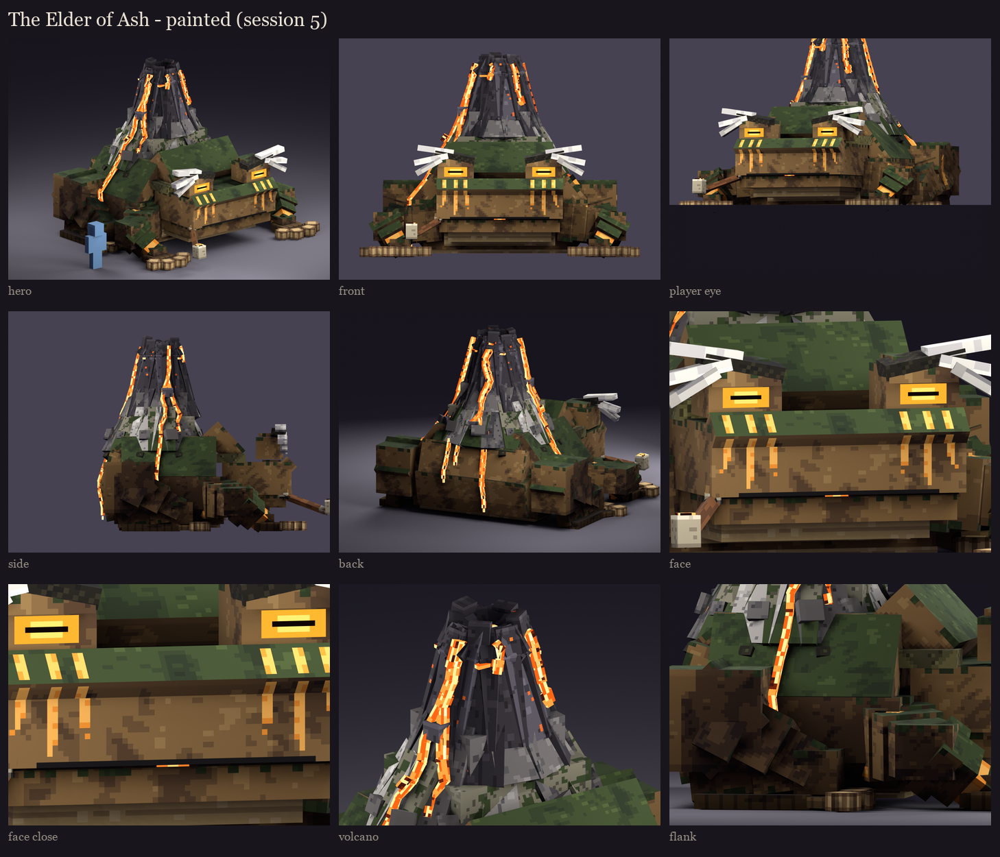

# The Elder of Ash, session 5: texture painting

The session 4 layout (one 512 x 512 atlas, the same islands) is painted with fine ramps: close shades, cool shadows,
warm lights. Form only, with no painted light direction; ambient occlusion is baked from the real geometry. Made by
`python tools/art/bosses/ash_s5.py` (after `ash_s4.py`).

| Part | Painted |
|---|---|
| **Skin, sky-facing** | Dark green, mottled with darker patches that run across neighbouring faces. Small raised warts (2 x 2) with a lit top and a shadow under. |
| **Skin, sides and undersides** | Brown, blotched, darker towards the ground and on undersides. A few green flecks where a side turns to the top, so the two colours meet softly. |
| **Belly** | Pale ochre with fine folds across. |
| **Glands, warts** | The glands pitted with pores; the warts dark with a lit crown. |
| **Fingers, toes** | Knuckle creases; pale pads with a darker rim. |
| **Face** | The mouth's line with its downturned corners, the nostrils, a dark inside of the mouth. The ember eyes with a bright core and a dark slit pupil. The brow ridges rough; the ash-white brows in strands, paler towards the tips. |
| **Amber markings** | Painted on: the three stripes down each cheek, the flank stripes, the haunch crescents, the wrist bands. Each is brighter along its middle. |
| **Volcano** | Skin hardening to ash: patches of skin left in the ash, cracks between. Ash speckled light and dark with soft cracks. Basalt in long columnar cracks, a few glowing amber through, the top edge of each facet lighter. |
| **Lava** | A hot core along each run, cooler orange towards the edges, dark crust floating on it. The crater is hotter. |
| **Pipe** | Wood grain, brass fittings with a highlight, the ember speckled with ash. |
| **Tongue** | A groove down its middle; the tip hot. |

**The join between body and volcano** (the user's fix): there was a shadowy crease where the mountain ended. Its foot
ring sat on top of the back's slope, its underside casting a dark line and its ash meeting the green skin at a hard
edge. Now:
- **Geometry:** the ring starts inside the body (from y 40, a little under the slope's surface), so the volcano grows
  out of the back.
- **Paint:** the foot is still the toad's green skin where it comes out of the back, and turns to ash as it rises, in
  patches.
- **Shading:** no crease shading is baked onto it.

Sessions 2 to 4 were regenerated with it. Same-size pieces of dark ash now share islands, to keep the atlas at
512 x 512 (821 islands).

**Clusters, not noise:** a first pass had single-pixel speckle on the skin, a busy ash checker and too many glowing
basalt cracks. Detail now comes in 2 x 2 clusters, and only a few cracks glow.

The review rig on your server is updated with this atlas: `/bm reload`, then `/bm test occultech_elder_of_ash_rig idle`.
