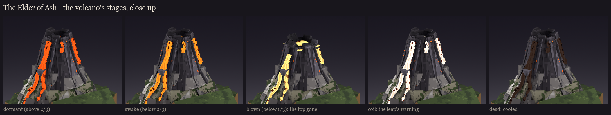
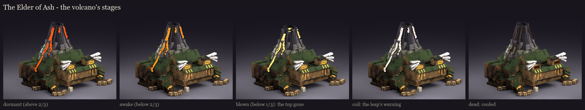
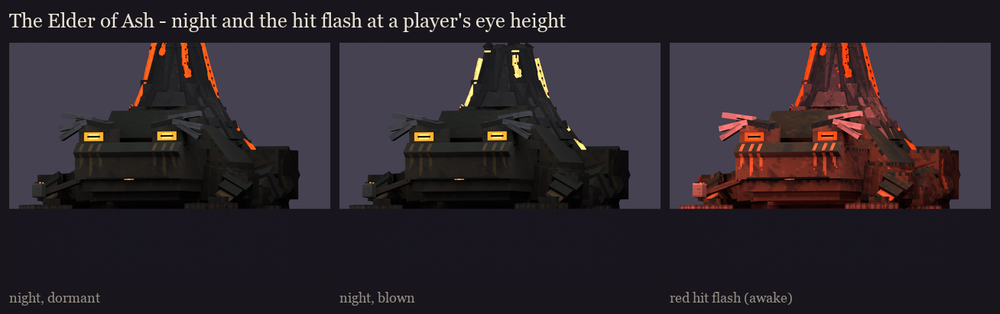

# The Elder of Ash, session 6: variants and readability

His variants are **the volcano's stages**. The lava (the streams and the crater) is now painted a near-white, warm
heat (session 5's orange was baked in). In the fight, BetterModel's per-bone tint multiplies the stage's colour into
it, so there is no texture swap. New this session: **the blown top** at 33%. Made by
`python tools/art/bosses/ash_s6.py` (after `ash_s5.py`).

| Stage | When | Tint (RGB) | The top |
|---|---|---|---|
| dormant | above 2/3 health | 255, 104, 34: deep orange-red | whole |
| awake | below 2/3 (after the eruption that throws the magma cubes) | 255, 160, 50: bright orange | whole |
| blown | below 1/3 | 255, 236, 150: white-hot yellow | blown off |
| coil | the leap's 1.5 s warning, at any stage | 255, 255, 255: the lava flares to its painted white heat | as the stage |
| dead | as he dies | 60, 46, 42: cooled to dark crust; the eyes dim too | as the stage |

## The blown top

The cone's top is its own bone, `cone_cap`: the last 12 units of the cone, the rim, the crater and the tops of the
streams (`glow_lava_cap`).
- **At 33%:** it is hidden, and `cone_blown` is shown: broken stumps leaning out round a crater twice as wide, with lava
  welling in it (`glow_crater_blown`).
- **Fixes from the review renders:**
  - The cone's core used to run up into the cap and showed as a black box once the cap was gone; it now stops at the
    cap line, and the cap has its own core.
  - The blown crater's pool was inside the core, so it sat dark; it now sits above it.
  - The streams' tops floated above the stumps; they now hide with the cap.

## How it works in BetterModel (as checked for the Witch Coven and The Unbound, 3.5.0)

- **The tint:** `tracker.update(TrackerUpdateAction.tint(rgb), bone -> name starts with "glow_lava", "glow_crater")`
  (this covers `glow_lava_cap` and `glow_crater_blown`), or MythicMobs' BetterModel `tint` mechanic with a part filter.
  The lava is painted white, so session 8 must set the dormant tint as soon as he spawns.
- **The blown top:** `TrackerUpdateAction.togglePart(false)` on `cone_cap`, `togglePart(true)` on `cone_blown`. It stays
  that way, even after a restart (the fight's saved health says which stage he is in).
- **The hit flash** (`damageTint`) tints every bone red for about 10 ticks, then restores each bone's previous tint. As
  for the coven and The Unbound, session 8 re-applies the stage tint about 12 ticks after every stage change.
- **The coil flare** is the same tint call: white for the 1.5 s warning, then back to the stage's colour.

## Readability

- **At night** (light level about 4), everything but the full-bright parts dims to a dark silhouette. The lava, the
  crater and the ember eyes are what's left, and the stage still reads at a glance in the dark: red-orange or white-hot.
- **Under the hit flash**, the whole body reddens and the lava stays the brightest thing on him.

The review rig on your server now carries the neutral (white-lava) atlas, so it shows the lava white until session 8
tints it in a fight. `/bm reload`, then `/bm test occultech_elder_of_ash_rig idle`.
