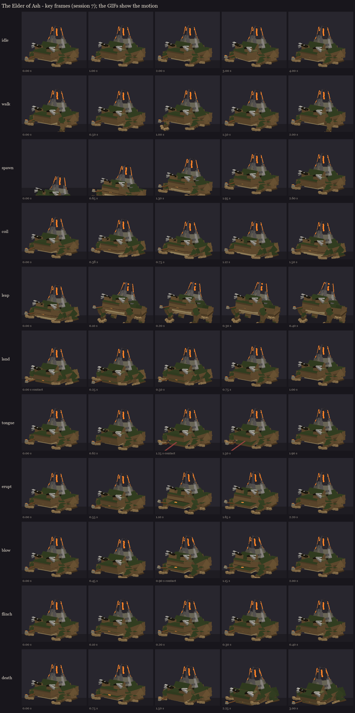

# The Elder of Ash, session 7: animation

Eleven clips on the session 6 rig (the painted atlas with the white lava the stage tints colour). Made by
`python tools/art/bosses/ash_s7.py` (after `ash_s6.py`).

**How the clips are built:**
- **Whole poses:** each clip is a few whole poses at key times, built with session 2's pose code. Hands and feet are
  planted back on the ground at every key unless a limb is in mid-step.
- **Keyframes:** each bone's turn away from rest, plus position keys for the whole toad sinking or rising, the tongue
  sliding out along itself and the brows lifting.
- **No travel:** movement over the ground stays with the server, which also throws him for the leap. No clip moves
  him, so nothing doubles up.



| Clip | Length | Plays | What it does | Timed to (MireMonarch.java) |
|---|---|---|---|---|
| `idle` | 4.0 s | loop | Heavy, slow breathing (the back rises, the brows settle), a pull on the pipe, a glance aside. | - |
| `walk` | 2.0 s | loop | A heavy crawl: one hand reaching forward at a time, the body rolling over it. | his movement |
| `spawn` | 2.6 s | once | The ritual arrival: he rises out of the circle, volcano first, and settles. | the summon |
| `coil` | 1.5 s | hold | He sinks onto his haunches, elbows up, glaring up at the target, trembling. | the leap's 1.5 s warning (30 ticks) |
| `leap` | 0.4 s | hold | Arms reaching, hind legs thrown back, held while he's in the air. | the jump (the server throws him) |
| `land` | 1.0 s | once | **Contact at 0 s**, then a heavy splayed squash and back up. | the landing's shockwave |
| `tongue` | 1.9 s | once | He lowers his head and glares down the lane, the throat swells, the jaw cracks. **At 1.25 s** the tongue shoots 5 blocks out and snaps back. | the lane's 1.25 s warning (25 ticks), then the lash |
| `erupt` | 2.2 s | once | A crouch, then head thrown back, jaw wide. | the split at 66% (the magma cubes) |
| `blow` | 2.0 s | once | A shudder, then **the blast at 0.9 s**. | 33%: the cap is swapped for the blown top then |
| `flinch` | 0.4 s | once | A jolt, the brows up. | a hit |
| `death` | 3.0 s | hold | A gasp, a sag, then slumped flat, chin on the ground. | death |

**Overrides:** `coil`, `leap`, `land`, `tongue`, `erupt`, `blow` and `flinch` override the loops while they play.
The preview GIFs are in `gifs/`.

**What session 8 adds (to the code and Mythic):**
- **The stage tints:** the dormant tint at spawn; the white coil flare during `coil`; awake after `erupt`; blown and
  the part swap at `blow`'s 0.9 s; cooled with `death`.
- **The tongue's reach:** for a target past 5 blocks, `tongue` stretches the tongue bone along its length so the tip
  reaches the lane's end (up to 14 blocks).
- **Effects** from the real crater and pipe bowl: smoke, explosions while coiled, the lava bombs at `erupt`, ash and
  the crust ripple at `land`.

**Load test:** on the second test server, BetterModel loaded the animated rig with the ten shipped models and no
warnings ("11 of models are loaded successfully"). It was taken off that server again afterwards.

## In game

The animated review rig is in `run/plugins/BetterModel/models` on your server:

```
/bm reload
/bm test occultech_elder_of_ash_rig idle
```

Swap `idle` for `walk`, `spawn`, `coil`, `leap`, `land`, `tongue`, `erupt`, `blow`, `flinch` or `death`. Until session
8 tints it in a fight, the lava shows white.
