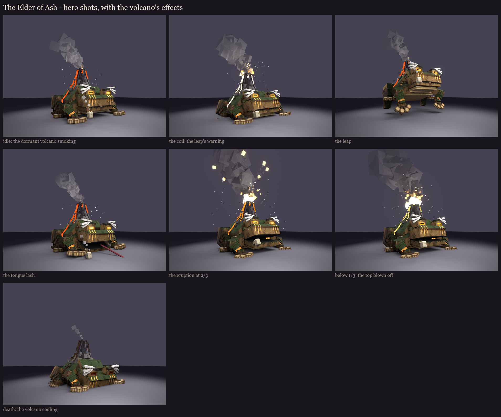

# The Elder of Ash, session 8: shipped

The elder toad sage with the volcano on his back is the real tier-0 gate fight now, renamed **the Elder of Ash**. The
id stays `MIRE_MONARCH`, so saved fights, win counts, the catalyst and the drops keep working, and `core/BossIds` still
maps the old `GELATINOUS_SOVEREIGN`. Plan: [../plan.md](../plan.md).

## Shipped

- **The model:** `src/main/models/occultech_mire_monarch.bbmodel`, generated by `python tools/art/bosses/ash_ship.py`
  (after the session scripts, through `ash_s7.py`).
  - It holds the session 7 rig with the painted atlas (the lava near white, for the stage tints), the hitbox, the
    hidden blown top (`cone_blown`) and the eleven clips.
  - It refuses to ship if any two faces share a plane (0 do).
  - It is installed into BetterModel's models folder at startup and merged into the Occultech resource pack.
- **Mythic** (`python tools/art/bosses/ash_mythic_skills.py`):
  - `src/main/mythic/Mobs/MireMonarch.yml`: `OCCULTECH_MIRE_MONARCH`, a **magma cube** carrier wearing the model
    (unscaled, invisible, no splitting).
  - `Skills/MireMonarch.yml`: the stage tints, the cap swap, the clips and their sounds. Look and sound only.
- **The name:** recipes.yml's new boss `name` field (`Elder of Ash`) is what the guide, the rituals and the self-test
  show. The catalyst now "Summons the Elder of Ash", and the carrier and Mythic display read "The Elder of Ash".

## Hero shots and the volcano's effects

**The hero shots:** made by `python tools/art/bosses/ash_hero.py`.
- **What each shot is:** the shipped rig in its stage's lava colour, posed, from a low three-quarter angle (a
  perspective camera at about a player's eye height).
- **The effects:** drawn as sprites where the fight spawns its particles. Minecraft draws flat, pixel-textured puffs;
  the cubes here stand in for them.
- **The renderer:** `bosskit/blender_texture_render.py` now takes effect sprites (see-through smoke, glowing embers)
  and perspective cameras.

**The volcano's effects in game** (MireMonarch.java, every behavior step; all forced, so they show from far off like a
volcano should):

| Moment | Effects |
|---|---|
| dormant (above 2/3) | a lazy plume of signal-fire smoke rising high from the crater and drifting, a few small flames, white ash drifting round the cone |
| awake (below 2/3) | a thicker plume with large smoke, lava popping from the crater, more ash |
| blown (below 1/3) | a heavy black plume, a fountain of flame welling up out of the wide crater, lava spitting and dripping over its rim |
| the coil (the leap's warning) | the plume thick and dark, fireballs popping round the rim with lava pops, lava spraying up |
| the eruption at 2/3 | a burst: an explosion, a column of smoke, lava and flame flung up, then 2 s more of boiling |
| the blast at 1/3 | a bigger burst, with basalt flying |
| always | lava dripping off the streams' ends on his flanks (and the rump's once awake); smoke curling from the pipe |

## The carrier: a magma cube

- **Why not the slime:** an invisible slime still throws green slime particles every time it lands; a magma cube's are
  flame, which suits a volcano. Without Mythic the fight runs on a bare magma cube too.
- **Movement:** a magma cube moves in bounces, which under a 9-block toad read as the whole mountain hopping. With
  the model on, his bounces are flattened to a crawl (the `walk` clip), except in the leap.
- **Size:** the carrier stays size 7 all fight. There is no shrinking any more.

## How the fight uses them (MireMonarch.java)

| Server event | Mythic skill | What you see |
|---|---|---|
| spawn | `STAGE_DORMANT` | the lava deep orange-red (it needs its tint at once: it's painted white) |
| a resumed fight below 2/3 or 1/3 | `STAGE_AWAKE` / `STAGE_BLOWN` | the stage his health puts him in, without replaying the eruption or the blast |
| every 8 s: the leap's 1.5 s warning | `COIL` (target: the player) | he sinks onto his haunches, holds still facing the ember ring and trembles; the lava flares white; the crater smokes heavily and pops with small explosions |
| the jump | `LEAP` | arms reaching, legs thrown back (the server throws him) |
| the landing | `LAND`, then the stage's tint again | the squash on the shockwave; ash, basalt debris and a crust ripple |
| every 10 s (8 s below 1/3): the tongue's 1.25 s warning | `TONGUE` (target: the player) | he turns to the locked lane and glares down it; at 1.25 s the model's tongue shoots out about 5 blocks, and an ember trail carries the lash on to wherever it reaches (up to 14 blocks) |
| health below 2/3 | `ERUPT` | head thrown back; the volcano erupts and throws 3 magma cubes to the arena's edge; the lava turns bright orange |
| health below 1/3 | `BLOW` | a shudder, then at 0.9 s the blast: the cone's cap swapped for the blown top, an explosion of lava and basalt, the lava white-hot |
| below 1/3, every 5 s | (the plugin) | pools of lava where he stands (2 a second to anyone in them) |
| he's hit | `FLINCH` | a jolt (at most once a second, not during the leap or the tongue) |
| always | (the plugin) | smoke from the crater, more at each stage; lava spitting once the top is blown; smoke curling from the pipe's bowl |
| death | `DEATH` (mob file) | the slump to the ground; the lava cools to dark crust, the eyes dim, a last cloud of smoke |

**The re-skin** (approved at the plan):
- **Colours:** lime became ember.
- **Spawn:** the shards are now magma cubes ("Magma Spawn"), thrown by the eruption.
- **Pools:** acid became lava pools (the damage is now named "Magma"; the numbers are unchanged).
- **Drops:** the mob drops are magma cream and the odd magma block, instead of slime balls.
- **Unchanged:** the boss drop (Sovereign Gel) and the catalyst keep their ids and look; their redesign comes later.

## Fixes after the first fight (2026-10-15)

- **Purple-black cubes on the hind legs:** each shin's thin beam ran the full 35 units from knee to ankle, past the
  client's item-model limit (-16..32), so the client drew it as a missing model. It now starts a third of the way down
  (`ash_s1.hind_leg`); every generated model is checked against the limit.
- **Facing and movement:** the magma cube's own AI is off (no goals, unaware: physics and its touch damage stay). The
  script crawls him after the nearest fighter, easing in, stepping up single blocks and stopping 5 blocks short (his
  head's reach), and turns him at most 6 degrees a tick, so he always faces whoever he's after.
- **The leap:** the server now flies him on a real arc (16-28 ticks, higher the further he goes) and puts him down on
  the marked spot; the landing splashes lava pools round him.
- **The tongue:** he tracks his target for 1 s, turning with them; then locks on (the lane shows, the jaw drops and hangs
  open, 0.75 s); at 1.75 s the tongue shoots out dead level and stays out 0.6 s, the plugin drawing it on straight down
  the lane (pink, a glowing tip that rides the caught player in), then it snaps back and the mouth closes. The clip is
  3.2 s.
- **Volcanic rocks:** magma blocks (block displays, tumbling, trailing fire) lobbed from the crater in high arcs at the
  fighters, each landing spot ringed for the whole flight; they burst (7 damage in the ring) and leave a lava pool.
  2 every 2.5 s in stage one, 3 every 1.5 s from the eruption, 4 every 1.25 s once the top is blown; the blast throws
  six more.
- **Two stages, two colours:** the lava is orange until the eruption at 2/3 and deep red from then on (the blown top
  stays deep red); the coil no longer flares. From the eruption: a faster crawl, the tongue every 8 s, more rocks, lava
  pools behind him every 5 s (3 s once blown), a scorched, flaming ring round him, flames off his flanks, a fountain of
  flame and red sparks from the crater.
- **Ground lava:** pools bubble and spit while they last (at most 14 at once); embers pop round him even in stage one.
- **Ash Frogs instead of the magma spawn:** the eruption throws three magma clods to the arena's edge; each bursts into a
  warm frog three times a frog's size (60 health, 6 armour, no knockback) that hops back to the altar and heals him 6%.

## The pack

**sha1 `69cb0cd6`** (after the fixes; first shipped as `57abff76`). BetterModel's output for the eleven shipped models (278 assets of the Elder's) is merged in, the
pack is copied into the pack repository's local clone, and the jar carries the same zip. The new jar is in both
servers' plugin folders. The session review rig was taken out of your server's BetterModel models; the shipped model
replaces it.

## Tests

- **Self-test with Mythic and BetterModel (server b): 568 passed, 0 failed** after the fixes (562/0 at the first ship). The
  volcanic rock grades in tier 0's area band at 7 damage (6 graded 11%, under the band). New checks at the first ship:
  - the Elder of Ash has one BetterModel tracker;
  - his model has its hitbox;
  - his carrier is an unscaled magma cube.

  The first run fell back to the vanilla body because the Mythic pack installer's file list didn't name the new files
  yet; it does now.
- **Split check:** the self-test's "no split slimes" check now counts magma cubes too (both are cube mobs; the split
  guard already covered both).
- **Unit tests:** pass. The cost model runs clean after the recipes.yml changes (the name field, the base and the mob
  drops).
- **Load:** MythicMobs loaded 18 mobs; BetterModel built the eleven shipped models.
- **Not yet tested:** a real fight with a player. Only a played fight shows the crawl, the facing, the clips' timing
  against the warnings and the tongue's trail (the boss ship checklist). Please play one.

## In game

1. Push the pack repository (`occultech_texture_pack_v1.0`) and the addon repository.
2. Restart your server with the run-server script, so it gets the new jar.
3. Summon the Elder of Ash at a tier-0 circle with the Sovereign's Catalyst, or use `/occultech showcase`.

Please check:
- **Movement:** he crawls rather than bounces, and faces the ring and the lane before he strikes.
- **Volcano:** it smokes more at each stage and flares white in the coil; the top blows off at 1/3.
- **Tongue:** the lash leaves his mouth and carries on to the lane's end.
- **Size and hitbox:** whether the size and the hitbox feel right for a 9-block toad.
