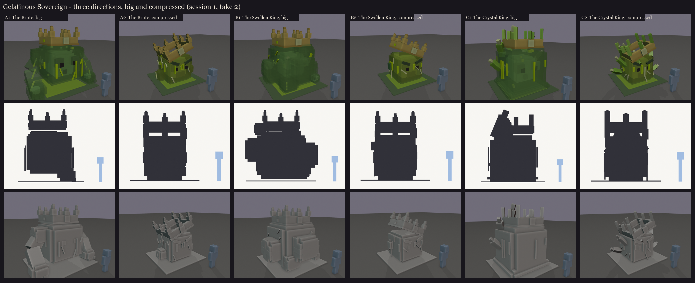
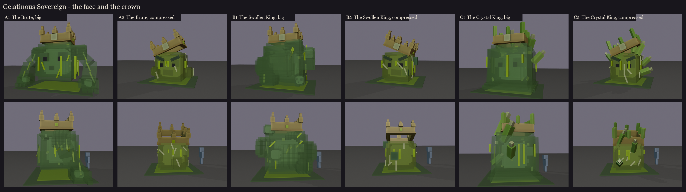

# Gelatinous Sovereign redesign, session 1 (take 2): three directions, each in both forms

**The brief (2026-10-11):** the first take, a drowned king in jelly, was rejected. The new brief:
- **Two forms:**
  1. normal: big and jumpy;
  2. compressed: small, dense, toxic and angry.
- **The vanilla slime,** buff and mutated.
- **Visibly radioactive.**
- **A large crown.**

The fight is unchanged (`GelatinousSovereign.java`). The compressed form is its 33% phase, when it shrinks, speeds up
and leaves acid puddles.

**What every direction shares:**
- **The vanilla slime's own build, scaled up:** a see-through outer cube around an opaque core. Two 2x2x2 dark eye
  cubes with a black pupil, and a black 1x1x1 mouth, stand half a pixel proud of the core's face, all from the
  vanilla model.
- **The crown:** a big, chunky Minecraft crown with blocky stepped points and a glowing radioactive front stone.
- **The radioactive light:** neon lime. It's drawn bright here; in game it becomes full-bright glow bones, so it
  shows at night.




| | Direction | Big (phase 1) | Compressed (phase 2) |
|---|---|---|---|
| A | **The Brute** (buff) | a squat, heavy body with muscle swelling over its back, and two huge jelly arms planted on their knuckles like a gorilla's, glowing veins down them. It leaps on its arms | the arms pulled in, fists clenched at its sides |
| B | **The Swollen King** (mutated) | bulges straining out of every face like a bag about to burst, glowing veins standing out; smaller slimes bud out of it, each with its own little face | the buds have torn away, leaving glowing wounds. The buds can be the three shards it splits off at 66% |
| C | **The Crystal King** (radioactive) | glowing uranium-green crystals grow out of its back and shoulders, with threads of light to its core and shards drifting in the jelly; its crown's points are crystals | crystals forced out of it all over, like spines |

In every compressed form it is squeezed into a dense, nearly opaque, sickly cube about 2.5 blocks across:
- the face scowls, its mouth open on the glow;
- light cracks through its skin;
- glowing acid runs off it into a puddle;
- the same big crown is jammed on askew.

Sizes, big then compressed: A 6.6 x 5.3 x 4.8 / 4.4 x 4.3 x 4.3 blocks; B 5.1 x 5.1 x 5.2 / 4.4 x 4.3 x 4.3; C 5.7 x
5.7 x 5.0 / 4.6 x 4.4 x 4.3. These include the crown and the acid puddle; the compressed body is about 2.5 blocks.

**Mixing:** the three lean on one word each of the brief (buff, mutated, radioactive), so they mix easily. For
example, A's arms with C's crystals, or B's budding shards with A's arms.

Sheets: [A big](A1/sheet.png), [A compressed](A2/sheet.png), [B big](B1/sheet.png), [B compressed](B2/sheet.png),
[C big](C1/sheet.png), [C compressed](C2/sheet.png). Regenerate with `python tools/art/bosses/sovereign_s1.py`.

## Still to check in game: see-through jelly

All three depend on the core and its face showing through the jelly. The test model `occultech_jelly_test` is on your
server (port 25565): a jelly cube around an opaque core with a crown, and a loose bone.

```
/bm reload
/bm spawn occultech_jelly_test
```

Walk round it. The inside should always show through the jelly, and the jelly should never vanish behind it. If it
breaks, the outer jelly becomes a thicker, frosted skin, with the face showing through clear patches.
